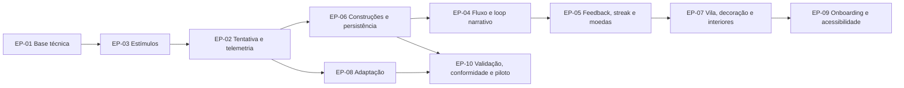

# ABD — Meu Pequeno Reino (Agile Backlog Document)

> **Fase 2 de 2.** Épicos aprovados pelo orientador. Este documento traz as stories com critérios BDD, as
> tasks em horas, o roadmap sem datas, a validação final e os artefatos de importação. **Há dois milestones, sem data:
> Core e Expansão; os dois juntos são o jogo inteiro, todo o SGDD.** O CSV das issues está ao lado:
> `ABD-1-Gabriel-issues.csv`. **Nada foi criado no GitHub.**
>
> **Versão 2 (26/11/2026).** O agente de IA do aluno só escreve código C# de runtime e testes; o Editor fica aberto, e
> quem roda os testes é o aluno, no Test Runner (não há execução da Unity por linha de comando); tudo o que se faz no Editor da Unity (cenas, UI, prefabs, `.asset`, ligações no Inspector, arte,
> som, builds) é do aluno. Cada task diz o dono no começo do texto, `[agente]` ou `[aluno]`. As decisões do
> orientador sobre as lacunas do SGDD (LG-Gab-01 a 22) entraram nos critérios, nos cenários e nas tasks.

## Lacunas abertas

Surgiram ao dividir as tasks entre agente e aluno e ao separar Core e Expansão. O orientador decidiu as LA-01 a 08 em 26/11/2026;
a LA-03 ficou resolvida pela regra do código, e a LA-09 e as LA-10 a 14, abertas na versão 7, são pendências dele; a última coluna diz a decisão.

| ID | Lacuna | Onde | Decisão |
|---|---|---|---|
| LA-01 | O conferidor do arquivo de sessão (T-236) e o script de análise (T-253) são código fora do jogo; a regra nova só fala de código de runtime e testes. | US-53, US-59 | **Decidida pelo orientador em 26/11/2026:** fica com o `[agente]`. |
| LA-02 | As horas de cada task dividida foram repartidas entre as duas partes, sem estimativa nova, e não há a carga horária do Gabriel nem a vazão do agente: o roadmap sem datas não tem como dizer quanto cabe em cada período. São 229 h do agente e 174 h do aluno (com o spike e as chores). | §10, §11 | **Decidida pelo orientador em 26/11/2026:** as tasks continuam sem estimativa nova; o aluno estima na hora de puxar a task, e o roadmap fica só com a ordem e os totais. |
| LA-03 | A LG-Gab-01 fixa a rotação no eixo vertical, mas parte dos 50 policubos do contrato gira em x ou z. Girá-los no eixo vertical, com o mesmo ângulo e a mesma forma, muda a vista de cada um; não está dito se a equipe aceita isso ou refaz esses estímulos. | US-12, US-18, US-66, US-72 | **Resolvida pelo orientador em 26/11/2026:** os estímulos mantêm a rotação original em x, y e z (`TrialDefinition.rotationAxis`, `BuildingDefinition.cs:4-11`; `Documentation/OriginalTrialContract.json`), conforme a implementação do aluno; o SGDD v1.4 segue o código. |
| LA-04 | Com um reino por código de criança (LG-Gab-04), não está dito se esse código é o `participant_code` da telemetria, se excluir os dados de um código (US-56) apaga também o reino, nem como o mesmo código serve à escola e à casa se o save fica só no aparelho. | US-34, US-56, US-71 | **Decidida pelo orientador em 26/11/2026:** o código da criança é o `participant_code`; o save fica só no aparelho, então escola e casa são reinos separados até a API. Excluir os dados de um código **não** apaga o reino: é o que o protótipo validado faz, e o protótipo vale sobre a sugestão “excluir apaga o reino”. |
| LA-05 | Com um reino por código, o “tutorial já visto” que um reino novo herda (LG-Gab-13) é do aparelho ou do código? | US-65, US-69 | **Decidida pelo orientador em 26/11/2026:** o “tutorial já visto” é do código; a T-223 guarda o “já visto” por código. |
| LA-06 | O painel do pesquisador não tem senha, mas nada diz como ele se abre; a LG-Gab-15 só fixa o atalho do mediador. | US-11, US-68 | **Decidida pelo orientador em 26/11/2026:** pelo mesmo atalho do mediador, numa aba do mesmo painel. |
| LA-07 | O Core pede “sair” no menu inicial, mas o §10.3 dá ao MENU só JOGAR e CONFIGURAÇÕES. | US-71, US-49 | **Decidida pelo orientador em 26/11/2026:** o MENU ganha SAIR, só no build Windows (some no WebGL e no Android), e CONFIGURAÇÕES com o volume (US-47); entra na US-71 (T-327, T-328). O SALVAR E SAIR da pausa continua. |
| LA-08 | A conferência do aluno no Play no lugar das capturas que ele tirava (T-73, T-102) foi decisão da revisão da versão 3, por ser mais barata; o orientador proibiu só as capturas do agente. | US-18, US-24 | **Decidida pelo orientador em 26/11/2026:** vale a conferência do aluno no Play. |
| LA-09 | A tela de assentimento da criança (US-55) vinha da regra de `context-ciatec.md`, mas a regra é comum aos jogos da IC e não foi decidida, e o protótipo que o orientador validou não tem a tela. | US-55 | **Pendência do orientador.** A US-55 mantém a tela (T-242, T-313) como proposta; ela só entra no jogo depois da decisão, e a trava da coleta (T-243) não depende dela. |
| LA-10 | O SGDD (§4.3, LG-Gab-06) faz a adaptação escolher a peça por ângulo, complexidade e similaridade, mas cada obra tem a sequência fixa de 10 do código (`BuildingDefinition.cs:21`, avanço em `GameSession.cs:101`), que vale por regra do orientador. As duas regras não cabem juntas. | US-42, US-72, US-17 | **Pendência do orientador.** Até a decisão, o motor (EP-08) calcula e grava o `difficulty_state`, e a peça seguinte é a da sequência. O pool único e as peças geradas (T-17, T-268, T-66, T-79, T-80, T-81, T-82, T-334) e a escolha pelo motor (T-190) ficam como proposta, com as horas, e só entram depois da decisão. |
| LA-11 | O conjunto original não tem 0° nem 45° e 90° no outro sentido, que o SGDD v1.3 pedia (§4.1); acrescentá-los muda a sequência fixa de 10 de cada obra. | US-13, US-66 | **Pendência do orientador e da equipe científica.** A US-13 (T-49 a T-52) e a T-76 ficam como proposta, com as horas, e só entram depois da decisão. |
| LA-12 | Como gerar em runtime a malha das peças feitas por código: o `TrialMeshBaker` do aluno só roda no Editor (`TrialMeshBaker.cs:5-6`), e o `ModelPresentation` só escolhe entre a malha da peça e a espelhada (`ModelPresentation.cs:28-33`). O SGDD não fala de malha. | US-72 | **Pendência do orientador**, junto com a LA-10. A T-334 propõe a malha unida com as faces externas das células, como a do `TrialMeshBaker` (`TrialMeshBaker.cs:70-118`). |
| LA-13 | O habitante é sorteado pelo `modelId` da peça (`TrialController.cs:51`), e cada um dos 50 modelos aparece numa condição só (`Documentation/OriginalTrialContract.json`, conferido): o mesmo habitante volta sempre com a mesma resposta, depois do erro ou num reino novo. Pode virar pista do gabarito (DP-03, §12-26). | US-20, US-23 | **Pendência do orientador.** O sorteio por `modelId` vale (regra do código); o teste da T-100 confere que a aparência só depende do `modelId`, e o risco fica registrado para o piloto. |
| LA-14 | Com Observatório e Museu sem pré-requisito, como nos dados do aluno (`Assets/Data/Buildings/`), o Laboratório não libera nada; o SGDD v1.3 o punha como requisito de Museu e Observatório. | US-31, US-32 | **Pendência do orientador.** A US-32 cadastra o Laboratório sem dependentes até a decisão. |

## Histórico

| Versão | Data | Mudança |
|---|---|---|
| 1 | 25/11/2026 | Backlog do SGDD inteiro num milestone com data, revisado em contexto limpo. |
| 2 | 26/11/2026 | Dono em cada task (`[agente]` só código e testes, `[aluno]` tudo no Editor), com 60 tasks da divisão (T-264 a T-323); decisões LG-Gab-01 a 22 nos critérios; milestones Core e Expansão, sem data, com 4 stories da divisão (US-73 a US-76); a API fica fora do backlog. |
| 3 | 26/11/2026 | Revisão: a Vila do Core usa só as construções do Core (o saldo de moedas foi para a US-30), cenários do Core sem a Expansão, teste do fluxo do Core (T-326), teste de fumaça sem a cena do aluno, ordem suíte → build nos marcos, animação de uso ligada à T-142; T-73 e T-102 sem captura, por decisão desta revisão (LA-08). |
| 4 | 26/11/2026 | O SGDD foi para a v1.2, com as decisões LG-Gab-01 a 22 escritas nas seções e indexadas na §13B, depois de o orientador validá-las jogando o protótipo web. O ABD já as tinha desde a versão 2: muda só a fonte (v1.2), e o rascunho que a US-58/T-251 entrega passa a ser a v1.3, sem as LG-Gab. Nenhuma story, task ou hora mudou. |
| 5 | 26/11/2026 | Perguntas abertas aprovadas pelo orientador (as lacunas LA-01 a LA-08 e as stories marcadas “(Core?)”), sem mudar o que ele validou no protótipo web: LA-01, 02, 04 a 08 decididas, LA-03 pendência da equipe científica; SAIR no menu do build Windows (T-327, T-328, US-71); US-48 e US-51 foram para a Expansão, e o `AudioManager` (T-210) passou para a US-47, para o volume do Core não depender da Expansão; US-03, US-11, US-52 e US-55 ficam no Core sem a marca. |
| 6 | 26/11/2026 | Revisão final contra o protótipo validado e o pacote de agentes novo (SGDD v1.3): o aluno roda os testes no Test Runner (sai a T-36; entram T-329 e T-330); menu pelo código com CONTINUAR e NOVO REINO; `participant_code` é o código do menu; painel do pesquisador como aba do mediador, com o botão “adulto”; chave do Bônus no painel do mediador (T-331, T-332); apagar dados mantém o reino (T-333); sessão de 10 tentativas; blocos de 4; rodízio da adaptação; `PAUSED` respondida; mapa 2400×1350; botões 380×150; assentimento como pendência (LA-09). |
| 7 | 26/11/2026 | Backlog montado sobre o código do aluno (`develop` @ 7429a32) e o SGDD v1.4: onde o código já decide, o SGDD e o ABD o seguem (regra do orientador), com nomes reais, tasks feitas como “Já existe” (0 h) ou encolhidas, asmdefs, namespace e Input System na T-01, T-334 a T-339 novas e as LA-10 a 14 abertas; LA-03 resolvida. |

## 1. Sumário

- **10 épicos, 75 stories, 338 tasks, 1 spike e 2 chores**, em dois milestones sem data: **Core** (45 stories,
  92 SP, 215 tasks, 244,5 h) e **Expansão** (30 stories, 58 SP, 123 tasks,
  151,5 h). **150 SP** e **396 h** de tasks (403 h com o spike e as chores; a T-328 ainda sem horas).
  Dessas, 23 h são propostas presas às LA-10 e LA-11, que só entram depois da decisão.
- **Dono de cada task:** 198 do `[agente]` (229 h) e 140 do `[aluno]` (167 h; 174 h com o
  spike e as chores). O agente escreve código C# de runtime (`Assets/Scripts/`) e testes EditMode e PlayMode
  (`Assets/Tests/`), que montam o mínimo por código, e diz quais testes rodar; não roda a Unity por linha de comando,
  não escreve script de Editor que monte cena, prefab ou asset, nem tira captura de tela. O Editor fica aberto, e o
  aluno roda os testes no Test Runner. O aluno faz no Editor as cenas, a UI, os prefabs, os `.asset` dos
  ScriptableObjects, as ligações no Inspector, a arte, o som, as Player Settings e os builds, e confere no Play o que
  é de tela. A task de código diz que campos `[SerializeField]` o componente expõe; a de
  montagem diz em que cena, que componente e que campo ligar, e depende da de código.
- **O escopo é o SGDD inteiro:** a tentativa científica e a telemetria, os estímulos, o loop NPC → Grande Livro →
  tentativa, streak, pontos, moedas e o ciclo do dia, as dez construções com o grafo e a persistência, a Vila com
  decoração e interiores, a adaptação da demanda, o onboarding de cinco passos, as configurações, o áudio, a
  acessibilidade (inclusive a baixa visão), a validação técnica, a conformidade e o piloto. A seção 6 liga cada
  linha normativa do SGDD à story que a cumpre.
- **Core:** o menu (escolha do código da criança, continuar ou novo reino, configurações de som, sair no Windows), o loop com a telemetria em
  arquivo local, os estímulos, a streak e os pontos, o grafo e a persistência, a Vila que mostra o reino, a
  adaptação, o onboarding e a pausa. **Expansão:** o dia e as moedas, a decoração, os interiores, os cadastros das
  outras construções, a Vila viva, a apresentação animada, a acessibilidade além do som, o Bônus de Agilidade, a
  validação técnica completa, o plano de dados, o piloto e a análise. As stories que estavam marcadas `(Core?)` foram
  decididas pelo orientador em 26/11/2026: a US-48 e a US-51 foram para a Expansão, e as outras ficam no Core.
- **Dois marcos:** a US-60 fecha o Core e depende só dele; a US-76 fecha o jogo inteiro. Em cada um o agente escreve o
  teste-robô, que joga na cena de entrada que o aluno montou, e lista os testes da suíte; o aluno roda a suíte inteira
  no Test Runner, gera o build só com tudo verde, confere no Play, joga e confere o arquivo da sessão.
- **Decisões do orientador de 26/11/2026:** as LG-Gab-01 a 22 estão nos critérios, nos cenários e nas tasks das
  stories donas, como regra decidida, e as L-ABD que elas resolvem estão marcadas na seção 5. O número de tentativas
  por dia continua pendência do piloto.
- **O resto das lacunas virou decisão provisória.** Cada L-ABD e cada linha de §13 do SGDD ainda não decidida tem
  um valor ou uma regra concreta, marcada “decisão provisória — confirmar com o pesquisador” (seções 5 e 6). As
  lacunas que a versão 2 abriu estão no topo do documento. Só as propostas presas às LA-09, LA-10 e LA-11 esperam
  decisão; nenhuma outra story espera.
- **Dependências externas** (CEP, piloto, playtest, LGPD, dispositivo-alvo) ficam nas stories, implementadas até
  onde o código alcança. O que só uma pessoa da equipe fecha é critério `humano`.
- **Regra de fechamento:** uma story fecha quando os critérios implementáveis estão feitos (os do agente, os do
  aluno e os `humano`). O que depende de evento fora da equipe (parecer do CEP, piloto, ciclo de PPI, primeira
  exportação real, publicação) é marcado `externo`, não segura a story nem o marco e vira **estado registrado** no
  marco do milestone da story (US-60 ou US-76): feito, ou esperando o evento.
- **Ordem de execução:** o Core primeiro, um épico por vez, na ordem EP-01 → EP-03 → EP-02 → EP-06 → EP-04 → EP-05 →
  EP-07 → EP-08 → EP-09 → EP-10; depois a Expansão, na mesma ordem (seção 4). Nenhuma story do Core depende de
  story da Expansão.
- **Dados só em arquivo local** (decisão do orientador, 25/11/2026): o jogo grava JSON Lines no dispositivo e
  exporta à mão. **A conexão com a API é de outro momento e não está neste backlog;** quando vier, o backlog dela fica
  em `ABD-1-Gabriel-api.md`, ao lado deste arquivo. Esta versão não tinha story, task nem spike de API para mover.
- **Capacidade não declarada:** sem datas, o roadmap mostra a ordem e os totais por milestone; a carga horária do
  Gabriel e a vazão do agente não entram, e o aluno estima a task ao puxá-la (LA-02, decidida pelo orientador).
- **Integração com a plataforma CIATEC:** não há (seção 3).
- **Divergências código × SGDD** (seção 8): o SGDD v1.4 e este ABD seguem o código onde ele decide; continuam como
  task os bugs (o destaque da US-41, o RT da última tentativa na US-07) e o que o código ainda não tem.
- **Revisão em contexto limpo** feita em 25/11/2026 na versão 1; os achados estão aplicados.
- **Versão 7: o backlog parte do código do aluno** (`ciatec-org/ciatec-game-my-little-kingdom`, `develop` @ 7429a32).
  O que o aluno já implementou vale; onde o código decide uma regra, o SGDD v1.4 e este ABD o seguem, e nenhuma
  task refatora para a regra antiga. Task que o código já cumpre fica com 0 h e “Já existe (arquivo:linha)”; a que ele
  cumpre em parte encolhe. Toda task `[agente]` que mexe num componente que já existe troca os campos `public` que
  toca por `[SerializeField] private`. Os scripts de Editor do aluno ficam; só se ajustam onde uma regra nova os faz
  falhar (T-335, T-336, T-337).

### Convenção de domínio e de perfil neste jogo Unity

As labels `domain:*` seguem `spec-github-projects.md` sem mudança (`stack-unity.md`). Neste jogo:
`backend` = regra de domínio em C# puro; `database` = dados, configuração e persistência; `frontend` =
cena, UI e apresentação; `research` = protocolo e conteúdo científico; `compliance` = CEP/LGPD. Os perfis das
stories são **criança** (quem joga; o jogo não é terapêutico, §3.1, por isso não “paciente”), **pesquisador**
(Gabriel e orientador no papel científico) e **IC** (Gabriel no papel de quem desenvolve).

### Convenção das decisões provisórias

**Siglas.** LG-Gab-01 a LG-Gab-22 são as decisões do orientador de 26/11/2026 sobre as lacunas do SGDD v1.1, com a
regra escrita nas seções do SGDD e o índice na §13B dele; LA-01 a LA-09 são as lacunas abertas no topo deste
documento; L-ABD-01 a 17 são as da seção 5. Onde o protótipo web que o orientador jogou em 26/11/2026 e este ABD
divergiam, vale o protótipo, e a regra aparece como decidida pelo orientador.

Onde o SGDD deixa um valor “a definir”, este ABD fixa um valor provisório para o código poder ser feito e o jogo
jogado. Cada uma aparece como **decisão provisória — confirmar com o pesquisador**, com a razão em uma linha, e
vive em configuração (ScriptableObject ou dado), nunca espalhada no código. Confirmar ou trocar o valor não
reabre a story: muda a configuração e o registro no SGDD (US-58).

## 2. Fontes

| Fonte | Uso |
|---|---|
| `SGDD-1-Gabriel.md` v1.4 | fonte principal (a v1.2 acrescentou as decisões LG-Gab-01 a 22, presentes neste ABD desde a versão 2; a v1.3 alinha o SGDD ao protótipo validado, como a versão 6 deste ABD; a v1.4 o alinha à implementação do aluno, como a versão 7; as citações `l.` de linha valem para a v1.1); §12 vira critério de aceite, §13 vira decisão provisória e critério humano, Anexo A orienta a divisão em épicos |
| `sugestoes-variaveis-gabriel.md` | apoio; só entra o que o SGDD já sustenta (ver L-ABD-12) |
| `assets/assets_itch.md` | referências de tilesets e do observatório, para o inventário de licenças (EP-01) |
| Skills `agile-pipeline`, `epic-generator`; specs `context-ciatec.md`, `stack-unity.md`, `spec-roadmap.md`, `spec-github-projects.md` | método |
| Repositório, branch `develop` (só leitura, via `gh`) | estado atual: `README.md`, `Packages/manifest.json`, `ProjectSettings/ProjectVersion.txt`, `Documentation/Pendencias.md` (auditoria P01–P24), `Documentation/OriginalTrialContract.json`, scripts em `Assets/Scripts/` |

`main` está atrás de `develop` (só o template, commit `6c3b40b`); a implementação migrada entrou em
`develop` pelo PR #2 (03/11/2026).

## 3. Decisão sobre integração com a plataforma CIATEC

**O jogo não integra a plataforma CIATEC nesta versão. Não há épico de integração, e a segunda passada do
`epic-generator` (fichas de agente, contratos, checklist) não se aplica.**

Evidência:
- SGDD §7.4 (Technology) não cita `com.ciatec.*`, ciatec-core, pose-server nem M3Kit. A plataforma está
  "a definir" entre Flutter/Flame e Unity.
- A interação é seleção discreta por interface (§2.2, §7.4), não captura de movimento: o pose-server não teria
  papel.
- `Packages/manifest.json` (develop) não tem nenhum pacote `com.ciatec.*`.
- O único vínculo é §1 ("Projeto vinculado: CIATec — Plataforma Aberta…") e o Anexo A, Bloco 0, que lista
  "integração futura com a infraestrutura do CIATec" só como **critério de avaliação** da tecnologia, sem
  requisito. A avaliação desse critério entra na US-02 (lacuna L-ABD-10).

Consequência de método: este é o caminho da `agile-pipeline`, e não da `glide-pipeline` (que é para microjogo
com o pacote CIATEC). As camadas de task seguem a tabela Unity de `stack-unity.md`, menos `layer:platform`, e a
seção "o que o pacote já entrega" não vale aqui: menu, configurações, áudio, telemetria e resultados são
trabalho do próprio jogo.

## 4. Épicos

### Mapa de dependências



As setas vêm das dependências declaradas das stories (seção 9): um épico depende de outro quando alguma story
ou task dele depende de uma story do outro. O desenho omite as setas que já chegam por outro caminho.

### Ordem de execução por épico

Os épicos se implementam **um de cada vez, nesta ordem**: EP-01 → EP-03 → EP-02 → EP-06 → EP-04 → EP-05 → EP-07 →
EP-08 → EP-09 → EP-10, **primeiro com as stories do Core e depois, na mesma ordem, com as da Expansão**. Nenhum
épico depende de um que vem depois dele, nenhuma story do Core depende de story da Expansão, e dentro de cada
épico as stories seguem a ordem da coluna (dependências primeiro). O Core fecha no marco US-60 e a Expansão no
US-76 (seção 11).

| Ordem | Épico | Depende de (épicos) | Stories do Core, na ordem | Stories da Expansão, na ordem | h Core | h Expansão |
|---|---|---|---|---|---|---|
| 1 | EP-01 · Base técnica, plataforma e governança de assets | — | US-01, US-02, US-03, US-04 | US-05 | 18 | 1,5 |
| 2 | EP-03 · Sistema de estímulos | EP-01 | US-12, US-13, US-14, US-15, US-16, US-17, US-18, US-66, US-72 | — | 53,5 | 0 |
| 3 | EP-02 · Tentativa científica e telemetria | EP-01, EP-03 | US-06, US-07, US-08, US-09, US-10, US-11 | — | 34 | 0 |
| 4 | EP-06 · Construções, dependências e persistência | EP-01, EP-02 | US-31, US-33, US-34, US-35 | US-32, US-62, US-63 | 20 | 23,5 |
| 5 | EP-04 · Fluxo de jogo e loop narrativo | EP-02, EP-06 | US-19, US-20, US-21, US-22, US-23, US-70, US-71 | US-24, US-73 | 41 | 6 |
| 6 | EP-05 · Feedback, streak, pontuação e moedas | EP-01, EP-02, EP-04, EP-06 | US-25, US-26, US-28 | US-27, US-29, US-30 | 12 | 15 |
| 7 | EP-07 · Vila, decoração e interiores | EP-01, EP-04, EP-05, EP-06 | US-36 | US-74, US-37, US-38, US-39, US-40, US-64, US-41 | 2 | 37,5 |
| 8 | EP-08 · Adaptação da demanda cognitiva | EP-02, EP-03 | US-42, US-43, US-44 | — | 17 | 0 |
| 9 | EP-09 · Onboarding, acessibilidade, configurações e áudio | EP-01, EP-02, EP-03, EP-04, EP-05, EP-06, EP-07 | US-45, US-69, US-47, US-49, US-50 | US-46, US-75, US-48, US-51, US-65, US-67 | 26 | 27,5 |
| 10 | EP-10 · Validação técnica, conformidade e piloto | EP-01, EP-02, EP-06, EP-08 | US-52, US-55, US-60 | US-53, US-54, US-56, US-57, US-58, US-59, US-68, US-76 | 21 | 40,5 |

A única exceção é a documentação do CEP (task da US-55 com o protocolo, o TCLE e o TALE), que corre em paralelo
desde o início: não depende de código e o parecer leva semanas (`spec-roadmap.md`: a aprovação do CEP nunca
bloqueia o desenvolvimento, mas nenhum dado real se coleta antes dela).

### Tabela resumo

Os épicos não têm milestone próprio: cada story está no Core ou na Expansão (seção 9.1), e o épico acompanha as
suas stories.

| ID | Épico | Domínio | Prioridade | Estimativa | Depende de | Stories | SP | h de tasks |
|---|---|---|---|---|---|---|---|---|
| EP-01 | Base técnica, plataforma e governança de assets | infra | P1 | S | — | 5 | 9 | 19,5 |
| EP-02 | Tentativa científica e telemetria | research + backend + database | P1 | L | EP-01, EP-03 | 6 | 12 | 34 |
| EP-03 | Sistema de estímulos | research + database | P1 | M | EP-01 | 9 | 23 | 53,5 |
| EP-04 | Fluxo de jogo e loop narrativo | frontend + ux | P1 | L | EP-02, EP-06 | 9 | 17 | 47 |
| EP-05 | Feedback, streak, pontuação e moedas | backend | P2 | M | EP-01, EP-02, EP-04, EP-06 | 6 | 9 | 27 |
| EP-06 | Construções, dependências e persistência | backend + database | P1 | M | EP-01, EP-02 | 7 | 15 | 43,5 |
| EP-07 | Vila, decoração e interiores | frontend | P2 | M | EP-01, EP-04, EP-05, EP-06 | 8 | 15 | 39,5 |
| EP-08 | Adaptação da demanda cognitiva | research + backend | P2 | M | EP-02, EP-03 | 3 | 6 | 17 |
| EP-09 | Onboarding, acessibilidade, configurações e áudio | ux + frontend | P1 | M | EP-01, EP-02, EP-03, EP-04, EP-05, EP-06, EP-07 | 11 | 19 | 53,5 |
| EP-10 | Validação técnica, conformidade e piloto | research + compliance | P1 | M | EP-01, EP-02, EP-06, EP-08 | 11 | 25 | 61,5 |

A estimativa S/M/L é a da fase 1 (escala do método); o tamanho real está nos SP das stories e nas horas das
tasks. O Bloco 12 (assets e direção artística) não virou épico: a governança de licenças está no EP-01 e a
arte de cada tela entra como task `layer:assets` da story dona da tela.

---

### EP-01 — BASE TÉCNICA, PLATAFORMA E GOVERNANÇA DE ASSETS

**Domínio:** Infraestrutura · **Prioridade:** P1-Crítico · **Estimativa:** S (1–2 sem) ·  
**Dependências:** nenhuma · **Milestones:** Core e Expansão

**Seções do SGDD cobertas:** §2.2, §7.4, §13 (Plataforma final, Plataforma prioritária, Assets
específicos); §12-33, §12-34; Anexo A Blocos 0 e 12 (licenças).

**Descrição.** Transformar o projeto Unity que já existe numa base declarada e reproduzível: a escolha da
engine registrada no SGDD, as regras centrais separadas da engine, testes automatizados que rodam, build
reproduzível no dispositivo-alvo e o inventário de licenças de toda arte externa.

**Valor.** Sem isso, o RT não pode ser caracterizado (o dispositivo não está declarado) e o repositório não
pode ser publicado com segurança (licenças sem registro, Pendências P11).

**DoD**
- [ ] A decisão Unity 6000.3.25f1 / URP 17.3 está registrada no SGDD §7.4 e §13, com o dispositivo-alvo provisório (PC Windows, L-ABD-01) e a avaliação do Bloco 0.
- [ ] As regras centrais (tentativa, pontuação, grafo de construções) vivem num assembly C# sem `UnityEngine`, com testes EditMode **executados** e verdes; há ao menos um PlayMode de fumaça que monta o mínimo por código, sem depender da cena `Kingdom` (§12-34).
- [ ] Clone limpo → importação → testes → build no dispositivo declarado, reproduzido e descrito no README.
- [ ] Todo conjunto de arte ou áudio externo tem autor, fonte, licença e permissão de redistribuição em `Documentation/ThirdPartyAssets.md` (§12-33).
- [ ] Nenhuma cena executável contém script ausente (Pendências P10).

**Labels:** `epic` `domain:infra` `priority:p1`

**Stories:** US-01, US-02, US-03, US-04, US-05 (detalhe na seção 9).

**Já existe no repositório:** projeto Unity 6000.3.25f1, URP 17.3.0, uGUI (`ProjectSettings/ProjectVersion.txt`,
`README.md`); Build Settings só com `Kingdom` e `Village` (`ProjectSettings/EditorBuildSettings.asset:9,12`), e a
`SampleScene` fora de `Assets/`; só o Input System 1.20 (`activeInputHandler: 1`); `ThirdPartyAssets.md` registra o
estado da verificação, sem autorização confirmada (P11). **Falta:** não há asmdef, namespace nem testes EditMode, e
os campos são `public`; os scripts de `Assets/Scripts/Editor/` (`KingdomValidation`, `PlayModeFlowChecks`,
`VillageInteractionChecks`, `TrialMeshBaker`) são ferramentas do aluno, acionadas pelo menu, e ficam; sem CI;
`PlayerSettings` com `companyName: DefaultCompany` (`ProjectSettings/ProjectSettings.asset:15`), já com
`productName: MeuPequenoReino` (:16).

---

### EP-02 — TENTATIVA CIENTÍFICA E TELEMETRIA

**Domínio:** Pesquisa + Backend + Dados · **Prioridade:** P1-Crítico · **Estimativa:** L (5–6 sem) ·  
**Dependências:** EP-01, EP-03 · **Milestones:** Core

**Seções do SGDD cobertas:** §3.3 (sem significado clínico isolado), §4.1, §5.1 (estados `TRIAL_*`), §7.1
(restrições), §7.4 (registro consistente), §11.1, §11.2 (interrupção técnica, ausência prolongada), §11.2.1,
§11.4; DP-01; §12-01, 03, 04, 05, 06, 07, 08, 24; Anexo A Bloco 1.

**Descrição.** A tentativa de Mental Rotation como instrumento: uma referência e um candidato, resposta
"serve"/"não serve", RT medido só a partir da disponibilidade completa, primeira resposta registrada, estado
de validade de cada tentativa, um registro estruturado com os campos de §11.4 e a exportação pseudonimizada.
É o Bloco 1 do Anexo A, que o próprio SGDD agrupa com a telemetria.

**Valor.** Pesquisador: sem este épico nenhum dado do jogo é interpretável como RT de rotação mental.

**DoD**
- [ ] Uma tentativa percorre `TRIAL_SETUP → TRIAL_ACTIVE → RESPONSE_RECEIVED → FEEDBACK → TRIAL_END` com exatamente uma referência e um candidato (§5.1, §12-01).
- [ ] O RT começa só quando os dois estímulos e os controles estão integralmente disponíveis, sem animação de entrada depois do início; só a primeira resposta válida é registrada (§5.1, §12-03, §12-04).
- [ ] `trial_status` recebe `COMPLETED`, `PAUSED`, `INTERRUPTED` (inclusive perda de foco do aplicativo) ou `ABANDONED` conforme §11.2.1 (inclusive evento que comprometa a medição, L-ABD-16), com um teste por caso; o RT dos três últimos é marcado inválido (§12-05).
- [ ] `trial_type` distingue `TRAINING` de `VALID` (§12-07).
- [ ] Cada tentativa grava os 23 campos de §11.4 (com `rotation_angle` de 0° a 180°) e 4 extras (`attempt_count`, `rotation_axis`, `rotation_angle_raw`, `feedback_shown`), e a sessão grava plataforma, dispositivo, versão e configurações de acessibilidade; o registro substitui o `Debug.Log` como fonte e se exporta em CSV e JSON Lines com `session_id` pseudonimizado.
- [ ] Depois do erro, a mesma peça volta, como no código do aluno (SGDD v1.4, LG-Gab-03, L-ABD-03), e a tentativa guarda a primeira resposta, o RT dela e `attempt_count`.
- [ ] Durante a tentativa válida não há rotação manual dos estímulos nem cronômetro visível (§12-06, §12-24).

**Labels:** `epic` `domain:research` `domain:backend` `domain:database` `priority:p1`

**Stories:** US-06, US-07, US-08, US-09, US-10, US-11 (detalhe na seção 9).

**Já existe no repositório:** `TrialController` apresenta referência e candidato juntos, com botões serve/não
serve, e mede o RT com relógio monotônico a partir da chegada do retrato (`TrialController.cs:55-66`); a pausa
pelo botão VILA acumula só o tempo ativo (`TrialController.cs:123-131`); não há rotação pelo participante (P01).
**A política do erro é a do código** (SGDD v1.4, LG-Gab-03): a mesma peça volta (`TrialController.cs:94-103`).
**Bug que continua:** o RT zera no erro (`TrialController.cs:99-100`), e o gravado seria o da última tentativa, não
o da primeira resposta que o SGDD pede (US-07); o início do RT não está sincronizado
com o primeiro quadro exibido e não há tratamento de perda de foco (P14); o registro é só `Debug.Log`
(`TrialController.cs:88`, P13); não existem `trial_type` nem `trial_status` estruturados.

---

### EP-03 — SISTEMA DE ESTÍMULOS

**Domínio:** Pesquisa + Dados · **Prioridade:** P1-Crítico · **Estimativa:** M (3–4 sem) ·  
**Dependências:** EP-01 · **Milestones:** Core

**Seções do SGDD cobertas:** §4.1 (justificativa científica, metadados mínimos, distratores, pistas
decorativas, simetria), §5.3, §7.3 (cor e decoração), §10.2 Visual, §11.1; DP-02; §12-02, §12-21, §12-29; §13
(Forma final dos estímulos, Cálculo do `complexity_score`, Escala de similaridade); Anexo A Blocos 2 e 12
(fluxo separado dos estímulos).

**Descrição.** Separar o conteúdo científico da lógica: cada estímulo vira dado com os campos do Bloco 2 e os
metadados de §4.1, o conjunto cobre 0° a 180° nos dois sentidos, a sequência de tentativas é balanceada entre
`MATCH` e `NON_MATCH`, um validador de autoria pega estímulo malformado antes do Play, e complexidade e
similaridade têm escala calculada. As escalas e a forma do conjunto usam decisões provisórias que a equipe
científica confirma.

**Valor.** Pesquisador: estímulos novos entram sem mexer no código, e cada parâmetro apresentado é rastreável.

**DoD**
- [ ] Cada estímulo é carregado de uma estrutura com `stimulus_id`, `reference_asset`, `candidate_asset`, `match_condition`, `rotation_angle`, `rotation_direction`, `complexity_score`, `distractor_similarity` (Bloco 2) e as orientações de referência e candidato (§4.1); acrescentar um estímulo não altera código (critério do Bloco 2).
- [ ] Os ângulos são os do conjunto original, 45°, 90°, 135°, 180° e 225°, em torno de x, y ou z (SGDD v1.4 §4.1, LG-Gab-01, conforme a implementação do aluno); `rotation_angle` é a magnitude (0°–180°), com `rotation_direction`, e o ângulo bruto fica em `rotation_angle_raw` (§11.1). O 0° e o outro sentido de 45° e 90° esperam a LA-11.
- [ ] Cada obra tem a sua sequência fixa de 10 estímulos (SGDD v1.4 §4.1, conforme a implementação do aluno); o pool único gerado por código (L-ABD-15) é proposta presa à LA-10.
- [ ] A sequência de cada obra tem 5 `MATCH` e 5 `NON_MATCH`, verificado por teste sobre os cadastros (§4.1, §12-02).
- [ ] Um validador de autoria acusa, antes do Play, malha ausente, campo vazio, `complexity_score` fora de 0–10 e estrutura simétrica demais (Pendências P24, §4.1).
- [ ] `complexity_score` e `distractor_similarity` saem calculados para todo estímulo, pelas escalas provisórias (§5.3).
- [ ] `[aluno]` conferir no Play: referência e candidato aparecem sem diferença de cor ou de detalhe decorativo que denuncie a resposta ou a orientação (§7.3, DP-02, §12-21).

**Labels:** `epic` `domain:research` `domain:database` `priority:p1`

**Stories:** US-12, US-13, US-14, US-15, US-16, US-17, US-18, US-66, US-72 (detalhe na seção 9).

**Já existe no repositório:** 50 `TrialModel` (policubos) com células, malha de referência e malha espelhada
(`TrialModel.cs:6-10`), em 5 sequências fixas de 10 (`BuildingDefinition.cs:21`, P08); os `NON_MATCH` são
espelhados, coerente com §4.1. Os ângulos 45°, 90°, 135°, 180° e 225° em torno de x, y ou z
(`OriginalTrialContract.json`; `TrialDefinition.rotation`/`rotationAxis`) e a sequência fixa **valem** (SGDD v1.4, conforme a implementação do aluno;
LA-03 resolvida); 0° e o outro sentido de 45° e 90° esperam a LA-11. **Falta:** campo de sentido,
`complexity_score` e `distractor_similarity`; a malha só se gera no Editor (`TrialMeshBaker.cs:5-6`); o `KingdomValidation` compara com o
contrato original, não valida autoria geral (P24); material único azul (P01).

---

### EP-04 — FLUXO DE JOGO E LOOP NARRATIVO

**Domínio:** Frontend + UX · **Prioridade:** P1-Crítico · **Estimativa:** L (5–6 sem) ·  
**Dependências:** EP-02, EP-06 · **Milestones:** Core e Expansão

**Seções do SGDD cobertas:** §2.1, §4.1 (fluxo), §5.1 (loop principal, duração e tentativas por sessão), §6
(Narrative), §7.2, §7.3 (NPC frontal, saliência reduzida em `TRIAL_ACTIVE`), §10.2 Social e Linguístico, §10.3
(telas, estados e fluxos), §11.1 (duração, tentativas), §11.2 (interrupção por desconforto e do protocolo);
DP-03; §12-09, §12-23, §12-26, §12-32; §13 (Duração das sessões, Quantidade de tentativas por sessão); Anexo A
Blocos 3 e 4.

**Descrição.** A máquina de estados do jogo com os 16 estados de §10.3, as telas de menu, carregamento e
apresentação da Vila, e o loop NPC chega → contexto → Grande Livro de Projetos destaca uma peça → tentativa →
consequência narrativa → progresso → próximo NPC ou Vila, com o fim de sessão configurável e o encerramento
pelo mediador. A tentativa do EP-02 entra no contexto narrativo sem mudar nenhum parâmetro científico.

**Valor.** Criança: a tarefa passa a ser cuidar do reino, não um teste (§6). Pesquisador: o contexto não
contamina a medida (DP-03).

**DoD**
- [ ] Os 16 estados de §10.3 existem, e os fluxos de §10.3 (MENU até CORE GAMEPLAY; `NPC_DIALOG` até `NPC_DIALOG` ou `VILLAGE_VIEW`) são percorríveis (critério do Bloco 3).
- [ ] MENU (escolha do código da criança; CONTINUAR, JOGAR ou NOVO REINO com confirmação, CONFIGURAÇÕES, SAIR só no Windows), LOAD_GAME e INTRO (apresentação da Vila) existem como telas (§10.3).
- [ ] Várias tentativas seguidas acontecem pelo contexto narrativo, com o Grande Livro destacando uma única peça, sem alterar os parâmetros científicos (critério do Bloco 4, §12-09).
- [ ] A interação com o NPC é 2D frontal; em `TRIAL_ACTIVE` o NPC sai do foco e a decoração animada tem saliência reduzida (§7.3, §12-23, §12-32).
- [ ] Aparência e comportamento do NPC não leem o gabarito: a aparência sai só do `modelId` (SGDD v1.4), verificado por teste; o risco de o `modelId` virar pista fica na LA-13 (DP-03, §12-26).
- [ ] A consequência narrativa da peça que não serve não acusa o habitante de mentir nem usa "errado" (§4.1, §7.2).
- [ ] A sessão termina pelo limite provisório de duração ou de tentativas, ou pelo mediador, com o motivo registrado (§5.1, §11.2).

**Labels:** `epic` `domain:frontend` `domain:ux` `priority:p1`

**Stories:** US-19, US-20, US-21, US-22, US-23, US-24, US-70, US-71, US-73 (detalhe na seção 9).

**Já existe no repositório:** `GameScreen` com 7 telas (`GameSession.cs:3-12`), não os 16 estados; fluxo menu →
tutorial → desafio → vila; retrato do visitante sorteado pelo `modelId` da peça (`TrialController.cs:51`), com
animação de chegada (`CharacterPortrait.cs:15-46`, P04); escolha de construção por placa
\+ INICIAR (P07); feedback em texto (`TrialController.cs:96,106`). **Falta:** Grande Livro, diálogo do NPC,
consequência narrativa e redução de saliência. A fila visual de visitantes (P05) **não está no SGDD**, que
descreve um habitante por vez (§4.1); não vira story sem antes entrar no SGDD.

---

### EP-05 — FEEDBACK, STREAK, PONTUAÇÃO E MOEDAS

**Domínio:** Backend · **Prioridade:** P2-Alta · **Estimativa:** M (3–4 sem) ·  
**Dependências:** EP-01, EP-02, EP-04, EP-06 · **Milestones:** Core e Expansão

**Seções do SGDD cobertas:** §4.2, §4.2.1–§4.2.4, §8 (duas últimas linhas), §11.1 (`streak`, `base_points`,
`streak_multiplier`, `agility_bonus`, `day_points`, `coins`, tentativas por dia); GP-03, DP-04; §12-13 a
§12-17; §13 (Critério do Bônus de Agilidade, Tentativas por dia de jogo, Valores definitivos de pontos); Anexo A
Bloco 5 e a conversão do Bloco 8.

**Descrição.** As recompensas do loop: streak só de acertos consecutivos, 100 pontos-base com multiplicador
por faixa, Bônus de Agilidade pequeno e só positivo, feedback não punitivo, e a conversão dos pontos do dia em
moedas ao anoitecer. Todos os valores em configuração, com os provisórios marcados.

**Valor.** Criança: o erro custa só a streak, nunca o que já conquistou (GP-03, H-03).

**DoD**
- [ ] Acerto soma 1 à streak e erro a zera; o RT não a afeta; a tentativa sem resposta (`ABANDONED`, ou encerrada pelo mediador) não mexe na streak nem nos pontos, e a `PAUSED` respondida conta como as outras para a streak, os pontos e a obra, mas não para a adaptação, o dia nem o limite da sessão (§4.2.1, GP-06, decidido pelo orientador em 26/11/2026), com testes EditMode.
- [ ] Pontos = 100 × multiplicador da faixa da tabela de §4.2.2, com valores lidos de configuração (§12-15).
- [ ] O Bônus de Agilidade (0–20) só existe em acerto, não mexe na streak, não aparece como cronômetro e tem limiares parametrizáveis, com a regra provisória implementada, **desligada por padrão** e ligável pelo mediador no painel do mediador, e os limiares calibrados no piloto (§4.2.3, §12-16).
- [ ] Um erro não remove construção, moeda nem ponto já obtido (§4.2, §12-14).
- [ ] No fechamento do dia, `day_points` vira moedas na taxa configurável, 100:1 por padrão (§4.2.4, §12-17).

**Labels:** `epic` `domain:backend` `priority:p2`

**Stories:** US-25, US-26, US-27, US-28, US-29, US-30 (detalhe na seção 9).

**Já existe no repositório:** nada. `GameSession` não tem streak, pontos nem moedas (`GameSession.cs:22-104`);
só o texto de acerto/erro (`TrialController.cs:96,106`).

---

### EP-06 — CONSTRUÇÕES, DEPENDÊNCIAS E PERSISTÊNCIA DO REINO

**Domínio:** Backend + Dados · **Prioridade:** P1-Crítico · **Estimativa:** M (3–4 sem) ·  
**Dependências:** EP-01, EP-02 · **Milestones:** Core e Expansão

**Seções do SGDD cobertas:** §2.1 (novas construções e habitantes), §4.3 (progressão lúdica), §5.2, §10.3 (Vila
liberada depois da primeira construção); DP-04, DP-05; §12-10, §12-11, §12-12; §13 (Assets específicos); Anexo A
Bloco 6.

**Descrição.** As dez construções de §5.2 como dados, com o grafo de dependências configurável, o progresso
individual de cada uma, a primeira construção, a escolha entre projetos disponíveis e a persistência do reino
entre sessões.

**Valor.** Criança: o reino dela continua lá na próxima sessão (§5.2, H-11).

**DoD**
- [ ] As dez construções de §5.2 existem como dados, com o grafo de §5.2 inteiro, inclusive os dois pré-requisitos do Mercado (Fazenda e Moinho), e Observatório e Museu sem pré-requisito (SGDD v1.4; o papel do Laboratório é a LA-14) (§12-11).
- [ ] Concluir uma construção altera a disponibilidade das dependentes, com teste sobre o grafo inteiro (critério do Bloco 6).
- [ ] O progresso segue a regra do código (SGDD v1.4, LG-Gab-02, L-ABD-02): 5 peças, só o `MATCH` aceito conta e a obra fecha no 10º estímulo; uma criança com mais dificuldade conclui a construção, porque a mesma peça volta depois do erro (DP-04).
- [ ] Construções, progresso e moedas persistem entre sessões em save versionado, um reino por código de criança (LG-Gab-04); fechar e reabrir devolve o mesmo reino (§5.2, §12-10, P15).
- [ ] A primeira construção é o Observatório (SGDD v1.4, LG-Gab-12, L-ABD-04, conforme a implementação do aluno), e concluí-la libera o acesso regular à Vila (§10.3).

**Labels:** `epic` `domain:backend` `domain:database` `priority:p1`

**Stories:** US-31, US-32, US-62, US-63, US-33, US-34, US-35 (detalhe na seção 9).

**Já existe no repositório:** `BuildingDefinition` (ScriptableObject) com **um único** `prerequisite`
(`BuildingDefinition.cs:19`), que não expressa o Mercado; 5 das 10 construções (Ponte, Moinho,
Museu, Observatório, Ferraria), mais um castelo; `requiredPieces = 5`, contando só acertos em `MATCH`
(`GameSession.cs:89-91`); Ponte libera Moinho. A primeira construção é o Observatório (`Assets/Data/Kingdom.asset:21`,
`GameApplication.cs:29`) e só o `MATCH` conta: as duas regras **valem** (SGDD v1.4, conforme a implementação do aluno). **Falta:** a lista de
pré-requisitos e a persistência (P15); o REINICIAR (`GameApplication.cs:170-183`) recria a sessão sem save.

---

### EP-07 — VILA, DECORAÇÃO E INTERIORES

**Domínio:** Frontend · **Prioridade:** P2-Alta · **Estimativa:** M (3–4 sem) ·  
**Dependências:** EP-01, EP-04, EP-05, EP-06 · **Milestones:** Core e Expansão

**Seções do SGDD cobertas:** §4.2.4 (uso das moedas), §5.2 (escolha e funções das construções), §6 (Discovery,
Expression, Sensation), §7.3 (Vila), §10.3 (`VILLAGE_VIEW`, `BUILDING_INTERIOR`, `DECORATION_MODE`); DP-05;
§12-12, §12-18, §12-31; §13 (Minigames das construções, Assets específicos); Anexo A Blocos 7, 8 (catálogo,
posicionamento, salvamento) e 11.

**Descrição.** A Vila pseudo-isométrica como espelho persistente do reino, a escolha entre projetos, o modo
decoração que gasta moedas e os interiores do Observatório, do Museu e do Parque. Os interiores entram na
Expansão, depois do núcleo estável, como o Bloco 11 pede.

**Valor.** Criança: vê o resultado do que fez e personaliza o mundo (Expression, §6), sem que isso mexa na
tarefa.

**DoD**
- [ ] A Vila mostra construções concluídas, regiões bloqueadas e permite deslocar a área, selecionar e entrar em construções elegíveis, a partir do estado persistido; habitantes novos aparecem conforme as construções concluem (critério do Bloco 7, §2.1, §12-31).
- [ ] A Ponte desbloqueia uma região nova, e cada construção concluída muda algo perceptível na Vila (§5.2, §12-12).
- [ ] O modo decoração tem catálogo inicial, posicionamento em locais permitidos, gasto de moedas e salvamento; moedas só compram decoração, e um teste garante que não alteram dificuldade nem progresso (critério do Bloco 8, §12-18).
- [ ] O interior do Observatório mostra corpos celestes com nome e breve descrição, variando com o dia; Museu e Parque têm a experiência provisória de §13 Minigames, sem coleta (§5.2, Bloco 11).
- [ ] O estado visual da seleção e do observatório não sobra entre ações e sessões (P20, P21).

**Labels:** `epic` `domain:frontend` `priority:p2`

**Stories:** US-36, US-74, US-37, US-38, US-39, US-40, US-64, US-41 (detalhe na seção 9).

**Já existe no repositório:** `Village.unity` com Grid isométrico e 6 Tilemaps, câmera de arraste presa aos limites do mapa
(`VillageCameraDrag.cs:9,76-82`), sem setas, placas com o estado da obra (`VillageBuilding.cs:34-44`), 14 aldeões
e 60 animais, seleção e entrada em construções (P03, P19); tela do Observatório com objetos celestes de nome e
tipo (`ObservatoryView`, P07); prefabs `Decoration_*` como cenário fixo. **Falta:** modo decoração, região
liberada pela Ponte, interiores de Museu e Parque. A paleta de Tilemaps (P03) e a manutenção de rotas (P19) são
melhoria de ferramenta que o SGDD não pede; entram como `chore` (seção 9.3), não como story.

---

### EP-08 — ADAPTAÇÃO DA DEMANDA COGNITIVA

**Domínio:** Pesquisa + Backend · **Prioridade:** P2-Alta · **Estimativa:** M (3–4 sem) ·  
**Dependências:** EP-02, EP-03 · **Milestones:** Core

**Seções do SGDD cobertas:** §3.3 (diagnóstico não decide dificuldade), §4.3 (adaptação da demanda), §5.3,
§11.2 (aumento, manutenção, redução), §11.3; GP-04, DP-06; §12-27, §12-28; §13 (Algoritmo de adaptação); Anexo A
Bloco 9.

**Descrição.** Um motor que lê acurácia, RT e histórico do jogador e ajusta ângulo, complexidade e similaridade
do distrator das próximas tentativas, sem nunca mostrar um rótulo de dificuldade. Começa sempre pelo estado
fácil (ângulos pequenos) e usa limiares e janela provisórios, em configuração, que o piloto calibra.

**Valor.** Criança: a demanda acompanha o desempenho dela, não o diagnóstico (H-04, H-17).

**DoD**
- [ ] O motor recebe `accuracy`, `reaction_time` e desempenho histórico e devolve `rotation_angle`, `complexity_score` e `distractor_similarity`, com limiares e janela em configuração externa à lógica (Bloco 9).
- [ ] O motor começa no estado fácil `a45-cLOW-s1`; a peça apresentada segue a sequência fixa da obra até a decisão da LA-10.
- [ ] Aumenta, mantém ou reduz a demanda conforme §11.2 e a regra provisória, com teste por caso sobre sequências sintéticas.
- [ ] Nenhuma tela exibe rótulo de dificuldade, nível ou regressão (§4.3).
- [ ] Diagnóstico não é entrada do motor (§12-27, DP-06).
- [ ] Cada ajuste e o `difficulty_state` aparecem na telemetria (§11.4).

**Labels:** `epic` `domain:research` `domain:backend` `priority:p2`

**Stories:** US-42, US-43, US-44 (detalhe na seção 9).

**Já existe no repositório:** nada. Erro e acerto só repetem ou avançam o índice da sequência fixa (`GameSession.cs:101`,
P09), que vale (SGDD v1.4); escolher a peça pelo motor espera a LA-10.

---

### EP-09 — ONBOARDING, ACESSIBILIDADE, CONFIGURAÇÕES E ÁUDIO

**Domínio:** UX + Frontend · **Prioridade:** P1-Crítico · **Estimativa:** M (3–4 sem) ·  
**Dependências:** EP-01, EP-02, EP-03, EP-04, EP-05, EP-06, EP-07 · **Milestones:** Core e Expansão

**Seções do SGDD cobertas:** §2.3 (sem “modo TEA”), §3A (GP-01, GP-02, GP-05, GP-06), §4.3 (adaptação de
acessibilidade), §4.4, §7.3 (áudio, restrições), §9 (requisitos derivados das personas), §10.1, §10.2 (Visual,
inclusive pessoas cegas; Auditivo; Motor; Linguístico), §11.2 (interrupção voluntária, ausência prolongada),
§11.3; §12-19, 20, 22, 25, 30; §13 (Acessibilidade para deficiência visual severa); Anexo A Bloco 10.

**Descrição.** O onboarding de cinco passos de §4.4, com rotação manual da peça permitida no treino, os
microtutoriais de desbloqueio, o acesso rápido para quem já sabe jogar, a tela de configurações (áudio, redução
de estímulos, alto contraste e ampliação), o áudio do jogo, a pausa e saída em qualquer ponto, os alvos de toque
grandes e o que o código alcança para baixa visão, com o escopo declarado para deficiência visual severa. O
critério é o do Bloco 10: a mecânica principal roda sem depender só de leitura, áudio ou cor.

**Valor.** Criança: entende a regra vendo e ajusta o que incomoda (personas 9.1–9.3).

**DoD**
- [ ] O onboarding tem os 5 passos de §4.4 com demonstração, símbolos, áudio complementar e texto simples; nos passos 1 a 4 do treino a criança pode girar a peça, e na tentativa assistida do passo 5 e nas `VALID` não pode (§4.4, DP-01, L-ABD-17); o quinto passo é uma tentativa assistida marcada `TRAINING` (§12-07, §12-19).
- [ ] Cada funcionalidade nova traz um microtutorial contextual na hora do desbloqueio (§4.4).
- [ ] A tela de configurações controla volume e mudo de música e efeitos, reduz animações e estímulos não essenciais e liga alto contraste, ampliação e leitura por voz; as escolhas persistem e entram nos metadados da sessão (§10.2, §11.4, §12-22).
- [ ] Toda informação sonora essencial tem equivalente visual (§10.2 Auditivo, §12-20).
- [ ] Pausa e saída estão acessíveis em qualquer estado de jogo, sem perda de progresso; no desafio, a pausa é o botão VILA (SGDD v1.4) (GP-06, §12-30).
- [ ] A decisão principal usa alvos grandes e não exige arraste preciso, verificado na resolução do dispositivo-alvo (§10.2 Motor, §12-25).
- [ ] O jogo declara que o paradigma é visual e não é plenamente acessível a pessoas cegas; alto contraste, ampliação e leitura por voz das telas não-estímulo funcionam (§10.2, §13).

**Labels:** `epic` `domain:ux` `domain:frontend` `priority:p1`

**Stories:** US-45, US-69, US-46, US-47, US-75, US-48, US-49, US-50, US-51, US-65, US-67 (detalhe na seção 9).

**Já existe no repositório:** tutorial de 2 passos — a mesma peça girando de 135° a 0°, depois a peça espelhada
(`TutorialController.cs:37-58`) — sem tentativa assistida; pausa só pelo botão VILA durante o desafio
(`TrialController.cs:123-131`), que vale como a pausa do desafio (SGDD v1.4). **Falta:** áudio (P16), tela de
configurações, microtutoriais; layout fixo 1600×900, escalado pelo `GameUI` (`GameUI.cs:32-37`, P18); navegação por teclado ou gamepad não validada (P17).

---

### EP-10 — VALIDAÇÃO TÉCNICA, CONFORMIDADE E PILOTO

**Domínio:** Pesquisa + Compliance · **Prioridade:** P1-Crítico · **Estimativa:** M (3–4 sem) ·  
**Dependências:** EP-01, EP-02, EP-06, EP-08 (a documentação do CEP corre em paralelo desde o início) · **Milestones:** Core e Expansão

**Seções do SGDD cobertas:** §1 (Triple Diamond, PPI), §2.2 (contexto de uso), §3.2 e §3.3, §7.4 (precisão
temporal), §11.2 (interrupção por desconforto, interrupção do protocolo), §13, §13A (H-01 a H-17); §12-35; Anexo
A Blocos 1 (tarefa isolada), 13 e 14. Regra de `context-ciatec.md`: projeto com coleta de dados humanos tem
épico de conformidade CEP/LGPD em P1.

**Descrição.** Fecha a volta: caracteriza a precisão temporal e o desempenho no dispositivo-alvo, executa o
checklist de validação técnica do Bloco 13, prepara a conformidade (CEP e LGPD) para coletar dados de crianças,
oferece a tarefa de referência sem reino para a validade da gamificação, prepara o piloto e o novo ciclo de PPI
do Bloco 14, e termina nos marcos: o Core jogado (US-60) e o jogo inteiro jogado do início ao fim (US-76).

**Valor.** Pesquisador e orientador: só depois deste épico um RT do jogo pode ser usado em análise, e só com
aprovação ética.

**DoD**
- [ ] A precisão temporal está caracterizada no dispositivo-alvo, com relatório, antes de qualquer uso científico do RT (§7.4, §12-35).
- [ ] Os 11 itens do Bloco 13 foram verificados e registrados; nenhuma condição técnica conhecida altera os dados em silêncio (critério do Bloco 13).
- [ ] Protocolo, TCLE, TALE e plano de dados (pseudonimização do `session_id`, retenção, acesso) estão prontos para submissão; a tela de assentimento depende da decisão do orientador (LA-09), e o modo coleta só liga com o parecer; nenhum dado real é coletado antes da aprovação.
- [ ] O roteiro do piloto observa os itens do Bloco 14 e as hipóteses H-01 a H-17, e o SGDD ganha o rascunho da v1.5 com as decisões provisórias.
- [ ] Desempenho medido no hardware-alvo (P22).
- [ ] Os marcos US-60 (Core) e US-76 (Expansão) estão fechados: teste-robô e lista da suíte pelo `[agente]`; suíte rodada no Test Runner, build, conferência no Play, jogada, conferência do arquivo e playtest pelo `[aluno]`; o estado de cada critério `externo` registrado (feito, ou esperando o evento).

**Labels:** `epic` `domain:research` `domain:compliance` `priority:p1`

**Stories:** US-52, US-53, US-54, US-55, US-56, US-57, US-58, US-59, US-68, US-60, US-76 (detalhe na seção 9).

**Já existe no repositório:** evidências da migração em `Documentation/Validation` e `Documentation/Audit`,
produzidas por drivers de editor; não são benchmark nem teste no hardware-alvo (P22, seção G da auditoria). Não
há caracterização de RT, protocolo, nem material de CEP ou LGPD.

## 5. Lacunas encontradas nesta leitura (L-ABD) e decisões provisórias

As lacunas de §13 do SGDD estão na seção 6. As abaixo **não estão em §13**. Cada uma recebe uma **decisão
provisória — confirmar com o pesquisador**: um valor ou uma regra concreta, com a razão em uma linha, que a
story aplica em configuração. As que o orientador decidiu em 26/11/2026 (LG-Gab) estão marcadas na própria
linha e valem como regra. O lugar definitivo de cada uma é o SGDD; a US-58 leva todas para o rascunho da
v1.5 (a v1.2 já tem as LG-Gab, a v1.3 o que o protótipo validado fixou, e a v1.4 o que o código do aluno decide).

| ID | Lacuna | Onde aparece | Decisão provisória — confirmar com o pesquisador | Razão | Story que aplica |
|---|---|---|---|---|---|
| L-ABD-01 | O SGDD v1.1 dizia plataforma "a definir"; a v1.3 registra Unity, com build Windows, WebGL e Android (decidido pelo orientador em 26/11/2026), mas não a versão do Editor nem o dispositivo-alvo das medições. | §2.2, §7.4, §13 | Engine Unity 6000.3.25f1/URP 17.3. Dispositivo-alvo: **PC Windows 10/11, tela de 1366×768 a 1920×1080, mouse ou toque**. | É onde o build já roda e a equipe testa; trocar depois é mudar o perfil de build e repetir as medições. | US-02, US-04, US-50, US-52, US-54 |
| L-ABD-02 | Regra de progresso da construção: quantas peças e se a recusa correta de um `NON_MATCH` conta. §4.2 diz que a peça correta "pode ser incorporada"; §4.3 e DP-04 pedem progresso "principalmente da participação". O código conta só acertos em `MATCH`, 5 por construção. | §4.2, §4.3, DP-04 | **Conforme a implementação do aluno (`GameSession.cs:84-104`), pela regra do orientador de 26/11/2026; SGDD v1.4, LG-Gab-02.** **5 peças por construção, e só o acerto em `MATCH` conta**; a obra fecha no 10º estímulo da sequência. A recusa correta de `NON_MATCH` avança a sequência sem somar; o erro não conta e não tira. | O código já decide, e o orientador mandou seguir o código; quem tem mais dificuldade conclui a obra porque a mesma peça volta depois do erro (DP-04). | US-33 |
| L-ABD-03 | O que acontece depois do erro. §10.3 segue para `CONSTRUCTION_PROGRESS` e o próximo NPC, e §4.2 diz que a peça "não funcionará"; §5.1 fala de "respostas posteriores". O código reapresenta (P02). | §4.2, §5.1, §10.3 | **Conforme a implementação do aluno (`TrialController.cs:94-103`), pela regra do orientador de 26/11/2026; SGDD v1.4, LG-Gab-03.** **A mesma peça volta**, numa tentativa só, e a US-07 grava a primeira resposta, o RT dela e `attempt_count`. | O código já decide; guardar a primeira resposta e o RT dela mantém uma tentativa com um dado só (§5.1). | US-10 (US-07 protege o dado em qualquer caso) |
| L-ABD-04 | Qual é a primeira construção. §10.3 libera a Vila "após a conclusão da primeira construção" sem dizer qual. O código começa pelo Observatório. | §5.2, §10.3 | **Conforme a implementação do aluno (`Assets/Data/Kingdom.asset:21`), pela regra do orientador de 26/11/2026; SGDD v1.4, LG-Gab-12.** **Observatório.** | É a primeira obra do código; no grafo da v1.4 o Observatório não tem pré-requisito. | US-35 |
| L-ABD-05 | Ordem de apresentação dos estímulos: fixa, aleatória com semente ou contrabalanceada. §4.1 só pede ~50% de cada condição (P08). | §4.1 | **Conforme a implementação do aluno (`BuildingDefinition.cs:21`), pela regra do orientador de 26/11/2026; SGDD v1.4 §4.1.** **Sequência fixa de 10 por obra, com 5 `MATCH` e 5 `NON_MATCH`, sempre na mesma ordem.** | O código já decide; a ordem fixa torna a sessão reproduzível, e o balanço 5/5 vem do cadastro. | US-14 |
| L-ABD-06 | Formato, destino e identificação dos dados: §11.4 lista os campos, mas não diz onde ficam, como se exportam nem como o `session_id` se pseudonimiza (P13). | §11.4 | **Decidida pelo orientador em 26/11/2026 (LG-Gab-18).** **Um arquivo JSON Lines por sessão no `persistentDataPath`; exportação em CSV e JSON Lines para uma pasta que o pesquisador escolhe; `session_id` em UUID v4; `participant_code` é o código da criança escolhido no menu (letras maiúsculas, algarismos e hífen, até 32), decidido pelo orientador em 26/11/2026; sem servidor.** A parte local foi confirmada pelo orientador em 25/11/2026 (seção 5.1). | O SGDD não prevê servidor, e dado local, pseudonimizado e exportado à mão é o menor risco para a LGPD. | US-09, US-11, US-56 |
| L-ABD-07 | Os valores de `difficulty_state` (§11.4) não estão definidos. | §11.4 | **Decidida pelo orientador em 26/11/2026, como no protótipo validado.** **Texto `a<ângulo máximo>-c<LOW/MID/HIGH>-s<1/2/3>`**, por exemplo `a45-cLOW-s1` (o estado inicial). | Registra as três dimensões que o motor mexe (§4.3), sem inventar uma escala única de “nível”. | US-44 |
| L-ABD-08 | O SGDD não cita CEP, consentimento nem LGPD, embora preveja coleta com crianças (§3.2, §11.4, Bloco 14). | §3.2, §11.4 | **TCLE para o responsável, TALE com imagens para a criança e modo coleta desligado até o número do parecer do CEP.** A tela de assentimento pictográfica no jogo é pendência do orientador (LA-09). | É a regra de `context-ciatec.md` para coleta com crianças, levada até onde o código alcança. | US-55 |
| L-ABD-09 | Conteúdo de áudio: §7.3 diz que o áudio enriquece ambientação e feedback, sem lista (P16). | §7.3 | **Decidida pelo orientador em 26/11/2026 (LG-Gab-20).** **Duas músicas (Vila; diálogo e tentativa, calma); efeitos de chegada do habitante, abrir o Livro, peça que encaixa, peça que não serve (neutro), construção concluída, anoitecer e moedas, toque de botão; narração das falas e do tutorial por voz sintética provisória.** Nenhum som da tentativa depende do gabarito. | Cobre os momentos de feedback e ambientação que §7.3 e §4.4 citam, com o mínimo de sons para licenciar. | US-48, US-20, US-69 |
| L-ABD-10 | "Integração futura com a infraestrutura do CIATec" aparece só como critério do Bloco 0, sem requisito. | Anexo A Bloco 0 | **Sem integração nesta versão; a avaliação do Bloco 0 registra o critério e o que a Unity permitiria.** | O SGDD não tem requisito de integração e o `manifest.json` não tem pacote `com.ciatec.*`. | US-02 |
| L-ABD-11 | Desenho do Grande Livro de Projetos e da consequência narrativa: §10.3 deixa os wireframes para etapa posterior. | §4.1, §10.3 | **Livro aberto em tela cheia (PROJECT_VIEW): à esquerda, a silhueta da construção com as peças obtidas cheias e as que faltam em contorno; à direita, a peça necessária numa moldura grande, que vira a referência da tentativa.** Wireframes provisórios em `Documentation/Wireframes/`. | Destaca uma peça só (§4.1) e leva à tentativa sem busca visual (H-13). | US-19, US-21 |
| L-ABD-12 | O arquivo de sugestões deixa `interaction_mode` em aberto entre `drag` e `single_click`. | sugestões §1.4, §2 | **`single_click`: botões “serve” e “não serve”.** O arraste só entra no backlog se entrar antes no SGDD. | É o que §7.4 decide (seleção discreta) e o que §10.2 Motor exige (sem arraste preciso na decisão). | US-06, US-50 |
| L-ABD-13 | Convenção de sentido (CW/CCW) para rotações em torno de x, y e z. O conjunto atual gira em torno dos três eixos, e o SGDD não fala de eixo. | §4.1, §11.1 | **Eixo conforme a implementação do aluno (SGDD v1.4, LG-Gab-01): x, y ou z, como no conjunto original; a convenção de sentido segue provisória.** **O sentido é o visto olhando do semieixo positivo do eixo de rotação para a origem; 0° e 180° recebem `NONE`; 225° vira 135° no sentido oposto.** | Define CW/CCW em 3D sem ambiguidade e cobre o conjunto atual sem refazer geometria. | US-12, US-66 |
| L-ABD-14 | Que dependências valem enquanto só existem 5 das 10 construções. | §5.2 | **Vale o grafo inteiro de §5.2.** O grafo vale desde o Core; construção ainda sem cadastro (os cadastros de Laboratório, Fazenda, Mercado, Casas e Parque são da Expansão) fica oculta, não liberada. | Com a construção oculta até o cadastro, o grafo não muda entre o Core e a Expansão. | US-31 |
| L-ABD-15 | O conjunto de estímulos é por construção (o código tem 5 `MATCH` e 5 `NON_MATCH` em cada uma) ou um pool só? Com estímulos por construção, o motor de adaptação (§4.3) não acha a peça que pede quando a construção não a tem. | §4.1, §4.3, §5.3 | **Proposta presa à LA-10:** só vale se a adaptação escolher a peça; até lá, cada obra tem a sua sequência fixa de 10 (SGDD v1.4). **Pool único.** A construção é só o contexto narrativo da peça. O pool tem **ao menos 3 estímulos em cada célula** ângulo (0°, 45°, 90°, 135°, 180°) × faixa de complexidade × condição (`MATCH`; `NON_MATCH` de similaridade 3, 2 e 1), inclusive o estado fácil inicial, gerados por código. | O motor escolhe por ângulo, complexidade e similaridade (§4.3); só um pool coberto em todas as células garante que a escolha exista. | US-12, US-13, US-14, US-17, US-66, US-72, US-32, US-62, US-63, US-42 |
| L-ABD-16 | §11.2 invalida o RT por perda de foco “ou evento que comprometa a medição”, sem dizer qual evento. | §11.2, §11.2.1 | **Quadro acima de 100 ms ou mudança de resolução ou de janela durante `TRIAL_ACTIVE`** marcam `INTERRUPTED`, como a perda de foco. | São os eventos que o jogo detecta e que atrasam a apresentação ou a leitura da resposta. | US-08 |
| L-ABD-17 | §4.4 permite a rotação manual no treino e DP-01 a proíbe nas válidas; a tentativa assistida do passo 5 é `TRAINING`, mas prepara a `VALID`. | §4.4, §7.4 (DP-01) | **Decidida pelo orientador em 26/11/2026 (LG-Gab-13).** **Rotação manual nos passos 1 a 4; a tentativa assistida do passo 5 não permite girar**, igual à `VALID`, com a dica visual. | O passo 5 ensaia a tarefa como ela vai ser; girar ali ensinaria uma estratégia que a `VALID` não deixa usar. | US-45, US-69 |

### 5.1 Decisões do orientador

| Data | Decisão | Efeito neste ABD |
|---|---|---|
| 25/11/2026 | “Os três projetos precisam criar um arquivo local, conexão com API vem num outro momento.” | Confirma a parte local de L-ABD-06: o jogo grava JSON Lines no dispositivo e exporta à mão (US-09, US-11). Nenhuma story nem task pede servidor ou cliente de API, então não há o que mover para um milestone de conexão. Quando a conexão vier, ela entra como milestone próprio, “Conexão com a API”, sem data. |
| 26/11/2026 | O agente de IA do aluno só escreve código e testes; tudo o que se faz no Editor é do aluno. | Cada task tem dono `[agente]` ou `[aluno]`; as tasks mistas viraram duas (T-264 a T-323); critério de tela vira conferência do aluno no Play; os marcos separam o que o agente escreve (testes e a lista da suíte) do que o aluno roda no Test Runner, monta e joga. |
| 26/11/2026 | Decisões das lacunas do SGDD (LG-Gab-01 a 22). | Entraram como regra nos critérios, nos cenários e nas tasks; L-ABD-02, 03, 04, 06, 09, 13 (o eixo) e 17 estão marcadas como decididas; o número de tentativas por dia segue pendência do piloto. |
| 26/11/2026 | O que o aluno já implementou vale; onde o código decide uma regra, o SGDD e o ABD passam a seguir o código, e não se refatora para a regra antiga. | Versão 7 e SGDD v1.4: L-ABD-02, 03, 04, 05 e 13 seguem o código; a LA-03 ficou resolvida; tasks feitas viraram “Já existe”; LA-10 a 14 abertas. |
| 26/11/2026 | Dois milestones sem data, Core e Expansão; a conexão com a API sai do backlog. | Datas e semanas saíram do ABD e do CSV; 4 stories mistas viraram duas (US-73 a US-76); o marco do Core é a US-60 e o da Expansão a US-76. Não havia story de API para mover; quando ela vier, fica em `ABD-1-Gabriel-api.md`. |

## 6. Cobertura do SGDD

### 6.1 Cobertura do §12 (Requisitos Técnicos Consolidados)

O §12 não numera as linhas; o índice `§12-NN` abaixo segue a ordem da tabela e existe só para
rastreabilidade. Toda linha tem épico e story donos.

| § | Requisito (resumo) | Prioridade SGDD | Épico | Stories |
|---|---|---|---|---|
| §12-01 | Uma referência ativa e um candidato | Crítica | EP-02 | US-06 |
| §12-02 | Balancear `MATCH`/`NON_MATCH` | Crítica | EP-03 | US-12, US-13, US-14, US-72 |
| §12-03 | RT só após estímulos e controles disponíveis | Crítica | EP-02 | US-06 |
| §12-04 | Só a primeira resposta válida | Crítica | EP-02 | US-07, US-10 |
| §12-05 | Invalidar RT pausado, interrompido ou abandonado | Crítica | EP-02 | US-08, US-51 |
| §12-06 | Sem rotação manual na tentativa válida | Crítica | EP-02, EP-09 | US-06, US-69 |
| §12-07 | Treino separado das válidas | Crítica | EP-02 (dado), EP-09 (tutorial) | US-45, US-69 |
| §12-08 | Registrar parâmetros apresentados | Crítica | EP-02 | US-09 |
| §12-09 | Grande Livro de Projetos | Alta | EP-04 | US-21 |
| §12-10 | Construção e persistência do reino | Alta | EP-06 | US-34 |
| §12-11 | Dependências em dados configuráveis | Alta | EP-06 | US-31 |
| §12-12 | Construções desbloqueiam experiências | Alta | EP-06 (desbloqueio), EP-07 (experiência) | US-74, US-62, US-63, US-39, US-40, US-64 |
| §12-13 | Streak só de acertos consecutivos | Alta | EP-05 | US-25 |
| §12-14 | Erro zera streak sem tirar progresso | Alta | EP-05 | US-25, US-30, US-10 |
| §12-15 | Multiplicadores configuráveis | Média | EP-05 | US-26 |
| §12-16 | Bônus de Agilidade independente da streak | Média | EP-05 | US-27 |
| §12-17 | Pontos do dia em moedas, taxa configurável | Média | EP-05 | US-29 |
| §12-18 | Moedas só para decoração | Média | EP-07 | US-37 |
| §12-19 | Onboarding sem depender só de leitura | Alta | EP-09 | US-45, US-69 |
| §12-20 | Informação essencial não só sonora | Alta | EP-09 | US-48 |
| §12-21 | Cor não determina a resposta | Crítica | EP-03 | US-18, US-67 |
| §12-22 | Controle de áudio | Alta | EP-09 | US-47 |
| §12-23 | Reduzir estímulos visuais na tarefa | Alta | EP-04 (padrão), EP-09 (ajuste) | US-23, US-75 |
| §12-24 | Sem cronômetro visível | Alta | EP-02 | US-06, US-27, US-51 |
| §12-25 | Resposta simples e de baixa precisão | Alta | EP-09 | US-50 |
| §12-26 | NPC sem pistas da resposta | Crítica | EP-04 | US-23 |
| §12-27 | Adaptação não só por diagnóstico | Crítica | EP-08 | US-42 |
| §12-28 | Adaptação por acurácia e RT | Alta | EP-08 | US-43 |
| §12-29 | Ângulo, complexidade e similaridade parametrizáveis | Alta | EP-03 | US-12, US-16, US-17, US-72, US-42 |
| §12-30 | Pausar ou interromper sem perda | Alta | EP-09 (fluxo), EP-02 (`PAUSED`) | US-08, US-49, US-70 |
| §12-31 | Vila pseudo-isométrica 2D | Alta | EP-07 | US-36 |
| §12-32 | NPC em composição 2D frontal | Alta | EP-04 | US-20 |
| §12-33 | Origem, autor e licença de asset externo | Alta | EP-01 | US-03, US-38, US-48 |
| §12-34 | Regras centrais independentes da engine | Alta | EP-01 | US-01 |
| §12-35 | Caracterizar precisão temporal antes do uso científico | Crítica | EP-10 | US-52 |

### 6.2 Cobertura do §13 (lacunas e decisões pendentes do SGDD)

Cada linha do §13 tem uma story que a aplica, com a decisão provisória que o código usa. O que só uma pessoa
fecha está na última coluna e vira critério humano da story.

| Linha do §13 | Story | Decisão provisória — confirmar com o pesquisador | Razão | Parte humana (critério da story) |
|---|---|---|---|---|
| Posição formal no Triple Diamond | US-58 | Registrar “prototipagem: protótipo funcional em teste” no rascunho da v1.5. | O protótipo jogável existe; o SGDD v1.3 ainda descreve a fase de co-design. | A coordenação do GLIDE confirma a classificação. |
| PPI específico do jogo de Mental Rotation | US-57 | O ciclo específico é o piloto do Bloco 14, com o roteiro da US-57. | O Bloco 14 já pede o novo ciclo de PPI com o protótipo. | A equipe conduz o ciclo depois do parecer do CEP. |
| Plataforma final | US-02 | Unity 6000.3.25f1 / URP 17.3. | Definida pelo orientador; é o projeto que existe. | — |
| Plataforma prioritária | US-02, US-04, US-50, US-52, US-54 | PC Windows, 1366×768 a 1920×1080, mouse ou toque (L-ABD-01). | Ver L-ABD-01. | O orientador confirma o dispositivo. |
| Contexto de uso | US-55, US-57, US-70 | Uso supervisionado (escola ou laboratório, com mediador presente). | Coleta com crianças pede supervisão, e o mediador é quem encerra por desconforto (§11.2). | A coordenação científica confirma. |
| Forma final dos estímulos | US-18 | Policubos de Shepard–Metzler de 8 a 10 cubos, cor única neutra igual nos dois, faces distinguidas por iluminação e contorno de arestas, fundo com contraste de pelo menos 4,5:1. | Mantém a estrutura como única informação (DP-02) e usa os 50 policubos que já existem. | A equipe aprova a leitura das faces no dispositivo. |
| Cálculo definitivo do `complexity_score` | US-16 | `mín(10; 0,4 × (cubos − 5) + 1,2 × mudanças de direção + 1,5 × ramificações + 1,0 × não planar)`, pesos em configuração. | Usa as propriedades que §5.3 cita e dá ~6,6 (média) para o policubo clássico de 10 cubos e 3 dobras. | A equipe científica ajusta os pesos depois do piloto. |
| Escala de similaridade dos distratores | US-17 | Ordinal: 3 = espelho exato; 2 = uma célula deslocada; 1 = duas ou mais células alteradas. | Ordena pela distância estrutural, independente da complexidade (§5.3). | A equipe científica confirma o método. |
| Algoritmo de adaptação | US-43 | **Começo no fácil e subida em rodízio decididos pelo orientador em 26/11/2026 (LG-Gab-06, como no protótipo validado); limiares e janela seguem provisórios até o piloto.** Janela de 8 tentativas `VALID` `COMPLETED`; histórico com o RT das últimas 40; sobe com acurácia ≥ 85% e RT mediano ≤ a mediana do histórico; desce com acurácia ≤ 50% e RT mediano ≥ 1,25× essa mediana, desfazendo o último aumento; senão mantém; depois de cada ajuste a janela recomeça vazia. Começa em `a45-cLOW-s1`; um degrau por ajuste, em rodízio ângulo → complexidade → similaridade → ângulo, a partir do eixo que subiu por último e pulando o que está no topo. | Começar fácil protege a primeira experiência (GP-03); um passo por vez cumpre o “gradual” de §4.3. | O piloto calibra limiares e janela. |
| Critério do Bônus de Agilidade | US-27 | **Desligado até o piloto, decidido pelo orientador em 26/11/2026 (LG-Gab-10).** Implementado e configurável, **desligado por padrão**; o mediador liga no painel do mediador, nunca nas configurações. Limiares provisórios anotados: 10 pontos se o RT ≤ a mediana dos últimos 10 acertos do jogador no mesmo ângulo; 20 se ≤ 0,75× essa mediana; 0 com menos de 5 acertos naquele ângulo. | Relativo ao próprio jogador e à dificuldade, como §4.2.3 pede, sem limite absoluto. | O piloto calibra e verifica se o bônus troca acurácia por pressa (H-14). |
| Limite para tentativa abandonada | US-08, US-51 | **Pergunta aos 45 s e abandono aos 75 s, decididos pelo orientador em 26/11/2026 (LG-Gab-21).** Pergunta neutra aos 45 s sem resposta; a tentativa vira `ABANDONED` quando a criança responde à pergunta ou 30 s depois dela. | Bem acima do RT típico de rotação mental em crianças, para não cortar resposta lenta. | O piloto estima o limite. |
| Duração das sessões | US-70, US-57 | 15 minutos de alvo. | Cabe numa aula ou atendimento sem fadiga, com folga para o tutorial. | O piloto avalia a duração espontânea. |
| Quantidade de tentativas por sessão | US-70, US-57 | **10 tentativas `VALID` `COMPLETED`, ajustável pelo mediador no painel (5, 10, 20, 30 ou sem limite), decidido pelo orientador em 26/11/2026, como no protótipo validado.** | Uma sessão curta, que o mediador alonga quando a criança quer seguir. | O protocolo define. |
| Quantidade de tentativas por dia de jogo | US-29 | **Gatilho decidido pelo orientador em 26/11/2026 (LG-Gab-11); o número exato segue pendência do piloto.** 10 tentativas `VALID` por dia de jogo; o dia também fecha ao encerrar a sessão. | Um dia curto, e a criança sempre vê o anoitecer antes de sair. | Game design balanceia. |
| Valores definitivos de pontos, multiplicadores e moedas | US-26, US-29 | Os de §4.2.2 e 100:1, marcados como provisórios na configuração. | São os iniciais do próprio SGDD. | Game design rebalanceia. |
| Efeito do feedback narrativo | US-22, US-57 | O tipo de consequência mostrada vai para o registro (`feedback_shown`). | Sem o dado não há como avaliar o efeito. | O piloto observa. |
| Efeito da streak e do Bônus de Agilidade na frustração | US-57 | Observação no roteiro do piloto. | É hipótese (H-03, H-14). | O piloto observa. |
| Validade da gamificação | US-68, US-59 | Tarefa de referência sem reino no mesmo build, com os mesmos estímulos e o mesmo registro. | Permite a comparação que §13 pede sem outro software. | A equipe científica faz a comparação. |
| Minigames das construções | US-40, US-64 | **Mantido pelo orientador em 26/11/2026 (LG-Gab-16); o conteúdo de cada interior é do Gabriel.** Museu: galeria de 5 dinossauros e fósseis com nome e frase curta. Parque: 2 brinquedos que se ligam ao toque, sem pontos nem tentativa. | O mínimo que dá experiência à construção (DP-05) sem tocar na coleta (Bloco 11). | Game design confirma. |
| Assets específicos | US-03, US-32, US-62, US-63, US-38, US-48 | Pacotes de `assets_itch.md` com licença registrada; o que faltar sai em pixel art própria. | Direção visual já definida (§7.3); só falta registrar licenças. | — |
| Acessibilidade para deficiência visual severa | US-67 | O paradigma é visual e o jogo declara que não é acessível a pessoas cegas; atende baixa visão com alto contraste, ampliação, contorno forte e leitura por voz das telas que não são estímulo. | §10.2 já diz que uma versão para cegos exige investigação própria; o resto o código alcança. | A coordenação científica confirma o escopo. |
| Precisão temporal da plataforma | US-52, SP-01 | Caracterizar no PC Windows com câmera de 240 fps ou fotodiodo, 50 tentativas. | É o método mais simples que mede apresentação e entrada juntas. | Uma pessoa faz a medição no dispositivo. |

### 6.3 Cobertura do SGDD, seção por seção

Toda linha normativa do SGDD fora do §12 e do §13, com a story que a cumpre.

| Seção | O que o SGDD exige | Story |
|---|---|---|
| §1 | Posição no Triple Diamond confirmada | US-58 |
| §1, nota do PPI | Decisões do PPI tratadas como hipóteses a testar em ciclo próprio | US-57 |
| §2.1 | Vila que cresce; habitantes trazem peças; Grande Livro; surgem construções, habitantes, atividades e regiões | US-20, US-21, US-36, US-74, US-62, US-63 |
| §2.2 | Plataforma; single player; contexto de uso; interação por seleção | US-02, US-19, US-55, US-06, US-50 |
| §2.3 | O mesmo núcleo para todas as crianças, sem “modo TEA”; acessibilidade e demanda ajustáveis | US-47, US-75, US-42 |
| §3.1 | Provocar e registrar decisões de transformação visuoespacial | US-06, US-09 |
| §3.2 | Preservar MR; coleta sem significado clínico automático; menos dependência de leitura, cor e motricidade fina; adaptação; experiência positiva no erro; reino persistente; escolhas lúdicas; mesmo universo para todos; gamificação validada como instrumento | US-06, US-11, US-69, US-18, US-50, US-42, US-28, US-34, US-36, US-37, US-47, US-68 |
| §3.3 | Não diagnosticar nem atribuir significado clínico; diagnóstico não decide a dificuldade | US-11, US-42 |
| §3A GP-01 | Instrução concreta e multimodal | US-69, US-45 |
| §3A GP-02 | Configurabilidade sensorial | US-47, US-75, US-48 |
| §3A GP-03 | Progressão com baixa punição | US-25, US-28, US-30, US-43 |
| §3A GP-04 | Adaptação à heterogeneidade funcional | US-42, US-47, US-75 |
| §3A GP-05 | Controle da carga visual na comparação | US-23 |
| §3A GP-06 | Pausa e saída sem penalização | US-49, US-70 |
| DP-01 | Sem rotação livre na tentativa | US-06, US-69 |
| DP-02 | Cor não determina a resposta | US-18, US-67 |
| DP-03 | Personagem não dá pista | US-23 |
| DP-04 | Dificuldade não impede o reino | US-33, US-37 |
| DP-05 | Construções mudam a experiência | US-74, US-39, US-40, US-64, US-62, US-63 |
| DP-06 | Adaptação por desempenho e necessidade, não por diagnóstico | US-42 |
| §4.1 | Fluxo habitante → contexto → Livro → referência e candidato juntos → serve/não serve → primeira resposta e RT → consequência → streak, pontos e progresso | US-19, US-20, US-21, US-06, US-07, US-22, US-25, US-26, US-33 |
| §4.1 | Uma referência ativa e um candidato; sem busca entre referências | US-06, US-21 |
| §4.1 | Peça incompatível não significa engano | US-22 |
| §4.1 | Referência em orientação padronizada; ângulos do conjunto original (45° a 225° em x, y ou z, v1.4) e sequência fixa de 10 por obra; `rotation_angle` de 0° a 180° com `rotation_direction` (§11.1), ângulo bruto à parte; 0° e o outro sentido presos à LA-11 | US-12, US-14, US-66, US-13 |
| §4.1 | ~50% `MATCH` e ~50% `NON_MATCH` | US-14 |
| §4.1 | Estímulos feitos para a tarefa, sem detalhe que revele a orientação, e não simétricos demais | US-18, US-15 |
| §4.1 | `NON_MATCH` estruturalmente próximos (espelho ou alteração controlada) | US-17 |
| §4.1 | Metadados mínimos do estímulo (9 itens) | US-12, US-16, US-17, US-66, US-72 |
| §4.2 | Feedback pela consequência no mundo, sem “errado”, repreensão ou perda | US-22, US-28 |
| §4.2 | Erro não tira construções, moedas nem pontos | US-10, US-25, US-30 |
| §4.2.1 | Streak de acertos; RT não afeta | US-25 |
| §4.2.2 | 100 pontos-base e multiplicadores configuráveis | US-26 |
| §4.2.3 | Sem cronômetro, contagem, barra ou urgência; bônus 0–20 só em acerto, sem limite absoluto, pela dificuldade e pelo padrão individual | US-27, US-06 |
| §4.2.4 | Pontos do dia viram moedas ao anoitecer, 100:1 configurável; moedas só para decoração (árvores, bancos, lagos, estradas, vegetação); construções não se compram | US-29, US-30, US-37, US-38 |
| §4.2, ponto de validação | Avaliar o efeito da streak, do bônus e da consequência narrativa | US-22, US-57 |
| §4.3 | Progressão lúdica pela participação | US-33 |
| §4.3 | Adaptação por acurácia e RT, nas três dimensões, invisível, com limiares configuráveis; a escolha da peça pelo motor e o pool que cobre todas as combinações estão presos à LA-10 | US-42, US-43, US-44, US-72 |
| §4.3 | Ajustes de acessibilidade não contam como avanço ou regressão | US-47, US-75 |
| §4.4 | Animação curta com os 5 passos; rotação explícita no treino e não nas válidas | US-69, US-45 |
| §4.4 | Microtutoriais contextuais no desbloqueio | US-46 |
| §4.4 | Sem tutorial longo ou obrigatório; demonstração, símbolos, áudio e texto simples | US-65, US-69 |
| §5.1 | Loop NPC → Livro → tentativa → registro → consequência → streak e pontos → progresso → próximo NPC ou Vila | US-19, US-20, US-21, US-22, US-25, US-26, US-33 |
| §5.1 | Estados `TRIAL_*` e o que cada um faz | US-06, US-07, US-09 |
| §5.1 | Pausar ou encerrar sem perda; duração e tentativas por sessão | US-49, US-70 |
| §5.2 | Reino persistente entre sessões | US-34 |
| §5.2 | Dez construções, grafo como dados, escolha entre projetos | US-31, US-32, US-62, US-63, US-36 |
| §5.2 | Funções: Ponte abre região; Fazenda muda a paisagem; Mercado anima o centro; Ferraria como requisito do Parque; o Laboratório sem função no grafo (LA-14); Observatório com corpos celestes por dia; Museu com dinossauros; Parque com experiências; Casas aumentam a população | US-74, US-62, US-32, US-31, US-39, US-40, US-64, US-63 |
| §5.3 | Três variáveis de demanda; `complexity_score` 0–10 com faixas, como escala interna; similaridade independente; redução e aumento graduais | US-16, US-17, US-42, US-43 |
| §6 | Fantasy, Discovery, Expression, Challenge, Narrative, Sensation; a criança sente que ajuda o reino, não que faz testes | US-74 (habitantes novos), US-37, US-20, US-43, US-63, US-76 (critério humano) |
| §7.1 | Restrições: leitura, cor, motricidade simples, sem cronômetro, sem rotação, sem leitura social | US-69, US-18, US-50, US-06, US-23 |
| §7.2 | Habitantes trazem materiais; incompatibilidade explicada por confusão, fabricação, transporte ou semelhança; sem leitura extensa nem ironia | US-20, US-22 |
| §7.3 | Pixel art; Vila pseudo-isométrica com deslocamento; NPC frontal; saliência reduzida em `TRIAL_ACTIVE`; cor sem pista; áudio reduzível; restrições da população | US-36, US-20, US-23, US-18, US-47, US-48 |
| §7.4 | Seleção discreta; lógica independente da engine; tentativas, estímulos, streak, pontos, dependências, telemetria, configurações e progressão como dados; precisão temporal | US-06, US-01, US-12, US-26, US-31, US-09, US-47, US-52 |
| §8 | As 10 linhas do LM-GM | US-06, US-69, US-47, US-23, US-25, US-30, US-42, US-34, US-36, US-27, US-29 |
| §9.1 | Sem tutorial longo para quem já entende; acesso rápido; desafio gradual; personalização sensorial | US-65, US-43, US-47, US-75 |
| §9.2 | Tutorial demonstrativo; feedback positivo; sem perda após erro; diminuir a demanda | US-69, US-28, US-25, US-30, US-43 |
| §9.3 | Demonstração clara; menos estímulos na tarefa; pausa sem penalização; configurações acessíveis | US-69, US-23, US-49, US-47 |
| §10.1 | Compreensão sem depender só de leitura, áudio, cor ou precisão motora; estruturas em foco na tentativa | US-69, US-48, US-18, US-50, US-23 |
| §10.2 Visual | Contraste; objetos grandes; referência e candidato identificáveis; cor não única; menos movimento; sem detalhe local; não apresentar como acessível a cegos | US-18, US-50, US-67, US-23, US-15 |
| §10.2 Auditivo | Áudio não indispensável; equivalente visual; volume e mudo; efeitos como complemento | US-48, US-47 |
| §10.2 Motor | Controles simples, áreas grandes, sem movimento rápido nem arraste preciso | US-50, US-06 |
| §10.2 Linguístico | Português simples, textos curtos, instruções com demonstração, jogável sem alfabetização plena | US-20, US-28, US-69 |
| §10.2 Social | Nenhuma resposta depende de expressão, olhar, emoção ou tom | US-23 |
| §10.2 Cultural | Representação, linguagem e personagens avaliados em ciclo posterior | US-57 |
| §10.3 | MENU (código da criança; CONTINUAR, JOGAR ou NOVO REINO, REVER TUTORIAL, CONFIGURAÇÕES, SAIR só no Windows; botão “adulto”) → CARREGAMENTO → APRESENTAÇÃO DA VILA → TUTORIAL → CORE GAMEPLAY | US-71, US-65, US-70, US-73, US-19 |
| §10.3 | Vila liberada depois da primeira construção | US-35 |
| §10.3 | Os 16 estados e o fluxo `NPC_DIALOG` → … → `NPC_DIALOG` ou `VILLAGE_VIEW` | US-19 |
| §10.3 | Na Vila: observar, decoração, selecionar, entrar em construções (`BUILDING_INTERIOR`) | US-36, US-37, US-39, US-40, US-64 |
| §10.3 | Tutoriais posteriores como camadas contextuais; wireframes | US-46, US-19 |
| §11.1 | As 18 variáveis, todas configuráveis | US-12, US-16, US-17, US-66, US-09, US-25, US-26, US-27, US-29, US-30, US-70 |
| §11.2 | Aumento, manutenção, redução; interrupção voluntária, técnica, por ausência, por desconforto e do protocolo; sem contagem regressiva | US-43, US-49, US-08, US-51, US-70, US-57 |
| §11.2.1 | `COMPLETED`, `PAUSED`, `INTERRUPTED`, `ABANDONED`; RT dos três últimos não interpretado | US-08 |
| §11.3 | Sem faixas fixas por diagnóstico; o PPI só orienta a configuração inicial de acessibilidade | US-42, US-47 |
| §11.4 | 23 campos por tentativa; acessibilidade, plataforma, dispositivo e versão na sessão | US-09, US-25, US-26, US-27, US-44, US-47 |
| §13A | H-01 a H-17 verificadas | US-57 |
| Anexo A Bloco 0 | Avaliação tecnológica e decisão | US-02 |
| Anexo A Bloco 1 | Protótipo científico isolado, com telemetria verificável | US-06, US-07, US-08, US-09, US-68 |
| Anexo A Bloco 2 | Estímulos como dados | US-12 |
| Anexo A Bloco 3 | Máquina de estados percorrível com placeholders | US-19 |
| Anexo A Bloco 4 | Loop NPC → Projeto → Tentativa | US-20, US-21, US-22 |
| Anexo A Bloco 5 | Pontos, streak, multiplicadores, consequência, bônus, sem perda | US-25, US-26, US-27, US-28 |
| Anexo A Bloco 6 | Dez construções, progresso, conclusão, grafo, desbloqueio, persistência | US-31, US-32, US-62, US-63, US-33, US-34, US-35 |
| Anexo A Bloco 7 | Vila | US-36 |
| Anexo A Bloco 8 | Fechamento do dia, moedas, saldo, catálogo, posicionamento, salvamento | US-29, US-30, US-37, US-38 |
| Anexo A Bloco 9 | Sistema adaptativo | US-42, US-43, US-44 |
| Anexo A Bloco 10 | Música e efeitos, equivalentes visuais, controles grandes, pausa, menos estímulos, apoio visual | US-47, US-75, US-48, US-49, US-50, US-67 |
| Anexo A Bloco 11 | Observatório, Museu, Parque, sem interferir na coleta | US-39, US-40, US-64 |
| Anexo A Bloco 12 | Arte de cenário, construções, NPCs, interface, animações, decorações e áudio, com licença; estímulos em fluxo separado | US-03 e as tasks `layer:assets` de US-18, US-20, US-21, US-32, US-62, US-63, US-74, US-38, US-40, US-64, US-48, US-69 |
| Anexo A Bloco 13 | Validação técnica antes do piloto | US-53, US-52, US-54 |
| Anexo A Bloco 14 | Protótipo com usuários e novo ciclo de PPI; resultados no SGDD | US-57, US-58, US-76 |

Nenhuma linha normativa do SGDD ficou sem story.

## 7. Pendências da auditoria do repositório (P01–P24) por épico

| Pendências | Épico |
|---|---|
| P10, P11, P12, P23 | EP-01 (US-03, US-04, US-05) |
| P02, P13, P14 | EP-02 |
| P01, P08, P24 | EP-03 |
| P04, P07 (fluxo) | EP-04 |
| P15 | EP-06 |
| P07 (interiores), P20, P21; P03 e P19 como `chore` (CH-01, CH-02, seção 9.3) | EP-07 |
| P09 | EP-08 |
| P16, P17, P18 | EP-09 |
| P22 | EP-10 |
| P05 (fila de visitantes) não está no SGDD; P06 não pede correção | nenhum |

## 8. Divergências código × SGDD: decisão

Na versão 7, por regra do orientador (26/11/2026), onde o código já decide uma regra o SGDD v1.4 e este ABD seguem o
código, e não se refatora para a regra antiga; continuam como task os bugs e o que o código ainda não tem e o SGDD pede.

| # | Divergência | O SGDD decide? | Tratamento |
|---|---|---|---|
| D1 | Depois do erro, o código reapresenta a mesma peça e zera o RT (`TrialController.cs:94-103`). | **Sim, pelo código** (SGDD v1.4 §4.2, LG-Gab-03): a mesma peça volta. | **L-ABD-03** segue o código: a **US-10** registra a política (T-41 já existe); a **US-07** corrige o bug do RT, que zera no erro (`TrialController.cs:99-100`): ficam a primeira resposta, o RT dela e `attempt_count`. |
| D2 | Ângulos 45°, 90°, 135°, 180° e 225° em torno de x/y/z, sem 0° e sem campo de sentido (`OriginalTrialContract.json`). | **Sim, pelo código** (SGDD v1.4 §4.1, LG-Gab-01): vale a rotação original em x, y e z; o 0° e o outro sentido de 45° e 90° ficam pendentes (LA-11). | **US-12** grava ângulo bruto, eixo e magnitude (225° → 135°); **US-66** aplica a convenção de sentido de L-ABD-13 nos três eixos; a **US-13** e a T-76 esperam a LA-11. |
| D3 | `BuildingDefinition` aceita um único pré-requisito (`BuildingDefinition.cs:19`); o §5.2 tem construções com dois. | **Sim** (§5.2, §12-11). | **US-31** com o grafo de §5.2 da v1.4 (L-ABD-14). |
| D4 | A primeira construção jogada é o Observatório (`Assets/Data/Kingdom.asset:21`, Pendências P07). | **Sim, pelo código** (SGDD v1.4 §5.2, LG-Gab-12). | **L-ABD-04** segue o código: na **US-35** a T-157 e a T-292 já existem, e a story testa a regra. |
| D5 | Cada obra tem uma sequência fixa de 10 (`BuildingDefinition.cs:21`); a versão 6 tinha blocos de 4 e pool único. | **Sim, pelo código** (SGDD v1.4 §4.1). | **US-14**: a T-53 já existe; a escolha da peça pela adaptação espera a LA-10. |
| D6 | A pausa do desafio é o botão VILA, que leva à Vila (`GameSession.cs:65-81`, `TrialController.cs:123-139`). | **Sim, pelo código** (SGDD v1.4 §5.1, LG-Gab-05). | **US-08** e **US-49**: a pausa nova só nas outras telas. |
| D7 | Com tudo pronto, REINICIAR recomeça o reino (`GameApplication.cs:116-124,170-183`). | **Sim, pelo código** (SGDD v1.4 §5.2). | **US-34**: com o save, REINICIAR grava um reino novo do código (T-153). |
| D8 | O habitante é sorteado por `100 + modelId` (`TrialController.cs:51`), sem elenco fixo. | **Sim, pelo código** (SGDD v1.4 §5.2, LG-Gab-22). | **US-20** e **US-23**; o risco de pista do gabarito fica na LA-13. |
| D9 | Os limites do mapa são os do `VillageCameraDrag` (`VillageCameraDrag.cs:9`: 43,75 × 27,08 unidades), não o 2400×1350 em pixels do protótipo. | **Sim, pelo código** (SGDD v1.4 §5.2, LG-Gab-16). | **US-36**: a T-165 só acrescenta as setas. |

## 9. User stories

### 9.1 Índice

Cada story está no milestone **Core** ou **Expansão** (coluna Milestone); a marca `(Core?)` saiu em 26/11/2026
(US-48 e US-51 para a Expansão; as outras no Core). A coluna “Decisão provisória aplicada” aponta a L-ABD
(seção 5) ou a linha de §13 (seção 6.2) cujo valor provisório a story usa; nenhuma espera decisão para começar.

| ID | Story | Épico | Perfil | SP | Prior. | Milestone | h | Decisão provisória aplicada | Depende de |
|---|---|---|---|---|---|---|---|---|---|
| US-01 | Regras centrais em assembly próprio, com testes EditMode e PlayMode rodando | EP-01 | IC | 2 | P1 | Core | 6,5 | — | — |
| US-02 | Registrar no SGDD a decisão de plataforma e o dispositivo-alvo | EP-01 | Pesquisador | 1 | P1 | Core | 2 | L-ABD-01 | — |
| US-03 | Inventário de licenças por conjunto de assets | EP-01 | IC | 2 | P2 | Core | 5 | §13 Assets específicos | — |
| US-04 | Build reproduzível no dispositivo-alvo | EP-01 | IC | 3 | P2 | Core | 4,5 | L-ABD-01 | US-02 |
| US-05 | Identidade da aplicação nas PlayerSettings | EP-01 | IC | 1 | P3 | Expansão | 1,5 | — | — |
| US-06 | Tentativa com estados explícitos e RT a partir da disponibilidade completa | EP-02 | Pesquisador | 2 | P1 | Core | 6,5 | — | US-01 |
| US-07 | Registrar a primeira resposta e quantas vezes a peça foi apresentada | EP-02 | Pesquisador | 1 | P1 | Core | 3 | — | US-06 |
| US-08 | Estados de validade da tentativa: PAUSED, INTERRUPTED e ABANDONED | EP-02 | Pesquisador | 2 | P1 | Core | 5 | §13 Limite para tentativa abandonada | US-06 |
| US-09 | Registro estruturado por tentativa e por sessão, exportável para inspeção local | EP-02 | Pesquisador | 3 | P1 | Core | 9 | L-ABD-06 | US-07, US-08, US-12, US-14, US-06 |
| US-10 | Aplicar a política depois do erro | EP-02 | Pesquisador | 1 | P2 | Core | 1,5 | L-ABD-03 | US-07 |
| US-11 | Exportação e pseudonimização dos dados | EP-02 | Pesquisador | 3 | P2 | Core | 9 | L-ABD-06 | US-09 |
| US-12 | Modelo de dados do estímulo e migração dos 50 policubos | EP-03 | Pesquisador | 2 | P1 | Core | 5,5 | L-ABD-13 | US-01 |
| US-13 | Condição de 0° no conjunto de estímulos | EP-03 | Pesquisador | 2 | P2 | Core | 5 | LA-11 | US-12 |
| US-14 | Ordem de apresentação e balanceamento por sessão | EP-03 | Pesquisador | 3 | P2 | Core | 2,5 | L-ABD-05 | US-12 |
| US-15 | Validador de autoria dos estímulos | EP-03 | IC | 2 | P3 | Core | 5 | — | US-12 |
| US-16 | `complexity_score` calculado | EP-03 | Pesquisador | 3 | P2 | Core | 6 | §13 Cálculo do `complexity_score` | US-12 |
| US-17 | `distractor_similarity` classificada | EP-03 | Pesquisador | 2 | P2 | Core | 7 | §13 Escala de similaridade | US-12 |
| US-18 | Conjunto infantil e revisão de apresentação dos estímulos | EP-03 | Pesquisador | 5 | P2 | Core | 8,5 | §13 Forma final dos estímulos | US-12 |
| US-66 | Aplicar a convenção de sentido de rotação | EP-03 | Pesquisador | 1 | P2 | Core | 5 | L-ABD-13 | US-12 |
| US-72 | Pool único de estímulos com cobertura de todas as células, gerado por código | EP-03 | Pesquisador | 3 | P1 | Core | 9 | L-ABD-15 | US-13, US-15, US-16, US-17, US-66 |
| US-19 | Máquina de estados do jogo com os 16 estados de §10.3 | EP-04 | IC | 3 | P1 | Core | 8 | L-ABD-11 | US-06 |
| US-20 | Chegada do NPC e contexto da construção | EP-04 | Criança | 2 | P1 | Core | 6 | — | US-19 |
| US-21 | Grande Livro de Projetos destaca a peça necessária | EP-04 | Criança | 3 | P1 | Core | 8,5 | L-ABD-11 | US-20, US-06 |
| US-22 | Consequência narrativa e progresso da construção | EP-04 | Criança | 2 | P1 | Core | 5,5 | — | US-21, US-09 |
| US-23 | Redução de saliência durante a comparação e NPC sem pista | EP-04 | Pesquisador | 1 | P1 | Core | 3 | — | US-20 |
| US-24 | Apresentação e aproximação do NPC | EP-04 | Criança | 2 | P3 | Expansão | 3,5 | — | US-20 |
| US-70 | Fim de sessão por duração ou número de tentativas, e encerramento pelo mediador | EP-04 | Pesquisador | 2 | P1 | Core | 6 | §13 Duração das sessões; §13 Tentativas por sessão | US-19, US-34, US-09 |
| US-71 | Menu e carregamento, com a escolha do código da criança | EP-04 | Criança | 1 | P1 | Core | 4 | — | US-19 |
| US-73 | Apresentação da Vila na primeira entrada | EP-04 | Criança | 1 | P1 | Expansão | 2,5 | — | US-71 |
| US-25 | Streak de acertos consecutivos | EP-05 | Criança | 1 | P2 | Core | 3,5 | — | US-06, US-01, US-09 |
| US-26 | Pontuação com multiplicadores configuráveis | EP-05 | Criança | 2 | P2 | Core | 5,5 | §13 Valores de pontos, multiplicadores e moedas | US-25, US-09 |
| US-27 | Bônus de Agilidade parametrizável | EP-05 | Pesquisador | 2 | P3 | Expansão | 6 | §13 Critério do Bônus de Agilidade | US-26, US-70 |
| US-28 | Feedback não punitivo centrado no mundo | EP-05 | Criança | 1 | P2 | Core | 3 | — | US-22 |
| US-29 | Fechamento do dia e conversão de pontos em moedas | EP-05 | Criança | 2 | P2 | Expansão | 6 | §13 Tentativas por dia de jogo | US-26 |
| US-30 | Saldo de moedas persistente | EP-05 | Criança | 1 | P2 | Expansão | 3 | — | US-29, US-34 |
| US-31 | Grafo de dependências com mais de um pré-requisito | EP-06 | IC | 2 | P1 | Core | 7 | L-ABD-14 | US-01 |
| US-32 | Cadastro do Laboratório | EP-06 | IC | 2 | P2 | Expansão | 6,5 | §13 Assets específicos | US-31 |
| US-62 | Cadastro da Fazenda e do Mercado | EP-06 | IC | 3 | P2 | Expansão | 8 | §13 Assets específicos | US-31 |
| US-63 | Cadastro das Casas e do Parque de Diversões | EP-06 | IC | 3 | P3 | Expansão | 9 | §13 Assets específicos | US-31 |
| US-33 | Progresso individual da construção | EP-06 | Criança | 1 | P1 | Core | 1,5 | L-ABD-02 | US-31, US-07 |
| US-34 | Persistência do reino em save versionado | EP-06 | Criança | 3 | P1 | Core | 9,5 | — | US-31 |
| US-35 | Primeira construção e liberação da Vila | EP-06 | Criança | 1 | P1 | Core | 2 | L-ABD-04 | US-31 |
| US-36 | A Vila reflete o reino persistido e deixa escolher o próximo projeto | EP-07 | Criança | 1 | P2 | Core | 2 | — | US-34, US-20 |
| US-74 | Vila viva: região da Ponte, animações de uso e habitantes novos | EP-07 | Criança | 1 | P2 | Expansão | 6,5 | — | US-36, US-20 |
| US-37 | Modo decoração | EP-07 | Criança | 3 | P2 | Expansão | 8 | — | US-30, US-36, US-34 |
| US-38 | Catálogo de decoração com arte licenciada | EP-07 | IC | 2 | P3 | Expansão | 4 | §13 Assets específicos | US-03, US-37 |
| US-39 | Interior do Observatório com nome e breve descrição | EP-07 | Criança | 1 | P3 | Expansão | 4 | — | US-36, US-29 |
| US-40 | Experiência do Museu (dinossauros) | EP-07 | Criança | 3 | P4 | Expansão | 7 | §13 Minigames das construções | US-36, US-19 |
| US-64 | Experiência do Parque de Diversões | EP-07 | Criança | 3 | P4 | Expansão | 6 | §13 Minigames das construções | US-36, US-63, US-19 |
| US-41 | Destaque de construção coerente com a seleção | EP-07 | Criança | 1 | P3 | Expansão | 2 | — | US-36 |
| US-42 | Motor de adaptação parametrizável e invisível | EP-08 | Pesquisador | 3 | P2 | Core | 8 | LA-10 | US-09, US-16, US-17, US-14 |
| US-43 | Regra de aumento, manutenção e redução da demanda, começando pelo fácil | EP-08 | Pesquisador | 2 | P2 | Core | 6 | §13 Algoritmo de adaptação | US-42 |
| US-44 | Registro de `difficulty_state` e dos ajustes | EP-08 | Pesquisador | 1 | P2 | Core | 3 | L-ABD-07 | US-42 |
| US-45 | Tentativa assistida no fim do tutorial, marcada TRAINING | EP-09 | Criança | 1 | P1 | Core | 3 | — | US-06 |
| US-69 | Onboarding de cinco passos, com rotação manual permitida no treino | EP-09 | Criança | 3 | P1 | Core | 7 | — | US-45 |
| US-46 | Microtutoriais de desbloqueio | EP-09 | Criança | 2 | P2 | Expansão | 5 | — | US-19, US-34, US-36, US-37 |
| US-47 | Tela de configurações com o som | EP-09 | Criança | 1 | P1 | Core | 6,5 | — | US-34 |
| US-75 | Configurações de acessibilidade | EP-09 | Criança | 1 | P1 | Expansão | 1,5 | — | US-47 |
| US-48 | Sistema de áudio com equivalente visual | EP-09 | Criança | 3 | P2 | Expansão | 5 | L-ABD-09 | US-03, US-47 |
| US-49 | Pausa e saída em qualquer estado, sem perda | EP-09 | Criança | 1 | P1 | Core | 3 | — | US-34 |
| US-50 | Alvos e layout no dispositivo-alvo | EP-09 | Criança | 2 | P2 | Core | 6,5 | L-ABD-01 | US-02 |
| US-51 | Pergunta neutra depois de ausência prolongada | EP-09 | Criança | 1 | P3 | Expansão | 3 | §13 Limite para tentativa abandonada | US-08 |
| US-65 | Acesso rápido ao jogo para quem já passou pelo tutorial | EP-09 | Criança | 1 | P2 | Expansão | 3 | — | US-34, US-45 |
| US-67 | Baixa visão e deficiência visual severa: escopo declarado e o que o código alcança | EP-09 | Criança | 3 | P2 | Expansão | 10 | §13 Deficiência visual severa | US-47, US-48, US-29, US-18, US-50 |
| US-52 | Caracterização da precisão temporal no dispositivo-alvo | EP-10 | Pesquisador | 3 | P1 | Core | 5 | §13 Precisão temporal; L-ABD-01 | US-04, US-09, US-06 |
| US-53 | Checklist de validação técnica completo (Bloco 13) | EP-10 | IC | 2 | P1 | Expansão | 6 | — | US-09, US-34, US-42 |
| US-54 | Desempenho no hardware-alvo | EP-10 | IC | 2 | P3 | Expansão | 4 | L-ABD-01 | US-04 |
| US-55 | Documentação para o CEP, consentimento e assentimento | EP-10 | Pesquisador | 3 | P1 | Core | 7 | §13 Contexto de uso; L-ABD-08 | — |
| US-56 | Plano de dados (LGPD) | EP-10 | Pesquisador | 1 | P1 | Expansão | 4,5 | L-ABD-06 | US-11 |
| US-57 | Roteiro do piloto e PPI específico do jogo | EP-10 | Pesquisador | 3 | P1 | Expansão | 5 | §13 PPI específico; §13 Duração; §13 Tentativas por sessão | US-55 |
| US-58 | Registro das decisões e dos resultados do piloto no SGDD | EP-10 | Pesquisador | 1 | P2 | Expansão | 3 | §13 Posição no Triple Diamond | US-57 |
| US-59 | Análise e publicação | EP-10 | Pesquisador | 3 | P3 | Expansão | 5 | §13 Validade da gamificação; §11.2 Interrupção do protocolo | US-58, US-11 |
| US-68 | Modo tarefa de referência, sem reino (Bloco 1) | EP-10 | Pesquisador | 2 | P2 | Expansão | 4 | — | US-09, US-06 |
| US-60 | MARCO Core: o loop completo jogado do menu à saída, com a telemetria conferida | EP-10 | Pesquisador | 3 | P1 | Core | 9 | — | todas as outras 44 stories do Core |
| US-76 | MARCO Expansão: o jogo inteiro jogado do início ao fim, cobrindo o SGDD | EP-10 | Pesquisador | 2 | P1 | Expansão | 9 | — | todas as outras 74 stories, inclusive o marco do Core (US-60) |

ID aposentado nesta versão (o número não volta a ser usado):

| ID | O que era | Para onde foi |
|---|---|---|
| ~~US-61~~ | Marco do reino jogado do início ao fim, pelo caminho da criança | Fundido na US-60 da versão 1, que na versão 2 se dividiu em US-60 (Core) e US-76 (Expansão) |

Critérios marcados `humano` só uma pessoa da equipe fecha (o pesquisador, o orientador, quem joga); o resto fecha o
`[agente]`, com teste, ou o `[aluno]`, com o build e a conferência no Play (critérios marcados `[aluno]`). Critérios marcados `externo` dependem de evento fora da equipe (parecer
do CEP, piloto, ciclo de PPI, primeira exportação real, publicação): **não seguram a story nem o milestone** e
viram estado registrado no marco do milestone da story, US-60 ou US-76 (feito, ou esperando o evento). Uma
story fecha quando os critérios implementáveis (do agente, do aluno e `humano`) estão feitos.

### 9.2 Stories por épico

Cada épico termina com a tabela das suas tasks. Toda task fecha com o teste ou o arquivo nomeado no título
executado e verde; o teste, o aluno roda no Test Runner; teste escrito e não rodado não fecha task (DoD Unity).

#### EP-01 — Base técnica, plataforma e governança de assets

##### US-01: Regras centrais em assembly próprio, com testes EditMode e PlayMode rodando

**Épico:** EP-01 · **Perfil:** IC · **SP:** 2 · **Prioridade:** P1 · **Milestone:** Core · **Horas (tasks):** 6,5 h  
**Fontes:** §7.4, §12-34; stack-unity.md (DoD Unity)  
**Depende de:** —  
**Labels:** `user-story` `domain:infra` `priority:p1` `sp:2`

Como **IC**, quero separar as regras do jogo num assembly sem `UnityEngine` e ter testes que rodam no Editor, para que cada story seguinte feche com teste executado, e não só escrito.

*Contexto:* Não há asmdef, namespace nem testes: tudo compila no `Assembly-CSharp`, com campos `public`. `GameSession` **não** é C# puro: lê `KingdomDefinition`, `BuildingDefinition` e `TrialDefinition`, que são ScriptableObjects (`GameSession.cs:24,34,51,88`), e `TrialDefinition` usa `Vector3`. O projeto usa só o Input System 1.20 (`activeInputHandler: 1`). Os scripts de `Assets/Scripts/Editor/` (`KingdomValidation`, `PlayModeFlowChecks`, `VillageInteractionChecks`, `TrialMeshBaker`) são ferramentas do aluno, acionadas pelo menu (o `[InitializeOnLoad]` dos `*Checks` só instala o gancho), e ficam (Pendências P23).

Critérios de aceite:

- [ ] `§12-34` — as regras de sessão **compilam** num assembly com `noEngineReferences`
- [ ] `DoD Unity` — o projeto **compila** com os asmdefs `Game`, `Game.Core`, `Game.Editor`, `Tests.EditMode` e `Tests.PlayMode`, e os scripts de Editor do aluno **continuam** abrindo pelo menu
- [ ] `DoD Unity` — o Test Runner **executa** ao menos um teste EditMode verde
- [ ] `DoD Unity` — um teste PlayMode de fumaça **monta** por código o mínimo do loop e chega ao primeiro desafio com o console sem exception, sem depender da cena `Kingdom` do aluno

Cenários:

1. *Regras testáveis sem cena* — **Dado** o assembly de regras existe; **quando** rodo os testes EditMode no Test Runner; **então** o teste de `GameSession` passa sem carregar cena.
2. *Fumaça montada* — **Dado** o projeto aberto em `develop`; **quando** rodo o teste PlayMode; **então** o mínimo montado por código chega ao desafio e o console não tem exception.
3. *Regra que depende da engine* — **Dado** uma classe de regra referencia `UnityEngine`; **quando** compilo o assembly de regras; **então** a compilação falha e aponta a dependência.

##### US-02: Registrar no SGDD a decisão de plataforma e o dispositivo-alvo

**Épico:** EP-01 · **Perfil:** Pesquisador · **SP:** 1 · **Prioridade:** P1 · **Milestone:** Core · **Horas (tasks):** 2 h  
**Fontes:** §2.2, §7.4, §13; Anexo A Bloco 0; L-ABD-01, L-ABD-10  
**Depende de:** —  
**Decisão provisória:** L-ABD-01 — dispositivo-alvo PC Windows, 1366×768 a 1920×1080, mouse ou toque  
**Labels:** `user-story` `domain:infra` `priority:p1` `sp:1`

Como **pesquisador**, quero ver no SGDD que a engine é Unity 6000.3.25f1/URP e qual é o dispositivo-alvo, para que o RT, o build e o layout tenham um alvo declarado.

Critérios de aceite:

- [ ] `§7.4` — o SGDD **diz** Unity 6000.3.25f1 / URP 17.3 como plataforma
- [ ] `§13` — a linha Plataforma prioritária **traz** o dispositivo-alvo provisório, marcado “confirmar com o pesquisador”
- [ ] `Bloco 0` — a decisão **registra** a avaliação dos 8 critérios do Bloco 0, inclusive a integração futura com o CIATec (L-ABD-10)
- [ ] `humano` — (pesquisador) o orientador **confirma** ou troca o dispositivo-alvo

Cenários:

1. *Decisão registrada* — **Dado** o orientador confirmou Unity; **quando** abro o SGDD §7.4; **então** leio a engine e a versão.
2. *Dispositivo provisório* — **Dado** o orientador ainda não confirmou o dispositivo; **quando** fecho a story; **então** §13 traz PC Windows como provisório, e US-04, US-50, US-52 e US-54 seguem com esse alvo.

##### US-03: Inventário de licenças por conjunto de assets

**Épico:** EP-01 · **Perfil:** IC · **SP:** 2 · **Prioridade:** P2 · **Milestone:** Core · **Horas (tasks):** 5 h  
**Fontes:** §12-33; §13 Assets específicos; Anexo A Bloco 12; Pendências P11; assets_itch.md  
**Depende de:** —  
**Decisão provisória:** §13 Assets específicos — pacotes de `assets_itch.md` com licença registrada; o que faltar, pixel art própria  
**Labels:** `user-story` `domain:infra` `priority:p2` `sp:2`

Como **IC**, quero registrar autor, fonte, licença e permissão de redistribuição de cada conjunto de arte e áudio externo, para que o repositório possa ser publicado sem violar licença.

Critérios de aceite:

- [ ] `§12-33` — cada conjunto em `Assets/Art/Original` e cada som **tem** autor, fonte, licença e permissão em `ThirdPartyAssets.md`
- [ ] `§12-33` — um teste EditMode do `[agente]` **acusa** pasta de arte ou áudio sem entrada no inventário
- [ ] `P11` — a autorização da Mana Seed **está referenciada** sem expor correspondência privada
- [ ] `humano` — (pesquisador) quem tem a correspondência da Mana Seed **confirma** a autorização

Cenários:

1. *Conjunto registrado* — **Dado** um pacote de tiles do itch.io; **quando** consulto `ThirdPartyAssets.md`; **então** acho autor, link, licença e se pode redistribuir.
2. *Conjunto sem licença* — **Dado** um PNG sem origem conhecida; **quando** rodo a verificação; **então** ele é acusado e fica marcado como pendente de troca por arte própria.

##### US-04: Build reproduzível no dispositivo-alvo

**Épico:** EP-01 · **Perfil:** IC · **SP:** 3 · **Prioridade:** P2 · **Milestone:** Core · **Horas (tasks):** 4,5 h  
**Fontes:** Pendências P10, P12, P23; §7.4  
**Depende de:** US-02  
**Decisão provisória:** L-ABD-01 — build para PC Windows  
**Labels:** `user-story` `domain:infra` `priority:p2` `sp:3`

Como **IC**, quero gerar o build do jogo a partir de um clone limpo, seguindo o README, para que qualquer pessoa da equipe reproduza a versão que vai para crianças.

Critérios de aceite:

- [ ] `P23` — o `[agente]` **escreve** os testes EditMode e PlayMode; o `[aluno]` **roda** todos no Test Runner do Editor e, só com todos verdes, **gera** o executável do dispositivo-alvo pelo Build Profiles
- [ ] `P10` — `[aluno]` conferir no Editor: nenhuma cena em `Assets/` ou nos Build Settings **tem** script ausente; a `SampleScene` sai de `Assets/` ou fica identificada como cena de trabalho
- [ ] `P12` — `ProjectVersion.txt`, `manifest.json`, `packages-lock.json` e o README **declaram** a mesma base: Unity 6000.3.25f1 / URP 17.3
- [ ] `humano` — (IC) clone → importação → testes no Test Runner → build **funciona** numa segunda máquina pelo README, com o resultado anotado

Cenários:

1. *Build limpo* — **Dado** um clone novo; **quando** sigo o README; **então** o build abre no dispositivo-alvo e chega ao menu.
2. *Versão errada do Editor* — **Dado** abro com outra versão da Unity; **quando** sigo o README; **então** o README avisa a versão exigida antes de importar.

##### US-05: Identidade da aplicação nas PlayerSettings

**Épico:** EP-01 · **Perfil:** IC · **SP:** 1 · **Prioridade:** P3 · **Milestone:** Expansão · **Horas (tasks):** 1,5 h  
**Fontes:** Pendências P23  
**Depende de:** —  
**Labels:** `user-story` `domain:infra` `priority:p3` `sp:1`

Como **IC**, quero trocar empresa, nome e identificador do template pelos do projeto, para que o app instalado se identifique como Meu Pequeno Reino.

Critérios de aceite:

- [ ] `P23` — `[aluno]` conferir no build: o nome e o ícone **são** os do jogo, não os do template
- [ ] `P23` — um teste EditMode **falha** se as PlayerSettings voltarem a `DefaultCompany`

Cenários:

1. *Nome correto* — **Dado** o build gerado; **quando** instalo e abro; **então** o sistema mostra Meu Pequeno Reino.
2. *Pasta de dados* — **Dado** o jogo grava telemetria; **quando** procuro a pasta; **então** o caminho usa a empresa e o produto do projeto.

##### Tasks do EP-01

| Task | Story | O que fazer | Camada | h | Depende de | Milestone |
|---|---|---|---|---|---|---|
| T-01 | US-01 | [agente] Criar os asmdefs deste repositório — `Game` (runtime, em `Assets/Scripts`, com `Unity.InputSystem` e `UnityEngine.UI`), `Game.Core` (regras, sem referência à engine), `Game.Editor` (os scripts de `Assets/Scripts/Editor` do aluno, só Editor), `Tests.EditMode` e `Tests.PlayMode` (com `Unity.InputSystem.TestFramework`) — e a linha `"testables": ["com.unity.inputsystem"]` no `Packages/manifest.json`. Neste repositório esses nomes valem no lugar do `Jogo`/`Jogo.Tests.*` do pacote de agentes. A entrada é só pelo Input System 1.20 (`activeInputHandler: 1`), simulada nos testes com `InputTestFixture`, não com `Agentes.Entrada` | `layer:tests` | 1,5 | — | Core |
| T-02 | US-01 | [agente] Mover `GameSession`, `AnswerResult` e as regras puras para `Game.Core`, com o namespace `MeuPequenoReino.Core` (os outros scripts ganham `MeuPequenoReino`, e os de Editor do aluno o `using` que faltar); o `GameSession` lê ScriptableObjects (`GameSession.cs:24,34,51,88`) e passa a receber os dados das obras em tipos C# puros, montados a partir deles fora do `Game.Core`; isolar o `Vector3` de `TrialDefinition` | `layer:gameplay` | 3 | T-01 | Core |
| T-03 | US-01 | [agente] Teste EditMode de `GameSession`: desbloqueio, pausa, conclusão | `layer:tests` | 1 | T-02 | Core |
| T-04 | US-01 | [agente] Teste PlayMode de fumaça, com o mínimo montado por código (sessão, tentativa e estímulos), sem depender da cena `Kingdom` do aluno: chega ao primeiro desafio com o console limpo | `layer:tests` | 1 | T-01 | Core |
| T-05 | US-02 | [aluno] Registrar no SGDD §7.4 e §13 a decisão Unity 6000.3.25f1/URP 17.3 e o dispositivo-alvo provisório (PC Windows) | `layer:docs` | 1 | — | Core |
| T-30 | US-02 | [aluno] Registrar a avaliação do Bloco 0 (os 8 critérios, inclusive a integração futura com o CIATec) que sustenta a escolha | `layer:docs` | 1 | T-05 | Core |
| T-31 | US-03 | [aluno] Levantar autor, fonte, licença e redistribuição de cada conjunto de arte e áudio em `ThirdPartyAssets.md`, a partir de `assets_itch.md` | `layer:docs` | 2 | — | Core |
| T-32 | US-03 | [agente] Teste EditMode (no lugar da verificação de editor): pasta de arte ou áudio sem entrada em `ThirdPartyAssets.md` é acusada | `layer:tests` | 2 | T-31 | Core |
| T-33 | US-03 | [aluno] Referenciar a autorização da Mana Seed sem expor correspondência; marcar como pendente de troca o que não tem licença | `layer:docs` | 1 | T-31 | Core |
| T-34 | US-04 | [aluno] No Editor: conferir e remover os scripts ausentes das cenas (P10). A `SampleScene` já saiu de `Assets/` (está em `Documentation/Integration`) e os Build Settings já listam só `Kingdom` e `Village` (`ProjectSettings/EditorBuildSettings.asset:9,12`) | `layer:content` | 0,5 | — | Core |
| T-35 | US-04 | [aluno] Alinhar `ProjectVersion.txt`, `manifest.json`, `packages-lock.json` e README em Unity 6000.3.25f1/URP 17.3 (P12) | `layer:docs` | 1 | — | Core |
| T-264 | US-04 | [aluno] Rodar no Test Runner todos os testes EditMode e PlayMode e, só com todos verdes, gerar o build Windows pelo Build Profiles do Editor; anotar quantos testes rodaram e onde fica o executável | `layer:tests` | 1 | T-34, T-35 | Core |
| T-37 | US-04 | [aluno] README: clone → importação → testes no Test Runner → build pelo Editor (T-264), com aviso da versão do Editor | `layer:docs` | 1 | T-264 | Core |
| T-38 | US-04 | [aluno] Reproduzir o build numa segunda máquina pelo README e anotar o resultado | `layer:tests` | 1 | T-37 | Core |
| T-39 | US-05 | [aluno] No Editor (Player Settings): empresa, identificador e ícone do Meu Pequeno Reino (P23); o produto já é `MeuPequenoReino` (`ProjectSettings/ProjectSettings.asset:16`) | `layer:content` | 0,5 | — | Expansão |
| T-40 | US-05 | [agente] Teste EditMode que falha se as PlayerSettings tiverem `DefaultCompany` ou o identificador do template | `layer:tests` | 1 | T-39 | Expansão |

**EP-01:** 16 tasks (6 `[agente]`, 10 `[aluno]`), 19,5 h (9,5 h do agente, 10 h do aluno).

#### EP-02 — Tentativa científica e telemetria

##### US-06: Tentativa com estados explícitos e RT a partir da disponibilidade completa

**Épico:** EP-02 · **Perfil:** Pesquisador · **SP:** 2 · **Prioridade:** P1 · **Milestone:** Core · **Horas (tasks):** 6,5 h  
**Fontes:** §5.1, §7.4, §12-01, §12-03, §12-06, §12-24; DP-01; L-ABD-12  
**Depende de:** US-01  
**Labels:** `user-story` `domain:research` `priority:p1` `sp:2`

Como **pesquisador**, quero que cada tentativa passe por TRIAL_SETUP, TRIAL_ACTIVE, RESPONSE_RECEIVED, FEEDBACK e TRIAL_END e que o RT comece só com tudo na tela, para que o RT meça a comparação, e não a animação de entrada.

*Contexto:* Hoje o RT começa ao ativar os objetos depois da chegada do retrato (`TrialController.cs:55-66`), sem sincronizar com o primeiro quadro exibido (P14).

Critérios de aceite:

- [ ] `§12-01` — a tentativa **apresenta** exatamente uma referência e um candidato
- [ ] `§5.1` — a máquina **percorre** os cinco estados nessa ordem, sem pular
- [ ] `§12-03` — o RT **começa** no primeiro quadro em que estímulos e botões estão visíveis e habilitados
- [ ] `§5.1` — nenhuma animação de entrada **roda** depois do início do RT
- [ ] `§12-06` — o participante **não consegue** girar referência nem candidato numa tentativa `VALID`
- [ ] `§12-24` — nenhum cronômetro **aparece** na tela
- [ ] `L-ABD-12` — a decisão **é** por dois botões, “serve” e “não serve”, sem arraste

Cenários:

1. *Início do RT* — **Dado** o visitante terminou de chegar; **quando** referência, candidato e botões aparecem; **então** o estado é TRIAL_ACTIVE e o RT começa nesse quadro.
2. *Resposta antes da hora* — **Dado** a tentativa está em TRIAL_SETUP; **quando** toco em serve; **então** nada é registrado e os botões seguem desabilitados.
3. *No jogo montado* — **Dado** dou Play em `Kingdom` e inicio uma construção; **quando** respondo a primeira peça; **então** o log da tentativa mostra os cinco estados em ordem e um RT maior que zero.

##### US-07: Registrar a primeira resposta e quantas vezes a peça foi apresentada

**Épico:** EP-02 · **Perfil:** Pesquisador · **SP:** 1 · **Prioridade:** P1 · **Milestone:** Core · **Horas (tasks):** 3 h  
**Fontes:** §5.1 RESPONSE_RECEIVED, §12-04; divergência D1  
**Depende de:** US-06  
**Labels:** `user-story` `domain:research` `priority:p1` `sp:1`

Como **pesquisador**, quero que a primeira resposta e o seu RT fiquem gravados quando a peça volta depois do erro, para que o dado seja o da primeira resposta, como o SGDD pede (§5.1, L-ABD-03).

*Contexto:* Depois do erro a mesma peça volta, que é a política do jogo (SGDD v1.4, LG-Gab-03, conforme a implementação do aluno; US-10). **Bug:** o RT zera no erro (`TrialController.cs:99-100`, P02), e o gravado seria o da última tentativa. Esta story grava a primeira resposta e o RT dela.

Critérios de aceite:

- [ ] `§12-04` — só a **primeira** resposta válida **entra** como `response` e `reaction_time_ms`
- [ ] `§5.1` — respostas posteriores à mesma peça **não alteram** o dado registrado
- [ ] `P02` — cada reapresentação da mesma peça **soma** 1 a `attempt_count` da mesma tentativa, sem criar tentativa nova

Cenários:

1. *Erro e nova chance* — **Dado** respondi errado; **quando** a peça volta e respondo certo; **então** o registro guarda a primeira resposta, o RT dela e `attempt_count` 2, numa tentativa só.
2. *Toque duplo* — **Dado** toquei serve; **quando** toco de novo antes do feedback; **então** o segundo toque é ignorado.

##### US-08: Estados de validade da tentativa: PAUSED, INTERRUPTED e ABANDONED

**Épico:** EP-02 · **Perfil:** Pesquisador · **SP:** 2 · **Prioridade:** P1 · **Milestone:** Core · **Horas (tasks):** 5 h  
**Fontes:** §11.2, §11.2.1, §12-05, §12-30  
**Depende de:** US-06  
**Decisão:** §13 Limite para tentativa abandonada — pergunta aos 45 s, encerramento 30 s depois · decidido pelo orientador em 26/11/2026 (LG-Gab-21)  
**Labels:** `user-story` `domain:research` `priority:p1` `sp:2`

Como **pesquisador**, quero que tentativas pausadas, interrompidas ou abandonadas fiquem marcadas e com RT inválido, para que eventos que não são cognitivos não contaminem a medida (H-15).

*Contexto:* A pausa pelo botão VILA existe (`TrialController.cs:123-131`); não há tratamento de perda de foco (P14). A pergunta neutra que antecede o abandono é a US-51.

Critérios de aceite:

- [ ] `§11.2.1` — tentativa respondida normalmente **fica** `COMPLETED`
- [ ] `§11.2.1` — abrir a pausa durante a tentativa **marca** `PAUSED`
- [ ] `§11.2` — perder o foco do aplicativo, ou outro evento que comprometa a medição (quadro acima de 100 ms ou mudança de resolução em TRIAL_ACTIVE, L-ABD-16), ou o mediador encerrar a sessão durante a tentativa (US-70, decidido pelo orientador em 26/11/2026), **marca** `INTERRUPTED`
- [ ] `§11.2.1` — passar do limite configurado sem resposta **marca** `ABANDONED`; o limite é 45 s até a pergunta e 75 s até o abandono, decidido pelo orientador em 26/11/2026 (LG-Gab-21)
- [ ] `§12-05` — o RT dos três últimos **fica** marcado inválido
- `externo` — (piloto) o piloto **estima** o limite; estado registrado na US-60
- [ ] `LG-Gab-05` — no desafio, a pausa **é** o botão VILA, que leva à Vila com RETOMAR (`TrialController.cs:123-139`, SGDD v1.4, conforme a implementação do aluno)

Cenários:

1. *Perda de foco* — **Dado** a tentativa está ativa; **quando** troco para outra janela e volto; **então** a tentativa fica INTERRUPTED e o RT inválido.
2. *Pausa* — **Dado** a tentativa está ativa; **quando** toco VILA, depois RETOMAR na Vila, e respondo; **então** a tentativa fica PAUSED, com o RT inválido.
3. *Silêncio longo* — **Dado** a configuração padrão; **quando** fico 75 s sem responder nem tocar na pergunta; **então** a tentativa fica ABANDONED e o RT inválido.

##### US-09: Registro estruturado por tentativa e por sessão, exportável para inspeção local

**Épico:** EP-02 · **Perfil:** Pesquisador · **SP:** 3 · **Prioridade:** P1 · **Milestone:** Core · **Horas (tasks):** 9 h  
**Fontes:** §11.4, §12-08, §7.4; Anexo A Bloco 1; Pendências P13  
**Depende de:** US-07, US-08, US-12, US-14, US-06  
**Decisão:** L-ABD-06 — um arquivo JSON Lines por sessão no `persistentDataPath` (a exportação é a US-11) · decidido pelo orientador em 26/11/2026 (LG-Gab-18)  
**Labels:** `user-story` `domain:research` `priority:p1` `sp:3`

Como **pesquisador**, quero abrir um arquivo da sessão com uma linha por tentativa e os 23 campos de §11.4, para que eu verifique depois cada parâmetro apresentado e cada resposta (critério do Bloco 1).

*Contexto:* Hoje o registro é só `Debug.Log` (`TrialController.cs:88`). O arquivo local serve à inspeção com dados sintéticos e jogadas da equipe; nenhum dado de criança se coleta antes do CEP (US-55).

Critérios de aceite:

- [ ] `§11.4` — cada tentativa **grava** os 23 campos de §11.4, na ordem de §11.4, seguidos de 4 campos que o §11.4 não tem: `attempt_count` (US-07), `rotation_axis` e `rotation_angle_raw` (US-12) e `feedback_shown` (US-22); `rotation_angle` é a magnitude de 0° a 180° do §11.1, com `rotation_direction`
- [ ] `§5.1` — **uma linha por tentativa** (`trial_id`): reapresentar a peça não cria linha, só soma `attempt_count`; `response` e `reaction_time_ms` são os da primeira resposta (US-07)
- [ ] `§11.4` — a sessão **grava** plataforma, dispositivo, versão do jogo, configurações de acessibilidade, e a obra e a posição de cada peça na sequência fixa (US-14)
- [ ] `§12-08` — os parâmetros gravados **são** os apresentados, e não os planejados
- [ ] `§11.4` — campo cujo sistema ainda não foi ligado **sai** como `null`, nunca inventado; US-25, US-26, US-27 e US-44 o preenchem
- [ ] `P13` — o `Debug.Log` **deixa** de ser a fonte do dado
- [ ] `LG-Gab-18` — os dados **ficam** num arquivo local por sessão, e o código de participante **é** o código da criança escolhido no menu, sempre preenchido (decidido pelo orientador em 26/11/2026)

Cenários:

1. *Sessão completa* — **Dado** joguei uma construção inteira; **quando** abro o arquivo da sessão; **então** há uma linha por tentativa com os 23 campos, os 4 extras e o cabeçalho da sessão.
2. *Reapresentação* — **Dado** um teste em que a mesma peça é apresentada duas vezes; **quando** abro o arquivo; **então** a peça tem uma linha só, com `attempt_count` 2.
3. *Jogo fechado no meio* — **Dado** fechei o jogo durante uma tentativa; **quando** abro o arquivo; **então** as tentativas já concluídas estão gravadas e o arquivo é válido.
4. *Campo sem sistema* — **Dado** a streak ainda não foi ligada; **quando** leio `streak_before`; **então** o valor é null.

##### US-10: Aplicar a política depois do erro

**Épico:** EP-02 · **Perfil:** Pesquisador · **SP:** 1 · **Prioridade:** P2 · **Milestone:** Core · **Horas (tasks):** 1,5 h  
**Fontes:** §4.2, §5.1, §10.3; divergência D1  
**Depende de:** US-07  
**Decisão:** L-ABD-03 — a mesma peça volta, numa tentativa só · conforme a implementação do aluno (SGDD v1.4, LG-Gab-03)  
**Labels:** `user-story` `domain:research` `priority:p2` `sp:1`

Como **pesquisador**, quero que o jogo, depois de um erro, apresente a mesma peça de novo na mesma tentativa, para que a política do código fique registrada e testada.

*Contexto:* Já existe (`TrialController.cs:94-103`): no erro aparece “Vamos observar mais uma vez.” e a mesma peça volta. É a regra do jogo (SGDD v1.4, LG-Gab-03, conforme a implementação do aluno).

Critérios de aceite:

- [ ] `L-ABD-03` — depois do erro, a mesma peça **volta** com o mesmo `trial_id`, e `attempt_count` **soma** 1
- [ ] `§4.2` — o erro **não retira** peças nem construções
- [x] `humano` — (pesquisador) a política é a do código, pela regra do orientador de 26/11/2026 (LG-Gab-03)
- [x] `humano` — o SGDD v1.4 **traz** a política (§4.2)

Cenários:

1. *Mesma peça* — **Dado** respondi errado; **quando** o feedback termina; **então** a mesma peça volta, com o mesmo habitante.
2. *Progresso preservado* — **Dado** a construção tem 3 peças; **quando** erro uma peça; **então** a construção continua com 3 peças.

##### US-11: Exportação e pseudonimização dos dados

**Épico:** EP-02 · **Perfil:** Pesquisador · **SP:** 3 · **Prioridade:** P2 · **Milestone:** Core · **Horas (tasks):** 9 h  
**Fontes:** §3.3, §11.4; Pendências P13; context-ciatec.md (LGPD)  
**Depende de:** US-09  
**Decisão:** L-ABD-06 — CSV e JSON Lines para a pasta que o pesquisador escolhe; `session_id` UUID v4; `participant_code` só código · decidido pelo orientador em 26/11/2026 (LG-Gab-18)  
**Labels:** `user-story` `domain:research` `priority:p2` `sp:3`

Como **pesquisador**, quero exportar os dados das sessões com identificador pseudonimizado, para que eu analise os dados sem identificar a criança.

Critérios de aceite:

- [ ] `L-ABD-06` — a exportação **gera** CSV (uma linha por tentativa) e JSON Lines, com manifesto das sessões
- [ ] `LGPD` — o `session_id` **é** UUID v4, e o `participant_code` **é** o código escolhido no menu, só com `[A-Z0-9-]` (US-34)
- [ ] `§3.3` — o manifesto **diz** que os dados não têm significado clínico isolado
- [ ] `context-ciatec` — toda exportação **deixa** registro de auditoria
- `externo` — (pesquisador) a primeira exportação real **é conferida** contra o plano de dados (US-56); estado registrado na US-60
- [ ] `LG-Gab-18` — a exportação **sai** pelo painel do pesquisador, uma aba do painel do mediador, e leva as sessões do código escolhido no menu (decidido pelo orientador em 26/11/2026)

Cenários:

1. *Exportação* — **Dado** há três sessões gravadas; **quando** exporto; **então** recebo os três conjuntos em CSV e JSON Lines e uma linha nova no registro de auditoria.
2. *Sem dado pessoal* — **Dado** um arquivo exportado; **quando** procuro nome ou data de nascimento; **então** não encontro.
3. *Código do menu* — **Dado** a criança jogou com o código `ANA-03`; **quando** exporto; **então** as sessões saem com `participant_code` `ANA-03`, e o painel do pesquisador não tem campo de código.

##### Tasks do EP-02

| Task | Story | O que fazer | Camada | h | Depende de | Milestone |
|---|---|---|---|---|---|---|
| T-06 | US-06 | [agente] `TrialPhase` e máquina de estados pura TRIAL_SETUP → TRIAL_END em `Game.Core` | `layer:gameplay` | 2 | T-02 | Core |
| T-07 | US-06 | [agente] Ligar `TrialController` à máquina; o RT já começa quando peças e botões ficam ativos, depois da chegada do retrato (`TrialController.cs:55-66`): falta sincronizá-lo com o fim do primeiro quadro desenhado | `layer:presentation` | 1,5 | T-06 | Core |
| T-08 | US-06 | [agente] Testes: transições (EditMode) e RT começando após a ativação (PlayMode, com o mínimo montado por código) | `layer:tests` | 2 | T-07 | Core |
| T-19 | US-06 | [agente] `TrialType` TRAINING/VALID na tentativa | `layer:gameplay` | 1 | T-06 | Core |
| T-09 | US-07 | [agente] Guardar primeira resposta, RT da primeira e `attempt_count`; reapresentação não sobrescreve nem cria tentativa | `layer:gameplay` | 1 | T-06 | Core |
| T-10 | US-07 | [agente] Teste: erro → reapresentação → acerto mantém a primeira resposta; toque duplo ignorado | `layer:tests` | 1 | T-09 | Core |
| T-11 | US-07 | [agente] Comentário no código: a primeira resposta é a registrada, qualquer que seja a política depois do erro (US-10) | `layer:docs` | 0,5 | T-09 | Core |
| T-265 | US-07 | [aluno] CHANGELOG: a primeira resposta é a registrada, qualquer que seja a política depois do erro (parte de documentação da T-11) | `layer:docs` | 0,5 | T-11 | Core |
| T-12 | US-08 | [agente] `TrialStatus` e regra de invalidação do RT em `Game.Core` | `layer:gameplay` | 1 | T-06 | Core |
| T-13 | US-08 | [agente] `OnApplicationFocus`/`OnApplicationPause` e evento que comprometa a medição (quadro acima de 100 ms ou mudança de resolução em TRIAL_ACTIVE, L-ABD-16) → INTERRUPTED; a pausa pelo botão VILA (`TrialController.Pause`, `TrialController.cs:123-131`) → PAUSED | `layer:presentation` | 2 | T-12 | Core |
| T-14 | US-08 | [agente] `TrialTimeoutConfig` (ScriptableObject) com `promptAfterSeconds` = 45 e `abandonAfterSeconds` = 75 como padrão no código (LG-Gab-21); o `TrialController` lê do campo `[SerializeField] timeoutConfig` | `layer:content` | 0,5 | T-12 | Core |
| T-266 | US-08 | [aluno] No Editor: criar `Assets/Config/TrialTimeoutConfig.asset` e arrastá-lo para o campo `timeoutConfig` do `TrialController` na cena `Kingdom` (parte de montagem da T-14) | `layer:content` | 0,5 | T-14 | Core |
| T-15 | US-08 | [agente] Testes dos três estados (EditMode, com a configuração criada por código), da perda de foco e do quadro longo (PlayMode) | `layer:tests` | 1 | T-13, T-14 | Core |
| T-22 | US-09 | [agente] `TrialRecord` (23 campos de §11.4, com `rotation_angle` de 0° a 180° e `rotation_direction`, mais 4 extras: `attempt_count`, `rotation_axis`, `rotation_angle_raw` e `feedback_shown`; uma linha por `trial_id`) e `SessionRecord` (plataforma, dispositivo, versão, acessibilidade, obra e posição na sequência) | `layer:content` | 2 | T-09, T-12, T-16, T-19, T-54 | Core |
| T-23 | US-09 | [agente] Gravador JSON Lines assíncrono em `persistentDataPath`, um arquivo por sessão (LG-Gab-18), gravação por tentativa | `layer:gameplay` | 3 | T-22 | Core |
| T-24 | US-09 | [agente] Trocar o `Debug.Log` do `TrialController` pelo registro | `layer:presentation` | 1 | T-23 | Core |
| T-25 | US-09 | [agente] Testes: 23 campos + 4 extras, uma linha por `trial_id` mesmo com reapresentação, campos sem sistema como null, arquivo íntegro após fechar no meio | `layer:tests` | 2 | T-23 | Core |
| T-26 | US-09 | [aluno] Documentar o formato do arquivo em `Documentation/TelemetryFormat.md`, inclusive `rotation_angle_raw` e `feedback_shown` | `layer:docs` | 1 | T-22 | Core |
| T-41 | US-10 | [agente] Já existe (`TrialController.cs:94-103`, `GameSession.cs:84-104`): depois do erro a mesma peça volta, sem tentativa nova (política do código, SGDD v1.4, LG-Gab-03) | `layer:gameplay` | 0 | — | Core |
| T-42 | US-10 | [agente] Teste: erro → a mesma peça volta com o mesmo `trial_id` e `attempt_count` 2, e o progresso fica igual | `layer:tests` | 1 | T-09 | Core |
| T-43 | US-10 | [aluno] Registrar a política no CHANGELOG (o SGDD v1.4 já a traz, §4.2) | `layer:docs` | 0,5 | T-42 | Core |
| T-44 | US-11 | [agente] `session_id` em UUID v4 e `participant_code` igual ao código da criança escolhido no menu, normalizado como na escolha (T-155): letras em maiúsculas, só `[A-Z0-9-]`, até 32 (decidido pelo orientador em 26/11/2026) | `layer:gameplay` | 2 | T-23 | Core |
| T-45 | US-11 | [agente] Exportador: junta as sessões em CSV (uma linha por tentativa) e JSON Lines, com manifesto e a nota de que o dado não tem significado clínico isolado (§3.3); componente `ResearcherPanel` (a aba Pesquisador do painel do mediador) com os campos `exportButton` e `statusText`, que exporta as sessões do código escolhido no menu (LG-Gab-18) | `layer:gameplay` | 2 | T-44 | Core |
| T-267 | US-11 | [aluno] Na cena `Kingdom`: montar o painel do pesquisador como a aba Pesquisador do painel do mediador (T-280), aberta pelo mesmo atalho e sem senha (decidido pelo orientador em 26/11/2026), com o botão de exportar e o texto de estado, e arrastá-los para `exportButton` e `statusText` do `ResearcherPanel` (parte de montagem da T-45) | `layer:gameplay` | 1 | T-45, T-280 | Core |
| T-46 | US-11 | [agente] Registro de auditoria de cada exportação (quando, quantas sessões, destino) | `layer:gameplay` | 1 | T-45 | Core |
| T-47 | US-11 | [agente] Testes: exportação de 3 sessões, nenhum campo com nome ou data de nascimento, auditoria gravada | `layer:tests` | 2 | T-45, T-46 | Core |
| T-48 | US-11 | [aluno] Contrato da exportação em `Documentation/TelemetryFormat.md` | `layer:docs` | 1 | T-45 | Core |

**EP-02:** 27 tasks (21 `[agente]`, 6 `[aluno]`), 34 h (29,5 h do agente, 4,5 h do aluno).

#### EP-03 — Sistema de estímulos

##### US-12: Modelo de dados do estímulo e migração dos 50 policubos

**Épico:** EP-03 · **Perfil:** Pesquisador · **SP:** 2 · **Prioridade:** P1 · **Milestone:** Core · **Horas (tasks):** 5,5 h  
**Fontes:** §4.1 (metadados mínimos), §11.1, §12-02, §12-29; Anexo A Bloco 2; divergência D2  
**Depende de:** US-01  
**Decisão provisória:** L-ABD-13 — convenção de sentido (aplicada pela US-66)  
**Labels:** `user-story` `domain:research` `priority:p1` `sp:2`

Como **pesquisador**, quero que cada estímulo seja um dado com os campos do Bloco 2, para que estímulos novos entrem sem mexer no código e cada parâmetro seja rastreável.

*Contexto:* Os 50 policubos têm modelo, ângulo, eixo e `structuralMatch` (`BuildingDefinition.cs:5-11`). Ângulos do contrato: 45°, 90°, 135°, 180° e 225°, em torno de x, y ou z. Cada construção tem 5 `MATCH` e 5 `NON_MATCH` (`OriginalTrialContract.json`, conferido). Os estímulos ficam na sequência fixa de 10 de cada obra (SGDD v1.4, conforme a implementação do aluno); o pool único (L-ABD-15) é proposta presa à LA-10.

Critérios de aceite:

- [ ] `Bloco 2` — cada estímulo **tem** `stimulus_id`, `reference_asset`, `candidate_asset`, `match_condition`, `rotation_angle`, `rotation_direction`, `complexity_score`, `distractor_similarity`
- [ ] `§4.1` — a orientação da referência e a do candidato **ficam** no estímulo, e a referência **tem** a mesma orientação padronizada em todas as tentativas
- [ ] `§11.1` — `rotation_angle` **fica** de 0° a 180° (a magnitude), com `rotation_direction`; o ângulo bruto do contrato **fica** em `rotation_angle_raw` e o eixo em `rotation_axis` (225° vira `rotation_angle` 135° no sentido oposto, L-ABD-13)
- [ ] `L-ABD-13` — `rotation_direction` **fica** `pendente` até a US-66 aplicar a convenção
- [ ] `§5.3` — `complexity_score` e `distractor_similarity` **ficam** nulos até a US-16 e a US-17 os calcularem
- [ ] `Bloco 2` — os 50 estímulos **jogam** igual: mesma forma, mesmo gabarito, mesmo ângulo e mesmo eixo do `OriginalTrialContract.json`
- [ ] `§4.1` — os 50 estímulos **ficam** na sequência fixa de cada obra, e um teste **confirma** 5 `MATCH` e 5 `NON_MATCH` em cada uma
- [ ] `LG-Gab-01` — a rotação **é** em profundidade, em torno do eixo x, y ou z de cada estímulo, como no conjunto original (SGDD v1.4, conforme a implementação do aluno; LA-03 resolvida)

Cenários:

1. *Migração fiel* — **Dado** os 50 estímulos; **quando** rodo o teste de equivalência; **então** cada um bate com o `OriginalTrialContract.json` na forma, no gabarito, no ângulo e no eixo.
2. *Estímulo novo* — **Dado** crio um estímulo pelo menu de assets; **quando** o ponho na sequência de uma obra; **então** ele aparece no jogo sem mudar código.
3. *No jogo montado* — **Dado** dou Play e respondo uma peça de 225°; **quando** leio o registro; **então** `rotation_angle` é 135°, `rotation_angle_raw` é 225° e o eixo é o do estímulo.

##### US-13: Condição de 0° no conjunto de estímulos

**Épico:** EP-03 · **Perfil:** Pesquisador · **SP:** 2 · **Prioridade:** P2 · **Milestone:** Core · **Horas (tasks):** 5 h  
**Fontes:** §4.1, §11.1; divergência D2  
**Depende de:** US-12  
**Decisão:** LA-11 — pendência do orientador e da equipe científica; a story é proposta até a decisão  
**Labels:** `user-story` `domain:research` `priority:p2` `sp:2`

Como **pesquisador**, quero ter tentativas com disparidade de 0°, para que o conjunto cubra a parametrização inicial de §4.1 (0° a 180°).

*Contexto:* O conjunto original não tem 0° (`OriginalTrialContract.json`), e a sequência de cada obra é fixa em 10 (SGDD v1.4 §4.1). **Proposta presa à LA-11:** a story só entra depois da decisão.

Critérios de aceite:

- [ ] `§4.1` — o pool **inclui** 0° em `MATCH` e em `NON_MATCH`
- [ ] `§12-02` — o balanço `MATCH`/`NON_MATCH` **se mantém**
- [ ] `§4.1` — `[aluno]` conferir no Play: o par 0° `MATCH` e o par 0° `NON_MATCH` **aparecem**, anotados na issue

Cenários:

1. *0° em jogo* — **Dado** um estímulo de 0°; **quando** ele é apresentado; **então** referência e candidato aparecem na mesma orientação.
2. *Espelhado a 0°* — **Dado** um `NON_MATCH` de 0°; **quando** respondo serve; **então** a resposta conta como erro.

##### US-14: Ordem de apresentação e balanceamento por sessão

**Épico:** EP-03 · **Perfil:** Pesquisador · **SP:** 3 · **Prioridade:** P2 · **Milestone:** Core · **Horas (tasks):** 2,5 h  
**Fontes:** §4.1, §12-02; Pendências P08  
**Depende de:** US-12  
**Decisão:** L-ABD-05 — sequência fixa de 10 por obra, 5 `MATCH` e 5 `NON_MATCH` · conforme a implementação do aluno (SGDD v1.4, regra do orientador de 26/11/2026)  
**Labels:** `user-story` `domain:research` `priority:p2` `sp:3`

Como **pesquisador**, quero que a ordem dos estímulos de cada obra fique balanceada e registrada, para que a frequência das respostas não vire pista e a sessão seja reproduzível.

*Contexto:* A sequência fixa de 10 de cada obra já existe (`BuildingDefinition.cs:21`, avanço em `GameSession.cs:101`) e vale (SGDD v1.4); a escolha da peça pela adaptação espera a LA-10.

Critérios de aceite:

- [ ] `§4.1` — a sequência de cada obra **tem** 5 `MATCH` e 5 `NON_MATCH`, na ordem do cadastro (conforme a implementação do aluno)
- [ ] `L-ABD-05` — a mesma obra **apresenta** sempre a mesma ordem
- [ ] `P08` — a sessão **expõe** a obra e a posição de cada peça na sequência, e o `SessionRecord` da US-09 as **grava**
- [x] `humano` — (pesquisador) a ordem é a do código, pela regra do orientador de 26/11/2026

Cenários:

1. *Balanço* — **Dado** uma obra concluída; **quando** conto as condições das 10 peças; **então** são 5 de cada.
2. *Reprodução* — **Dado** a mesma obra num reino novo; **quando** jogo de novo; **então** a ordem é a mesma.

##### US-15: Validador de autoria dos estímulos

**Épico:** EP-03 · **Perfil:** IC · **SP:** 2 · **Prioridade:** P3 · **Milestone:** Core · **Horas (tasks):** 5 h  
**Fontes:** Pendências P24; §4.1 (simetria); §5.3  
**Depende de:** US-12  
**Labels:** `user-story` `domain:research` `priority:p3` `sp:2`

Como **IC**, quero ver, antes do Play, os estímulos malformados, para que um erro de autoria não quebre a sessão no meio.

Critérios de aceite:

- [ ] `P24` — estímulo sem malha ou com campo vazio **é acusado** pelo `StimulusValidator`, num teste EditMode do `[agente]`, antes do Play
- [ ] `§5.3` — `complexity_score` fora de 0–10 **é acusado**
- [ ] `§4.1` — estrutura igual a si mesma em alguma rotação que não a identidade **é acusada** como simétrica demais

Cenários:

1. *Malha ausente* — **Dado** um estímulo sem malha; **quando** rodo o validador; **então** ele aponta o estímulo.
2. *Simétrico demais* — **Dado** um policubo em “L” plano e simétrico; **quando** rodo o validador; **então** ele é acusado.
3. *Conjunto válido* — **Dado** os 50 estímulos migrados; **quando** rodo o validador; **então** não há aviso.

##### US-16: `complexity_score` calculado

**Épico:** EP-03 · **Perfil:** Pesquisador · **SP:** 3 · **Prioridade:** P2 · **Milestone:** Core · **Horas (tasks):** 6 h  
**Fontes:** §5.3  
**Depende de:** US-12  
**Decisão provisória:** §13 Cálculo do `complexity_score` — `mín(10; 0,4 × (cubos − 5) + 1,2 × mudanças de direção + 1,5 × ramificações + 1,0 × não planar)`  
**Labels:** `user-story` `domain:research` `priority:p2` `sp:3`

Como **pesquisador**, quero que cada estímulo tenha o `complexity_score` pela fórmula provisória, para que a adaptação e a análise usem a mesma escala.

Critérios de aceite:

- [ ] `§5.3` — o score **é calculado** das propriedades do estímulo, com os pesos em configuração
- [ ] `§5.3` — a faixa (baixa 0–3,9, média 4–6,9, alta 7–10) **sai** do score, sem rótulo para a criança
- [ ] `§11.4` — `complexity_score` **sai preenchido** no registro, no lugar do nulo da US-12
- `externo` — (piloto) a equipe científica **ajusta** os pesos depois do piloto; estado registrado na US-60

Cenários:

1. *Cálculo* — **Dado** um policubo de 10 cubos com 3 mudanças de direção, sem ramificação, não planar; **quando** rodo o cálculo; **então** o score é 6,6 e a faixa é média.
2. *Fora da faixa* — **Dado** um score acima de 10 vindo de configuração errada; **quando** rodo o validador; **então** ele é acusado.

##### US-17: `distractor_similarity` classificada

**Épico:** EP-03 · **Perfil:** Pesquisador · **SP:** 2 · **Prioridade:** P2 · **Milestone:** Core · **Horas (tasks):** 7 h  
**Fontes:** §4.1, §5.3  
**Depende de:** US-12  
**Decisão provisória:** §13 Escala de similaridade — 3 espelho exato, 2 uma célula deslocada, 1 duas ou mais  
**Labels:** `user-story` `domain:research` `priority:p2` `sp:2`

Como **pesquisador**, quero que cada `NON_MATCH` tenha a similaridade pela escala provisória e que existam distratores de todas as faixas, para que a dificuldade do distrator seja controlável.

Critérios de aceite:

- [ ] `§5.3` — todo `NON_MATCH` **tem** similaridade pela escala provisória
- [ ] `§4.1` — no conjunto original todo `NON_MATCH` **é** espelho (similaridade 3); os distratores de similaridade 2 e 1, por alteração estrutural controlada, **entram** só depois da decisão da LA-10
- [ ] `§5.3` — a similaridade **é independente** do `complexity_score`
- [ ] `§11.4` — `distractor_similarity` **sai preenchida** no registro de todo `NON_MATCH`
- [ ] `humano` — (pesquisador) a equipe científica **confirma** a escala

Cenários:

1. *Classificação* — **Dado** um espelhado; **quando** aplico a escala; **então** a similaridade é 3.
2. *MATCH* — **Dado** um estímulo MATCH; **quando** leio a similaridade; **então** o campo não se aplica.

##### US-18: Conjunto infantil e revisão de apresentação dos estímulos

**Épico:** EP-03 · **Perfil:** Pesquisador · **SP:** 5 · **Prioridade:** P2 · **Milestone:** Core · **Horas (tasks):** 8,5 h  
**Fontes:** §4.1, §7.3, §10.2 Visual, §12-21, §13 Forma final dos estímulos; Anexo A Bloco 12; Pendências P01  
**Depende de:** US-12  
**Decisão provisória:** §13 Forma final dos estímulos — policubos de 8 a 10 cubos, cor única neutra igual nos dois, faces por iluminação e contorno, fundo com contraste ≥ 4,5:1  
**Labels:** `user-story` `domain:research` `priority:p2` `sp:5`

Como **pesquisador**, quero usar um conjunto de estímulos lúdico, legível e sem pista de cor ou detalhe, para que a criança compare estruturas, e não marcas.

Critérios de aceite:

- [ ] `§12-21` — referência e candidato **renderizam** com o mesmo material e a mesma cor, verificado por teste
- [ ] `§4.1` — nenhum detalhe decorativo **revela** a orientação
- [ ] `P01` — faces e arestas **se distinguem** por iluminação e contorno
- [ ] `§10.2` — o contraste entre peça e fundo **é** de pelo menos 4,5:1, medido (§7.3, §10.2 Visual)
- [ ] `§10.2` — referência (moldura do Livro) e candidato (mão do habitante) **são identificáveis** sem leitura
- [ ] `humano` — (pesquisador) a equipe **aprova** a leitura das faces em 5 pares que o `[aluno]` mostra no Play, no dispositivo-alvo
- [ ] `LG-Gab-01` — os policubos **giram** em torno do eixo x, y ou z de cada um, como no conjunto original (SGDD v1.4, conforme a implementação do aluno)

Cenários:

1. *Sem pista de cor* — **Dado** um par referência/candidato; **quando** roda o teste da T-72; **então** referência e candidato têm o mesmo material e a mesma cor.
2. *Legível* — **Dado** o dispositivo-alvo; **quando** mostro 5 pares à equipe; **então** a equipe aprova a leitura das faces.

##### US-66: Aplicar a convenção de sentido de rotação

**Épico:** EP-03 · **Perfil:** Pesquisador · **SP:** 1 · **Prioridade:** P2 · **Milestone:** Core · **Horas (tasks):** 5 h  
**Fontes:** §4.1, §11.1, §11.4; divergência D2  
**Depende de:** US-12  
**Decisão provisória:** L-ABD-13 — sentido visto do semieixo positivo para a origem; 0° e 180° = `NONE`; 225° = 135° no sentido oposto  
**Labels:** `user-story` `domain:research` `priority:p2` `sp:1`

Como **pesquisador**, quero que cada estímulo tenha `rotation_direction` pela convenção provisória e que o conjunto tenha os dois sentidos, para que a análise separe CW de CCW como §4.1 pede.

Critérios de aceite:

- [ ] `L-ABD-13` — os estímulos **recebem** CW, CCW ou `NONE` pela convenção
- [ ] `§4.1` — o conjunto original **tem** os dois sentidos em 135° (o 225°); CW e CCW em 45° e 90° **entram** só depois da decisão da LA-11
- [ ] `§11.4` — `rotation_direction` **sai preenchido** no registro, no lugar do `pendente` da US-12
- [ ] `humano` — (pesquisador) a equipe científica **confirma** a convenção
- [ ] `LG-Gab-01` — a convenção de sentido **vale** nos três eixos, x, y e z, como no conjunto original (SGDD v1.4, conforme a implementação do aluno); o sentido em si segue provisório até a equipe científica confirmar

Cenários:

1. *Convenção aplicada* — **Dado** a convenção provisória; **quando** rodo a migração; **então** nenhum estímulo fica `pendente`.
2. *Ângulo sem sentido* — **Dado** um estímulo de 180°; **quando** leio o sentido; **então** o campo é `NONE`.

##### US-72: Pool único de estímulos com cobertura de todas as células, gerado por código

**Épico:** EP-03 · **Perfil:** Pesquisador · **SP:** 3 · **Prioridade:** P1 · **Milestone:** Core · **Horas (tasks):** 9 h  
**Fontes:** §4.1, §4.3, §5.3, §11.1, §12-02, §12-29; Anexo A Bloco 2  
**Depende de:** US-13, US-15, US-16, US-17, US-66  
**Decisão provisória:** L-ABD-15 — pool único, a construção é só contexto narrativo; ao menos 3 estímulos por célula  
**Labels:** `user-story` `domain:research` `priority:p1` `sp:3`

Como **pesquisador**, quero um pool único de estímulos em que toda combinação de ângulo, faixa de complexidade, condição e similaridade tenha estímulos, para que o motor de adaptação (EP-08) sempre encontre a peça que pede, inclusive no estado fácil do começo.

*Contexto:* **Proposta presa à LA-10:** entra só se o orientador decidir que a adaptação escolhe a peça; até lá cada obra segue a sua sequência fixa de 10 (SGDD v1.4). Os 50 policubos do conjunto original (US-12) não cobrem todas as células: faltam 0° (US-13), similaridades 2 e 1 (US-17) e o outro sentido em 45° e 90° (US-66). Esta story gera o que falta por código, com a malha montada em runtime (LA-12), e mede a cobertura.

Critérios de aceite:

- [ ] `L-ABD-15` — os estímulos **ficam** num pool único; a construção **não tem** estímulos próprios e só dá o contexto narrativo da peça
- [ ] `§5.3` — um gerador procedural **cria** policubos de 8 a 10 cubos com semente, e o validador da US-15 **rejeita** os simétricos
- [ ] `§11.1` — **há** ao menos 3 estímulos em cada célula ângulo (0°, 45°, 90°, 135°, 180°) × faixa de complexidade (baixa, média, alta) × condição (`MATCH`; `NON_MATCH` de similaridade 3, 2 e 1), com os dois sentidos em 45°, 90° e 135°
- [ ] `§4.3` — o estado fácil inicial (0° e 45°, complexidade baixa, menor similaridade) **está coberto**, com teste
- [ ] `§12-02` — o pool **mantém** o balanço `MATCH`/`NON_MATCH` que a US-14 precisa
- [ ] `LG-Gab-01` — as peças geradas **giram** em torno de x, y ou z, como o conjunto original (SGDD v1.4)
- [ ] `LA-12` — as peças geradas **têm** malha montada em runtime, e o candidato `NON_MATCH` de similaridade 2 e 1 **usa** a malha dele, não a espelhada

Cenários:

1. *Cobertura* — **Dado** o pool gerado; **quando** rodo o teste de cobertura; **então** nenhuma das 60 células tem menos de 3 estímulos.
2. *Estado fácil* — **Dado** o motor no estado inicial; **quando** pede 0° com complexidade baixa e `NON_MATCH` de similaridade 1; **então** o pool devolve um estímulo.
3. *Reprodução* — **Dado** a mesma semente; **quando** gero o pool de novo; **então** os policubos são os mesmos.

##### Tasks do EP-03

| Task | Story | O que fazer | Camada | h | Depende de | Milestone |
|---|---|---|---|---|---|---|
| T-16 | US-12 | [agente] Estender `TrialModel` (`TrialModel.cs:6-10`, SO com `CreateAssetMenu`: `modelId`, células e malhas) e `TrialDefinition` (`BuildingDefinition.cs:4-11`: modelo, ângulo, eixo e `structuralMatch`) com os campos do Bloco 2 que faltam: `stimulus_id`, `match_condition`, orientação da referência e do candidato, `rotation_angle` de 0° a 180°, `rotation_direction`, `rotation_angle_raw` e `rotation_axis` (o eixo do estímulo, LG-Gab-01); complexidade e similaridade anuláveis; os 50 estímulos não mudam | `layer:content` | 1,5 | T-02 | Core |
| T-17 | US-12 | [agente] Proposta presa à LA-10 (entra só depois da decisão): `StimulusPoolBuilder` em C# de runtime: monta o pool único em memória, quando a sessão começa, a partir dos `TrialDefinition` das construções e dos estímulos avulsos listados num `StimulusPoolConfig` (ScriptableObject: semente, mínimo por célula, listas); mesma forma, mesmo gabarito, mesmo ângulo e mesmo eixo; a construção deixa de ter estímulos próprios. Nenhum script de editor grava asset | `layer:content` | 1,5 | T-16 | Core |
| T-268 | US-12 | [aluno] Proposta presa à LA-10 (entra só depois da decisão): No Editor: criar `Assets/Config/StimulusPoolConfig.asset`, arrastar para a lista `legacyBuildings` as 5 `BuildingDefinition` atuais (fonte dos 50 policubos) e ligar o asset ao campo `poolConfig` do `GameApplication` na cena `Kingdom` (parte de montagem da T-17) | `layer:content` | 0,5 | T-17 | Core |
| T-18 | US-12 | [agente] Teste EditMode: os 50 estímulos dos `BuildingDefinition` batem com o `OriginalTrialContract.json` (forma, gabarito, ângulo e eixo), e cada obra tem 5 `MATCH` e 5 `NON_MATCH` na sequência fixa | `layer:tests` | 2 | T-16 | Core |
| T-49 | US-13 | [agente] Proposta presa à LA-11 (entra só depois da decisão): gerar por código os estímulos de 0° (`MATCH` e `NON_MATCH` espelhado) a partir dos policubos existentes, na sequência que a LA-11 decidir | `layer:content` | 2 | T-16 | Core |
| T-50 | US-13 | [agente] Proposta presa à LA-11 (entra só depois da decisão): incluir 0° no balanceamento das sequências | `layer:content` | 1 | T-49 | Core |
| T-51 | US-13 | [agente] Proposta presa à LA-11 (entra só depois da decisão): teste EditMode: 0° nas duas condições e balanço mantido | `layer:tests` | 1 | T-50 | Core |
| T-52 | US-13 | [aluno] Proposta presa à LA-11 (entra só depois da decisão): conferir no Play um par 0° `MATCH` e um 0° `NON_MATCH` e anotar na issue (no lugar da captura do agente) | `layer:tests` | 1 | T-50 | Core |
| T-53 | US-14 | [agente] Já existe (`BuildingDefinition.cs:21`, `GameSession.cs:101`): a sequência fixa de 10 de cada obra em `BuildingDefinition.trials`, com o avanço em `GameSession.ApplyCorrectAnswer`; não há gerador (SGDD v1.4, conforme a implementação do aluno) | `layer:gameplay` | 0 | — | Core |
| T-54 | US-14 | [agente] Expor a obra e a posição de cada peça na sequência para o registro (o `SessionRecord` da US-09 grava) | `layer:gameplay` | 1 | T-53 | Core |
| T-55 | US-14 | [agente] Testes: 5 `MATCH` e 5 `NON_MATCH` em cada obra cadastrada; a mesma obra dá sempre a mesma ordem | `layer:tests` | 1 | T-54 | Core |
| T-56 | US-14 | [aluno] Registrar no CHANGELOG a ordem da sequência fixa (L-ABD-05; o SGDD v1.4 já a traz, §4.1) | `layer:docs` | 0,5 | T-54 | Core |
| T-57 | US-15 | [agente] `StimulusValidator` em C# (sem script de editor) e teste EditMode que o roda sobre todos os `TrialModel` e `TrialDefinition` do projeto: malha ausente, campo vazio e `complexity_score` fora de 0–10 | `layer:content` | 2 | T-16 | Core |
| T-58 | US-15 | [agente] Validador: estímulo igual a si mesmo em alguma rotação que não a identidade é acusado como simétrico demais (§4.1) | `layer:content` | 2 | T-57 | Core |
| T-59 | US-15 | [agente] Teste do validador com estímulos malformados de propósito, criados por código, e com os 50 migrados | `layer:tests` | 1 | T-58 | Core |
| T-60 | US-16 | [agente] Extrair do policubo: número de cubos, mudanças de direção, ramificações e não planaridade, em `Game.Core` | `layer:gameplay` | 2 | T-16 | Core |
| T-61 | US-16 | [agente] Fórmula provisória do `complexity_score` com pesos em `ComplexityConfig` (ScriptableObject, pesos provisórios como padrão no código) e a faixa baixa/média/alta | `layer:gameplay` | 1 | T-60 | Core |
| T-62 | US-16 | [agente] Calcular o score de todo estímulo quando a sessão começa, a partir das células do `TrialModel` (no lugar do script de editor) | `layer:content` | 0,5 | T-61 | Core |
| T-269 | US-16 | [aluno] No Editor: criar `Assets/Config/ComplexityConfig.asset` com os pesos provisórios e arrastá-lo para o campo `complexityConfig` do `GameApplication` na cena `Kingdom` (parte de montagem da T-62) | `layer:content` | 0,5 | T-62 | Core |
| T-63 | US-16 | [agente] Testes: fórmula em 3 policubos conhecidos e limites das faixas | `layer:tests` | 1 | T-61 | Core |
| T-64 | US-16 | [aluno] Registrar a fórmula provisória e propor a linha no SGDD §5.3 | `layer:docs` | 1 | T-61 | Core |
| T-65 | US-17 | [agente] Classificar a similaridade do distrator pela escala provisória (3 espelho, 2 uma célula alterada, 1 duas ou mais) | `layer:gameplay` | 2 | T-16 | Core |
| T-66 | US-17 | [agente] Proposta presa à LA-10 (entra só depois da decisão): gerar por código distratores de similaridade 2 e 1 por alteração estrutural controlada, com a malha da T-334 | `layer:content` | 3 | T-65 | Core |
| T-67 | US-17 | [agente] Testes: classificação, `MATCH` sem similaridade, independência do `complexity_score` | `layer:tests` | 1 | T-65 | Core |
| T-68 | US-17 | [aluno] Registrar a escala provisória e propor a linha no SGDD §5.3 | `layer:docs` | 1 | T-65 | Core |
| T-69 | US-18 | [aluno] No Editor: material único dos estímulos (URP), com contorno de arestas e luz que distingue as faces (P01) | `layer:assets` | 3 | T-16 | Core |
| T-70 | US-18 | [aluno] No Editor: fundo da tentativa com contraste de pelo menos 4,5:1 contra a peça; medir e anotar o valor na issue | `layer:assets` | 1 | T-69 | Core |
| T-71 | US-18 | [agente] `ModelPresentation` (que já põe cada peça numa câmera ortográfica com `RenderTexture`, `ModelPresentation.cs`): o mesmo `[SerializeField] stimulusMaterial` nas duas, a referência e o candidato do `TrialView` (`TrialView.cs:11`) | `layer:presentation` | 0,5 | T-69 | Core |
| T-270 | US-18 | [aluno] Na cena `Kingdom`: pôr a moldura do Livro (âncora da referência) e a mão do habitante (âncora do candidato), sem texto, com as imagens das duas `ModelPresentation`, e arrastar o material da T-69 para `stimulusMaterial` de cada uma (parte de montagem da T-71) | `layer:presentation` | 1 | T-71, T-69 | Core |
| T-72 | US-18 | [agente] Teste (as duas `ModelPresentation` montadas por código): referência e candidato renderizam com o mesmo material e a mesma cor | `layer:tests` | 1 | T-71 | Core |
| T-73 | US-18 | [aluno] Mostrar no Play, no dispositivo-alvo, 5 pares à equipe e anotar na issue se ela aprova a leitura das faces | `layer:tests` | 1 | T-270 | Core |
| T-74 | US-18 | [aluno] Registrar a forma provisória e propor a linha no SGDD §13 | `layer:docs` | 1 | T-69 | Core |
| T-75 | US-66 | [agente] Calcular `rotation_direction` pela convenção provisória (L-ABD-13), visto do semieixo positivo do eixo de rotação de cada estímulo (x, y ou z) para a origem | `layer:gameplay` | 1 | T-16 | Core |
| T-76 | US-66 | [agente] Proposta presa à LA-11 (entra só depois da decisão): completar, por código, o outro sentido em 45° e 90° | `layer:content` | 2 | T-75 | Core |
| T-77 | US-66 | [agente] Teste: nenhum estímulo `pendente`; o 225° sai como 135° no sentido oposto | `layer:tests` | 1 | T-75 | Core |
| T-78 | US-66 | [aluno] Registrar a convenção e propor a linha no SGDD §11.1 | `layer:docs` | 1 | T-75 | Core |
| T-79 | US-72 | [agente] Proposta presa à LA-10 (entra só depois da decisão): gerador procedural de policubos de 8 a 10 cubos em `Game.Core`, com semente, girados em x, y ou z (LG-Gab-01), que rejeita os simétricos pelo validador da US-15 | `layer:gameplay` | 3 | T-58, T-61 | Core |
| T-334 | US-72 | [agente] Proposta presa à LA-10 (entra só depois da decisão): malha das peças geradas montada em runtime a partir das células, com as faces externas, como a do `TrialMeshBaker` do aluno (`TrialMeshBaker.cs:70-118`, que só roda no Editor; como gerar é a LA-12); o candidato passa a ter malha própria no `TrialController.Present` e no `ModelPresentation` (`TrialController.cs:46-47`, `ModelPresentation.cs:28-33`, que hoje só escolhem entre a malha da peça e a espelhada); teste EditMode da contagem de faces | `layer:content` | 2 | T-79 | Core |
| T-80 | US-72 | [agente] Proposta presa à LA-10 (entra só depois da decisão): montar o pool por código quando a sessão começa, com a semente do `StimulusPoolConfig`: ao menos 3 estímulos por célula ângulo (0°, 45°, 90°, 135°, 180°) × faixa de complexidade × condição (`MATCH`; `NON_MATCH` de similaridade 3, 2 e 1), com os dois sentidos em 45°, 90° e 135° | `layer:content` | 2 | T-79, T-334, T-49, T-66, T-76 | Core |
| T-81 | US-72 | [agente] Proposta presa à LA-10 (entra só depois da decisão): teste de cobertura: nenhuma célula com menos de 3, inclusive o estado fácil inicial (0° e 45°, complexidade baixa) | `layer:tests` | 1 | T-80 | Core |
| T-82 | US-72 | [aluno] Proposta presa à LA-10 (entra só depois da decisão): registrar o pool único e a cobertura (L-ABD-15) no CHANGELOG e propor a linha no SGDD §5.3 | `layer:docs` | 1 | T-80 | Core |

**EP-03:** 41 tasks (28 `[agente]`, 13 `[aluno]`), 53,5 h (40 h do agente, 13,5 h do aluno).

#### EP-04 — Fluxo de jogo e loop narrativo

##### US-19: Máquina de estados do jogo com os 16 estados de §10.3

**Épico:** EP-04 · **Perfil:** IC · **SP:** 3 · **Prioridade:** P1 · **Milestone:** Core · **Horas (tasks):** 8 h  
**Fontes:** §2.2 (single player), §10.3; Anexo A Bloco 3; L-ABD-11  
**Depende de:** US-06  
**Decisão provisória:** L-ABD-11 — wireframes provisórios em `Documentation/Wireframes/`  
**Labels:** `user-story` `domain:frontend` `priority:p1` `sp:3`

Como **IC**, quero que o jogo tenha os 16 estados de §10.3 e os fluxos percorríveis, para que cada tela nova entre num lugar previsto.

*Contexto:* Hoje há 7 telas em `GameScreen` (`GameSession.cs:3-12`), que o `GameUI.Show` liga (`GameUI.cs:14-30`).

Critérios de aceite:

- [ ] `§10.3` — os 16 estados **existem**, com a tabela de transições permitidas em `Game.Core`
- [ ] `Bloco 3` — o fluxo MENU → CORE GAMEPLAY e o fluxo NPC_DIALOG → NPC_DIALOG ou VILLAGE_VIEW **são percorríveis**, com placeholder onde a tela ainda não existe
- [ ] `§10.3` — os wireframes provisórios das telas **estão** em `Documentation/Wireframes/`
- [ ] `humano` — (pesquisador) o pesquisador **aprova** os wireframes ou pede ajuste
- [ ] `LG-Gab-05` — PAUSE **se alcança** pelo mesmo botão e ícone de pausa em todas as telas, menos MENU e CONFIGURATIONS, onde o botão não aparece, e o desafio, onde a pausa é o botão VILA, que leva à Vila (SGDD v1.4, conforme a implementação do aluno)

Cenários:

1. *Fluxo inteiro* — **Dado** um save novo; **quando** jogo do menu à primeira tentativa; **então** passo por MENU, LOAD_GAME, TUTORIAL e NPC_DIALOG (a INTRO entra com a US-73, da Expansão).
2. *Transição proibida* — **Dado** estou em TRIAL_ACTIVE; **quando** peço DECORATION_MODE; **então** a transição é recusada.

##### US-20: Chegada do NPC e contexto da construção

**Épico:** EP-04 · **Perfil:** Criança · **SP:** 2 · **Prioridade:** P1 · **Milestone:** Core · **Horas (tasks):** 6 h  
**Fontes:** §2.1, §4.1, §5.1, §6 (Narrative), §7.2, §10.2 Linguístico, §12-32  
**Depende de:** US-19  
**Labels:** `user-story` `domain:frontend` `priority:p1` `sp:2`

Como **criança**, quero ver o habitante chegar e mostrar para qual construção é a peça, para que eu entenda por que estou olhando a peça.

Critérios de aceite:

- [ ] `§12-32` — o NPC **aparece** em composição 2D frontal
- [ ] `§7.2` — o contexto **se entende** sem leitura extensa (ícone da construção)
- [ ] `§10.2` — a fala do habitante **é curta**, em português simples, e **tem** narração gravada (§10.2 Linguístico)
- [ ] `§6` — o habitante de cada peça **sai** do `modelId` dela (`100 + modelId`, `TrialController.cs:51`), e a mesma peça **traz** sempre o mesmo habitante (SGDD v1.4, conforme a implementação do aluno; risco na LA-13)
- [ ] `LG-Gab-07` — a chegada do habitante **dura** 4 s e avança sozinha; um toque adianta (decidido pelo orientador em 26/11/2026)
- [ ] `LG-Gab-22` — o habitante **tem** aparência neutra e constante (decidido pelo orientador em 26/11/2026)

Cenários:

1. *Chegada* — **Dado** escolhi a Ponte; **quando** o habitante chega; **então** ele mostra o ícone da Ponte.
2. *Sem leitura* — **Dado** uma criança que não lê; **quando** o habitante chega; **então** o ícone, a imagem e a narração bastam para seguir.

##### US-21: Grande Livro de Projetos destaca a peça necessária

**Épico:** EP-04 · **Perfil:** Criança · **SP:** 3 · **Prioridade:** P1 · **Milestone:** Core · **Horas (tasks):** 8,5 h  
**Fontes:** §4.1, §12-09; Anexo A Bloco 4; H-13  
**Depende de:** US-20, US-06  
**Decisão provisória:** L-ABD-11 — Livro em tela cheia: silhueta e peças à esquerda, peça necessária destacada à direita  
**Labels:** `user-story` `domain:frontend` `priority:p1` `sp:3`

Como **criança**, quero abrir o Grande Livro e ver qual peça a construção precisa, para que eu saiba com o que comparar.

Critérios de aceite:

- [ ] `§4.1` — o Livro **destaca** uma única peça
- [ ] `§12-09` — a peça destacada **é** a referência da tentativa seguinte
- [ ] `L-ABD-11` — o Livro **mostra** a silhueta da construção com as peças obtidas cheias e as que faltam em contorno
- [ ] `§5.1` — a transição do Livro para a tentativa **termina** antes do início do RT
- [ ] `LG-Gab-07` — o Livro **fica** 2,5 s na tela e avança sozinho; um toque adianta (decidido pelo orientador em 26/11/2026)

Cenários:

1. *Peça destacada* — **Dado** o habitante trouxe uma peça; **quando** o Livro abre; **então** uma peça está destacada.
2. *Uma só referência* — **Dado** a construção precisa de 5 peças; **quando** a tentativa começa; **então** só uma referência está na tela.

##### US-22: Consequência narrativa e progresso da construção

**Épico:** EP-04 · **Perfil:** Criança · **SP:** 2 · **Prioridade:** P1 · **Milestone:** Core · **Horas (tasks):** 5,5 h  
**Fontes:** §4.1, §4.2, §7.2; CONSTRUCTION_PROGRESS (§10.3); §13 Efeito do feedback narrativo  
**Depende de:** US-21, US-09  
**Labels:** `user-story` `domain:frontend` `priority:p1` `sp:2`

Como **criança**, quero ver a peça funcionar ou não funcionar na construção, para que a decisão tenha consequência no meu reino.

Critérios de aceite:

- [ ] `§4.2` — a peça que serve **é incorporada** à construção na tela
- [ ] `L-ABD-02` — na recusa correta de um `NON_MATCH`, a peça **não entra** e a obra **segue** para a peça seguinte, sem somar (`GameSession.cs:89-90`, SGDD v1.4, conforme a implementação do aluno)
- [ ] `§7.2` — a peça que não serve **não acusa** o habitante de mentir nem diz "errado", e a fala **usa** uma das 4 explicações (confusão, fabricação, transporte, semelhança)
- [ ] `§10.3` — CONSTRUCTION_PROGRESS **mostra** o avanço da construção
- [ ] `§13` — o tipo de consequência mostrada **vai** para o registro (`feedback_shown`), para o piloto avaliar o efeito do feedback narrativo
- [ ] `LG-Gab-07` — o retorno **dura** 2,2 s e o progresso 1,4 s, avançando sozinhos; um toque adianta (decidido pelo orientador em 26/11/2026)
- [ ] `LG-Gab-08` — o `MATCH` recusado **é** erro, e a mesma peça **volta** (SGDD v1.4, conforme a implementação do aluno); as quatro explicações de “não serviu” **giram** em ordem; há ícone de encaixe ou de volta; cada fala **tem** até 8 palavras

Cenários:

1. *Peça serve* — **Dado** respondi certo; **quando** o feedback aparece; **então** a peça entra na construção.
2. *Peça não serve* — **Dado** respondi errado; **quando** o feedback aparece; **então** a peça não funciona para aquilo, sem repreensão.
3. *Recusa correta* — **Dado** recusei um `NON_MATCH`; **quando** o feedback aparece; **então** a obra segue para a peça seguinte, sem somar peça.

##### US-23: Redução de saliência durante a comparação e NPC sem pista

**Épico:** EP-04 · **Perfil:** Pesquisador · **SP:** 1 · **Prioridade:** P1 · **Milestone:** Core · **Horas (tasks):** 3 h  
**Fontes:** §7.3, §10.2 Social, §12-23, §12-26; DP-03; GP-05  
**Depende de:** US-20  
**Labels:** `user-story` `domain:frontend` `priority:p1` `sp:1`

Como **pesquisador**, quero que o NPC saia do foco e a decoração animada se acalme em TRIAL_ACTIVE, para que o personagem não dispute atenção nem dê pista (H-09).

Critérios de aceite:

- [ ] `§12-23` — em TRIAL_ACTIVE a decoração animada **reduz** a saliência
- [ ] `§12-26` — aparência e animação do NPC **não leem** o gabarito: a aparência sai só do `modelId` (SGDD v1.4), com teste; o risco de pista pelo `modelId` fica na LA-13
- [ ] `§10.2` — nenhuma resposta **depende** de expressão, olhar, emoção ou tom do habitante
- [ ] `LG-Gab-22` — aparência e comportamento do habitante **são** neutros e constantes, sem pista do gabarito (decidido pelo orientador em 26/11/2026)

Cenários:

1. *Foco na peça* — **Dado** a tentativa começa; **quando** olho a tela; **então** o NPC está fora do foco.
2. *Sem leitura do gabarito* — **Dado** duas tentativas sintéticas com o mesmo `modelId` e gabaritos diferentes; **quando** o NPC aparece; **então** a aparência e a animação são as mesmas.

##### US-24: Apresentação e aproximação do NPC

**Épico:** EP-04 · **Perfil:** Criança · **SP:** 2 · **Prioridade:** P3 · **Milestone:** Expansão · **Horas (tasks):** 3,5 h  
**Fontes:** §7.3; Pendências P04  
**Depende de:** US-20  
**Labels:** `user-story` `domain:frontend` `priority:p3` `sp:2`

Como **criança**, quero ver o habitante chegar sem deslizar nem mudar de tamanho, para que a cena pareça viva e não estranha.

Critérios de aceite:

- [ ] `P04` — a chegada **não desloca** a figura de forma indesejada nas resoluções-alvo
- [ ] `P04` — `[aluno]` conferir no Play: a chegada de 3 habitantes em 1366×768 e 1920×1080 **fica** estável, sem deslizar nem pular, anotada na issue

Cenários:

1. *Chegada estável* — **Dado** três personagens diferentes; **quando** vejo a chegada no Play; **então** nenhum desliza ou pula.
2. *Resolução* — **Dado** a resolução do dispositivo-alvo; **quando** o habitante chega; **então** o enquadramento é o do wireframe.

##### US-70: Fim de sessão por duração ou número de tentativas, e encerramento pelo mediador

**Épico:** EP-04 · **Perfil:** Pesquisador · **SP:** 2 · **Prioridade:** P1 · **Milestone:** Core · **Horas (tasks):** 6 h  
**Fontes:** §5.1, §11.1 (duração, quantidade de tentativas), §11.2 (interrupção por desconforto e do protocolo); §13 Duração das sessões, Quantidade de tentativas por sessão; GP-06  
**Depende de:** US-19, US-34, US-09  
**Decisão provisória:** §13 Duração (15 min); Tentativas por sessão: 10 `VALID` `COMPLETED`, ajustável no painel do mediador (decidido pelo orientador em 26/11/2026)  
**Labels:** `user-story` `domain:frontend` `priority:p1` `sp:2`

Como **pesquisador**, quero que a sessão termine sozinha no limite configurado e que o mediador possa encerrá-la a qualquer momento com o motivo registrado, para que a sessão tenha tamanho controlado e o desconforto da criança seja respeitado.

Critérios de aceite:

- [ ] `§11.1` — duração-alvo e máximo de tentativas `VALID` `COMPLETED` **vêm** de configuração, com 15 min e 10 como provisórios; o mediador **troca** o máximo no painel (5, 10, 20, 30 ou sem limite) (decidido pelo orientador em 26/11/2026)
- [ ] `§5.1` — atingir o limite **encerra** a sessão de forma neutra: o reino é salvo e a criança volta à Vila, sem mensagem de falha nem contagem regressiva
- [ ] `§11.2` — um atalho discreto do mediador **encerra** a sessão e **grava** o motivo (desconforto, protocolo, outro) no `SessionRecord`; a tentativa em curso **fica** `INTERRUPTED`
- `externo` — (piloto) o piloto **avalia** a duração e o número de tentativas; estado registrado na US-60
- [ ] `LG-Gab-15` — o painel do mediador **abre** com Ctrl+Shift+M, três toques no canto ou o botão discreto “adulto” do MENU, e o motivo do encerramento **é** gravado; o painel do pesquisador **é** uma aba dele, sem senha (decidido pelo orientador em 26/11/2026)

Cenários:

1. *Limite de tentativas* — **Dado** o máximo em 10; **quando** termino a 10ª tentativa `VALID` `COMPLETED`; **então** a sessão fecha, o reino é salvo e vou para a Vila.
2. *Mediador* — **Dado** a criança mostra desconforto; **quando** o mediador usa o atalho e escolhe “desconforto”; **então** a sessão fecha e o motivo está no registro.
3. *Limite no painel* — **Dado** o mediador trocou o limite para 20 no painel; **quando** termino a 10ª tentativa; **então** a sessão continua até a 20ª.

##### US-71: Menu e carregamento, com a escolha do código da criança

**Épico:** EP-04 · **Perfil:** Criança · **SP:** 1 · **Prioridade:** P1 · **Milestone:** Core · **Horas (tasks):** 4 h  
**Fontes:** §10.3 (fluxo inicial: MENU com o código da criança, CONTINUAR, JOGAR ou NOVO REINO, CONFIGURAÇÕES, SAIR, CARREGAMENTO, TUTORIAL); §4.4; §6 (Fantasy)
**Depende de:** US-19
**Decisão:** LG-Gab-04 — um reino por código de criança, escolhido no menu · decidido pelo orientador em 26/11/2026
**Labels:** `user-story` `domain:frontend` `priority:p1` `sp:1`

Como **criança**, quero abrir o jogo, escolher o meu código e continuar o meu reino ou começar um, para que eu saiba onde estou e o que vou cuidar.

*Contexto:* A apresentação da Vila na primeira entrada (INTRO) saiu para a US-73, da Expansão; no Core, LOAD_GAME segue ao tutorial, que tem o “pular” à mostra (US-69). Abrir direto no jogo quem já viu o tutorial, e o REVER TUTORIAL do menu, são a US-65, da Expansão. O botão “adulto” do menu, que abre o painel do mediador, é da US-70.

Critérios de aceite:

- [ ] `LG-Gab-04` — o MENU **começa** pela escolha do código da criança (os códigos com reino neste aparelho e “+ código” para um novo), e cada código **tem** o seu reino; sem código escolhido, o menu só **mostra** CONFIGURAÇÕES (decidido pelo orientador em 26/11/2026)
- [ ] `§10.3` — com o código escolhido, o MENU **tem** CONTINUAR (só com reino salvo), JOGAR (sem reino) ou NOVO REINO (com reino) e CONFIGURAÇÕES, reconhecíveis por ícone, sem depender de leitura (decidido pelo orientador em 26/11/2026, como no protótipo validado)
- [ ] `§10.3` — NOVO REINO **pede** confirmação antes de apagar o reino do código; recusar **mantém** o reino (decidido pelo orientador em 26/11/2026)
- [ ] `§10.3` — o MENU **tem** SAIR, reconhecível por ícone, só no build Windows (**some** no WebGL e no Android), e CONFIGURAÇÕES **abre** o volume da US-47 (decidido pelo orientador em 26/11/2026)
- [ ] `§10.3` — LOAD_GAME **mostra** que está carregando e lê o save do código escolhido
- [ ] `§10.3` — os fluxos MENU → código → JOGAR → LOAD_GAME → TUTORIAL, CONTINUAR e NOVO REINO com confirmação **são percorridos** num teste PlayMode do `[agente]`, com o mínimo montado por código
- [ ] `[aluno]` conferir no Play: o menu pictográfico, com a escolha do código no topo, e o indicador de carregamento aparecem na cena `Kingdom`

Cenários:

1. *Primeira vez* — **Dado** um código novo, sem reino; **quando** escolho o código e toco JOGAR; **então** vejo o carregamento e o tutorial.
2. *Outro código* — **Dado** dois códigos com reinos diferentes; **quando** escolho o segundo e toco CONTINUAR; **então** carrega o reino do segundo.
3. *Novo reino* — **Dado** um código com reino; **quando** toco NOVO REINO; **então** o jogo pede confirmação, e só depois do sim o reino antigo é apagado e um novo começa.
4. *Sair* — **Dado** o build Windows; **quando** toco SAIR no menu; **então** o jogo fecha. No WebGL e no Android o botão não aparece.

##### US-73: Apresentação da Vila na primeira entrada

**Épico:** EP-04 · **Perfil:** Criança · **SP:** 1 · **Prioridade:** P1 · **Milestone:** Expansão · **Horas (tasks):** 2,5 h  
**Fontes:** §10.3 (APRESENTAÇÃO DA VILA); §6 (Fantasy)
**Depende de:** US-71
**Labels:** `user-story` `domain:frontend` `priority:p1` `sp:1`

Como **criança**, quero ver o meu reino antes de começar, na primeira vez que entro nele, para que eu saiba onde estou.

*Contexto:* Saiu da US-71 na divisão entre Core e Expansão (26/11/2026): é a abertura animada.

Critérios de aceite:

- [ ] `§10.3` — na primeira entrada do reino, a INTRO **apresenta** a Vila em poucos segundos e **pode** ser pulada
- [ ] `§10.3` — o fluxo MENU → código → JOGAR → LOAD_GAME → INTRO → TUTORIAL **é percorrido** num teste PlayMode do `[agente]`, com o mínimo montado por código
- [ ] `[aluno]` conferir no Play: a animação da apresentação toca na primeira entrada, e um toque pula para o tutorial

Cenários:

1. *Primeira vez* — **Dado** um código sem reino; **quando** escolho o código e toco JOGAR; **então** vejo o carregamento, a apresentação da Vila e o tutorial.
2. *Pular* — **Dado** a apresentação começou; **quando** toco nela; **então** vou direto ao tutorial.

##### Tasks do EP-04

| Task | Story | O que fazer | Camada | h | Depende de | Milestone |
|---|---|---|---|---|---|---|
| T-83 | US-19 | [agente] Estender o `GameScreen` (hoje 7 telas, `GameSession.cs:3-12`) aos 16 estados de §10.3, com a tabela de transições permitidas em `Game.Core` | `layer:gameplay` | 1,5 | T-06 | Core |
| T-84 | US-19 | [agente] Estender o `GameUI.Show` (`GameUI.cs:14-30`, que já liga a tela do `GameScreen` atual): um `[SerializeField]` por estado novo (a raiz da tela); as telas do ciclo avançam sozinhas pelos tempos de `CycleTimingConfig` (ScriptableObject; padrão: habitante 4 s, Livro 2,5 s, retorno 2,2 s, progresso 1,4 s, LG-Gab-07) e um toque adianta | `layer:presentation` | 1 | T-83 | Core |
| T-271 | US-19 | [aluno] Na cena `Kingdom`: um painel placeholder para cada estado que ainda não tem tela, arrastados para os campos do `GameUI`; criar `Assets/Config/CycleTimingConfig.asset` com os tempos da LG-Gab-07 e ligá-lo ao `GameUI` (parte de montagem da T-84) | `layer:presentation` | 1,5 | T-84 | Core |
| T-85 | US-19 | [agente] Testes (o `GameUI` e telas falsas montados por código): os dois fluxos de §10.3 percorridos, transição proibida recusada, avanço automático e toque que adianta | `layer:tests` | 2 | T-84 | Core |
| T-86 | US-19 | [aluno] Wireframes provisórios das telas em `Documentation/Wireframes/` (L-ABD-11) | `layer:docs` | 2 | — | Core |
| T-87 | US-20 | [agente] `NpcDialogView` com os campos `portrait` (o `CharacterPortrait` que já existe), `buildingIcon` (Image), `lineText` (Text) e `voice` (AudioSource), alimentados pelo habitante e pela construção da tentativa | `layer:presentation` | 1 | T-84 | Core |
| T-272 | US-20 | [aluno] Na cena `Kingdom`: montar o Canvas de NPC_DIALOG em 2D frontal (retrato, ícone da construção, fala curta) e arrastar os quatro objetos para os campos do `NpcDialogView` (parte de montagem da T-87) | `layer:presentation` | 2 | T-87 | Core |
| T-88 | US-20 | [agente] `InhabitantLines` (ScriptableObject: falas curtas e o áudio de cada fala); o retrato continua o do `CharacterPortrait`, sorteado pelo `modelId` da peça (`CharacterPortrait.cs:15-25`, `TrialController.cs:51`), com aparência neutra e constante (LG-Gab-22, SGDD v1.4) | `layer:content` | 0,5 | — | Core |
| T-273 | US-20 | [aluno] No Editor: criar o `InhabitantLines.asset` com as falas de até 8 palavras (parte de montagem da T-88) | `layer:content` | 0,5 | T-88 | Core |
| T-89 | US-20 | [aluno] Narração das falas por voz sintética provisória (LG-Gab-20): gerar os áudios, importar e ligá-los no `InhabitantLines`, com o texto na tela | `layer:assets` | 1 | T-273 | Core |
| T-90 | US-20 | [agente] Teste PlayMode (montado por código): NPC_DIALOG mostra o ícone da construção escolhida | `layer:tests` | 1 | T-87 | Core |
| T-91 | US-21 | [agente] `ProjectBookView`: silhueta com um slot por peça (cheio ou em contorno) na lista `pieceSlots`, pela mesma regra do `TrialView.ShowProgress` (`TrialView.cs:17-22`), e a peça necessária destacada em `neededPiece` | `layer:presentation` | 1,5 | T-87 | Core |
| T-274 | US-21 | [aluno] Na cena `Kingdom`: montar PROJECT_VIEW (Livro aberto em tela cheia, silhueta à esquerda com os slots, moldura grande à direita) e arrastar os slots para `pieceSlots` e a moldura para `neededPiece` (parte de montagem da T-91) | `layer:presentation` | 2 | T-91, T-92 | Core |
| T-92 | US-21 | [aluno] Arte pixel do Livro e das molduras | `layer:assets` | 2 | — | Core |
| T-93 | US-21 | [agente] Transição Livro → tentativa: a peça destacada vira a referência, sem animação depois do início do RT | `layer:presentation` | 2 | T-91, T-07 | Core |
| T-94 | US-21 | [agente] Teste: a peça destacada é a referência da tentativa seguinte, e só uma é destacada | `layer:tests` | 1 | T-93 | Core |
| T-95 | US-22 | [agente] `ConstructionFeedbackView`: no acerto em `MATCH` dispara o trigger `PieceEnters` do `Animator` do campo `constructionAnimator`; na recusa correta de `NON_MATCH`, `PieceRejected` (a peça não é desta obra e a obra segue); no erro, `SamePiece` (a mesma peça volta, LG-Gab-03 e 08, SGDD v1.4) | `layer:presentation` | 1 | T-93 | Core |
| T-275 | US-22 | [aluno] No Editor: as animações da peça entrando na construção, da peça recusada e da mesma peça voltando, com os triggers `PieceEnters`, `PieceRejected` e `SamePiece` no Animator ligado a `constructionAnimator` (parte de montagem da T-95) | `layer:presentation` | 1 | T-95 | Core |
| T-96 | US-22 | [agente] `FeedbackLineSet` (ScriptableObject): as falas da peça que não serve, servidas em rodízio, na ordem (LG-Gab-08) | `layer:content` | 0,5 | — | Core |
| T-276 | US-22 | [aluno] No Editor: escrever no `FeedbackLineSet.asset` as falas das 4 explicações de §7.2 (confusão, fabricação, transporte, semelhança), sem “errado”, até 8 palavras (parte de conteúdo da T-96) | `layer:content` | 0,5 | T-96 | Core |
| T-97 | US-22 | [agente] Estender o `TrialView.ShowProgress` (`TrialView.cs:17-22`, que já enche a lista `progress`) para a tela de CONSTRUCTION_PROGRESS; o tipo de consequência mostrada vai para o registro (`feedback_shown`) | `layer:presentation` | 0,5 | T-95, T-22 | Core |
| T-277 | US-22 | [aluno] Na cena `Kingdom`: montar a tela de CONSTRUCTION_PROGRESS e ligar seus objetos aos campos do `TrialView` (parte de montagem da T-97) | `layer:presentation` | 1 | T-97 | Core |
| T-98 | US-22 | [agente] Teste: nenhum texto de feedback (os `FeedbackLineSet` do projeto e um montado por código) usa palavra da lista proibida; acerto incorpora a peça | `layer:tests` | 1 | T-96, T-97 | Core |
| T-99 | US-23 | [agente] `TrialFocusController`: em TRIAL_ACTIVE, tira do foco o NPC do campo `npcRoot` e pausa ou reduz os `Animator` da lista `ambientAnimators` | `layer:presentation` | 1 | T-87 | Core |
| T-278 | US-23 | [aluno] Na cena `Kingdom`: arrastar o NPC para `npcRoot` e os animadores da decoração para `ambientAnimators` do `TrialFocusController` (parte de montagem da T-99) | `layer:presentation` | 1 | T-99 | Core |
| T-100 | US-23 | [agente] Teste: com o mesmo `modelId` e gabaritos diferentes, aparência e animação do NPC são as mesmas (a aparência só depende do `modelId`; o risco do conjunto original fica na LA-13) | `layer:tests` | 1 | T-99 | Core |
| T-338 | US-24 | [agente] `CharacterPortrait`: a escala (0,78 → 1) e o deslocamento (−112 → −170) da chegada, hoje no código (`CharacterPortrait.cs:37-39`), viram campos `[SerializeField]`, para o aluno ajustá-los no Inspector | `layer:presentation` | 0,5 | — | Expansão |
| T-101 | US-24 | [aluno] No Editor: corrigir pivô, escala e âncora do retrato da chegada nas resoluções-alvo (P04) | `layer:presentation` | 2 | T-272, T-338 | Expansão |
| T-102 | US-24 | [aluno] Conferir no Play a chegada de 3 habitantes em 1366×768 e 1920×1080 e anotar na issue se algum desliza ou pula | `layer:tests` | 1 | T-101 | Expansão |
| T-103 | US-70 | [agente] `SessionConfig` (ScriptableObject): duração-alvo 15 min e máximo de 10 tentativas `VALID` `COMPLETED` como padrão provisório no código; o máximo da sessão em curso pode ser trocado pelo painel do mediador (T-105) (decidido pelo orientador em 26/11/2026) | `layer:content` | 0,5 | — | Core |
| T-279 | US-70 | [aluno] No Editor: criar `Assets/Config/SessionConfig.asset` e ligá-lo ao campo `sessionConfig` do `GameApplication` na cena `Kingdom` (parte de montagem da T-103) | `layer:content` | 0,5 | T-103 | Core |
| T-104 | US-70 | [agente] Fim de sessão neutro ao atingir o limite: o reino é salvo e a criança volta à Vila | `layer:presentation` | 2 | T-103, T-153 | Core |
| T-105 | US-70 | [agente] `MediatorPanel`: abre com Ctrl+Shift+M, com três toques na área do campo `cornerTapArea` ou pelo botão `adultButton` do MENU (LG-Gab-15); duas abas, Mediador e Pesquisador, com o `ResearcherPanel` (T-45) na segunda, sem senha (decidido pelo orientador em 26/11/2026); a aba Mediador mostra a sessão (código, válidas e limite, acerto, dia) e tem os botões `discomfortButton`, `protocolButton` e `otherButton`, que encerram a sessão, marcam `INTERRUPTED` a tentativa em curso e gravam o motivo no `SessionRecord`, e o seletor `sessionLimitDropdown` do limite de tentativas (5, 10, 20, 30 ou sem limite) | `layer:gameplay` | 1 | T-22, T-45, T-103 | Core |
| T-280 | US-70 | [aluno] Na cena `Kingdom`: montar o painel do mediador com as abas Mediador e Pesquisador, os três botões de motivo e o seletor do limite, a área de toque no canto e o botão discreto “adulto” no MENU, ligados aos campos do `MediatorPanel` (parte de montagem da T-105) | `layer:gameplay` | 1 | T-105, T-281 | Core |
| T-106 | US-70 | [agente] Testes: limite de tentativas (padrão e trocado no painel), limite de tempo, motivo gravado e tentativa em curso `INTERRUPTED` | `layer:tests` | 1 | T-104, T-105 | Core |
| T-107 | US-71 | [agente] Estender o `MenuView` (`MenuView.cs`, que tem `startButton` e `portrait`) com os campos `continueButton`, `playButton` (JOGAR ou NOVO REINO), `confirmNewKingdomPanel`, `settingsButton` e `reviewTutorialButton`; o menu começa pela escolha do código (LG-Gab-04; lógica na T-155); CONTINUAR só aparece com reino salvo; NOVO REINO pede confirmação e só então apaga o reino do código (decidido pelo orientador em 26/11/2026) | `layer:presentation` | 1 | T-84 | Core |
| T-281 | US-71 | [aluno] Na cena `Kingdom`: montar o MENU pictográfico com CONTINUAR, JOGAR/NOVO REINO, a confirmação do reino novo e CONFIGURAÇÕES (ícones), abaixo da escolha do código (T-291), e ligar os botões ao `MenuView` (parte de montagem da T-107) | `layer:presentation` | 1 | T-107 | Core |
| T-108 | US-71 | [agente] LOAD_GAME: lê o save do código escolhido e liga o indicador do campo `loadingIndicator` | `layer:presentation` | 0,5 | T-107 | Core |
| T-282 | US-71 | [aluno] Na cena `Kingdom`: pôr o indicador de carregamento e ligá-lo a `loadingIndicator` (parte de montagem da T-108) | `layer:presentation` | 0,5 | T-108 | Core |
| T-326 | US-71 | [agente] Teste PlayMode, com o mínimo montado por código: MENU → escolha do código → JOGAR → LOAD_GAME → TUTORIAL, sem a INTRO; CONTINUAR num código com reino; NOVO REINO recusado mantém o reino e aceito o apaga (parte da antiga T-110) | `layer:tests` | 0,5 | T-108, T-155 | Core |
| T-327 | US-71 | [agente] `MenuView`: campo `quitButton`; SAIR fecha o jogo e só aparece no build Windows (some no WebGL e no Android), com teste EditMode da visibilidade por plataforma (decidido pelo orientador em 26/11/2026) | `layer:presentation` | 0,5 | T-107 | Core |
| T-328 | US-71 | [aluno] Na cena `Kingdom`: pôr o botão SAIR (ícone) no MENU e ligá-lo a `quitButton` (parte de montagem da T-327); sem horas, o aluno estima ao puxar (decidido pelo orientador em 26/11/2026) | `layer:presentation` | — | T-327, T-281 | Core |
| T-109 | US-73 | [agente] `IntroController`: na primeira entrada do reino toca a apresentação do `Animator` do campo `introAnimator`; um toque pula para o tutorial | `layer:presentation` | 1 | T-108 | Expansão |
| T-283 | US-73 | [aluno] No Editor: a animação curta da apresentação da Vila, ligada a `introAnimator`; conferir no Play o fluxo MENU → código → JOGAR → LOAD_GAME → INTRO → TUTORIAL (parte de montagem da T-109) | `layer:presentation` | 1 | T-109, T-281, T-282 | Expansão |
| T-110 | US-73 | [agente] Estender o teste da T-326 à INTRO: MENU → código → JOGAR → LOAD_GAME → INTRO → TUTORIAL, com o mínimo montado por código | `layer:tests` | 0,5 | T-109, T-326 | Expansão |

**EP-04:** 45 tasks (26 `[agente]`, 19 `[aluno]`), 47 h (25,5 h do agente, 21,5 h do aluno).

#### EP-05 — Feedback, streak, pontuação e moedas

##### US-25: Streak de acertos consecutivos

**Épico:** EP-05 · **Perfil:** Criança · **SP:** 1 · **Prioridade:** P2 · **Milestone:** Core · **Horas (tasks):** 3,5 h  
**Fontes:** §4.2.1, §12-13, §12-14  
**Depende de:** US-06, US-01, US-09  
**Labels:** `user-story` `domain:backend` `priority:p2` `sp:1`

Como **criança**, quero ver minha sequência de acertos crescer, para que eu queira continuar acertando.

Critérios de aceite:

- [ ] `§12-13` — acerto **soma** 1 e erro **zera** a streak
- [ ] `§4.2.1` — o RT **não afeta** a streak
- [ ] `§12-14` — zerar a streak **não retira** progresso
- [ ] `GP-06` — a tentativa sem resposta (`ABANDONED`, ou encerrada pelo mediador) **não mexe** na streak nem nos pontos: parar não é punido
- [ ] `§11.2.1` — a tentativa `PAUSED` (ou `INTERRUPTED` pela perda de foco) que ainda recebe resposta **conta** para o jogo: o acerto soma streak, pontos (sem Bônus de Agilidade) e peça na obra, o erro zera a streak; ela **não conta** para a adaptação, para o dia nem para o limite da sessão (decidido pelo orientador em 26/11/2026, como no protótipo validado)
- [ ] `§11.4` — `streak_before` e `streak_after` **saem preenchidos** no registro, no lugar do `null` da US-09
- [ ] `LG-Gab-09` — a chama da streak **aparece** só na placa do acerto; no erro nada aparece, e a streak zerada não se mostra (decidido pelo orientador em 26/11/2026)

Cenários:

1. *Sequência* — **Dado** streak 2; **quando** acerto; **então** streak 3.
2. *Erro* — **Dado** streak 5; **quando** erro; **então** streak 0 e as peças seguem iguais.
3. *Pausa* — **Dado** streak 4; **quando** pauso no meio da tentativa, retomo e erro; **então** a tentativa fica `PAUSED`, a streak vai a 0 e a tentativa não entra na adaptação nem na contagem do dia.
4. *Parar* — **Dado** streak 4; **quando** a tentativa fica `ABANDONED`; **então** a streak continua 4.

##### US-26: Pontuação com multiplicadores configuráveis

**Épico:** EP-05 · **Perfil:** Criança · **SP:** 2 · **Prioridade:** P2 · **Milestone:** Core · **Horas (tasks):** 5,5 h  
**Fontes:** §4.2.2, §12-15  
**Depende de:** US-25, US-09  
**Decisão provisória:** §13 Valores de pontos e multiplicadores — os de §4.2.2, marcados provisórios  
**Labels:** `user-story` `domain:backend` `priority:p2` `sp:2`

Como **criança**, quero ganhar pontos que crescem com a sequência, para que acertar seguido valha a pena.

Critérios de aceite:

- [ ] `§4.2.2` — acerto **vale** 100 × o multiplicador da faixa da tabela, com a streak **contada depois** do acerto (o acerto atual já entra)
- [ ] `§12-15` — base e faixas **vêm** de configuração
- [ ] `§13` — os valores **ficam marcados** como provisórios na configuração
- [ ] `§11.4` — `base_points`, `streak_multiplier` e `points_earned` **saem preenchidos** no registro
- [ ] `LG-Gab-09` — os +pontos **aparecem** na placa do acerto; no erro nada aparece (decidido pelo orientador em 26/11/2026)

Cenários:

1. *Faixa 3–4* — **Dado** streak 2; **quando** acerto (a streak vira 3); **então** ganho 125 pontos.
2. *Configuração* — **Dado** mudo a base para 50 e a streak é 0; **quando** acerto (a streak vira 1); **então** ganho 50 pontos.

##### US-27: Bônus de Agilidade parametrizável

**Épico:** EP-05 · **Perfil:** Pesquisador · **SP:** 2 · **Prioridade:** P3 · **Milestone:** Expansão · **Horas (tasks):** 6 h  
**Fontes:** §4.2.3, §12-16, §12-24; H-14  
**Depende de:** US-26, US-70  
**Decisão provisória:** §13 Critério do Bônus — implementado e **desligado por padrão** até o piloto (decidido pelo orientador em 26/11/2026, LG-Gab-10), ligável pelo mediador no painel do mediador; limiares anotados: 10 pontos se RT ≤ mediana dos últimos 10 acertos do jogador no mesmo ângulo, 20 se ≤ 0,75× essa mediana, 0 com menos de 5 acertos nesse ângulo  
**Labels:** `user-story` `domain:backend` `priority:p3` `sp:2`

Como **pesquisador**, quero um bônus de 0–20 pontos para acertos ágeis, com limiares relativos ao próprio jogador e à dificuldade, para que eu calibre o efeito no piloto (H-14).

Critérios de aceite:

- [ ] `§4.2.3` — o bônus **só existe** em acerto e **não mexe** na streak
- [ ] `§4.2.3` — os limiares **dependem** do ângulo e do histórico do jogador, nunca de um limite absoluto único, e **vêm** de configuração com chave liga/desliga, **desligada por padrão** (SGDD §4.2.3: os limiares só se fixam depois do piloto); o mediador **liga** o bônus por uma chave no painel do mediador (US-70), nunca nas configurações (decidido pelo orientador em 26/11/2026)
- [ ] `§12-24` — nenhum cronômetro, contagem ou barra de tempo **aparece**; o bônus **aparece** como extra positivo
- [ ] `§11.4` — `agility_bonus` **sai preenchido** no registro, 0 quando não há bônus
- `externo` — (piloto) o piloto **calibra** os limiares e observa se o bônus troca acurácia por pressa; estado registrado na US-76
- [ ] `LG-Gab-10` — o bônus **fica** desligado até o piloto (decidido pelo orientador em 26/11/2026)
- [ ] `LG-Gab-09` — o +extra **aparece** na placa do acerto, ao lado dos +pontos (decidido pelo orientador em 26/11/2026)

Cenários:

1. *Padrão* — **Dado** um save novo, sem mexer no painel do mediador; **quando** acerto rápido; **então** o bônus é 0.
2. *Erro rápido* — **Dado** o mediador ligou o bônus; **quando** erro rápido; **então** não há bônus.
3. *Sem histórico* — **Dado** só 3 acertos em 90°; **quando** acerto rápido em 90°; **então** o bônus é 0.

##### US-28: Feedback não punitivo centrado no mundo

**Épico:** EP-05 · **Perfil:** Criança · **SP:** 1 · **Prioridade:** P2 · **Milestone:** Core · **Horas (tasks):** 3 h  
**Fontes:** §4.2, GP-03, §10.2 Linguístico  
**Depende de:** US-22  
**Labels:** `user-story` `domain:backend` `priority:p2` `sp:1`

Como **criança**, quero receber feedback que fala do reino, e não de mim, para que errar não me faça querer parar.

Critérios de aceite:

- [ ] `§4.2` — nenhum feedback **usa** "errado", repreensão ou perda, verificado contra uma lista de palavras proibidas
- [ ] `GP-03` — o feedback **tem** equivalente visual
- [ ] `§10.2` — o texto do feedback **tem** até 8 palavras, em português simples (§10.2 Linguístico)
- [ ] `LG-Gab-08` — cada um dos quatro resultados **tem** a consequência do SGDD v1.4: a peça certa aceita entra; a errada recusada é a recusa correta, e a obra segue; a peça certa recusada e a errada aceita são erro, e a mesma peça volta, com a explicação da vez na errada aceita (conforme a implementação do aluno)

Cenários:

1. *Erro* — **Dado** respondi errado; **quando** o feedback aparece; **então** ele fala da peça e não da criança.
2. *Sem som* — **Dado** o som desligado; **quando** erro; **então** entendo o feedback pela imagem.

##### US-29: Fechamento do dia e conversão de pontos em moedas

**Épico:** EP-05 · **Perfil:** Criança · **SP:** 2 · **Prioridade:** P2 · **Milestone:** Expansão · **Horas (tasks):** 6 h  
**Fontes:** §4.2.4, §11.1, §12-17; Anexo A Bloco 8  
**Depende de:** US-26  
**Decisão provisória:** §13 Tentativas por dia de jogo — 10 `VALID` por dia; o dia também fecha ao encerrar a sessão · gatilho decidido pelo orientador em 26/11/2026 (LG-Gab-11); o número segue pendência do piloto  
**Labels:** `user-story` `domain:backend` `priority:p2` `sp:2`

Como **criança**, quero ver meus pontos virarem moedas ao anoitecer, para que eu tenha com que enfeitar a vila.

Critérios de aceite:

- [ ] `§4.2.4` — o dia **fecha** depois de 10 tentativas `VALID` ou ao encerrar a sessão
- [ ] `§4.2.4` — no fim do dia `day_points` **vira** moedas a 100:1 configurável e **zera**
- [ ] `§4.2.4` — a tela de anoitecer **mostra** os pontos virando moedas, sem comparação com outros jogadores
- [ ] `§11.4` — `day_points` e `coins` **ficam** no registro da sessão
- `externo` — (playtest) game design **balanceia** o número de tentativas por dia depois do playtest; estado registrado na US-76
- [ ] `LG-Gab-11` — o dia **fecha** em 10 tentativas `VALID` ou no fim da sessão, com a tela de anoitecer e a conversão; a sobra de pontos não vira moeda; o número 10 segue pendência do piloto (decidido pelo orientador em 26/11/2026)

Cenários:

1. *Conversão* — **Dado** 450 pontos no dia; **quando** o dia termina; **então** ganho 4 moedas.
2. *Taxa* — **Dado** a taxa em 50:1; **quando** o dia termina com 100 pontos; **então** ganho 2 moedas.

##### US-30: Saldo de moedas persistente

**Épico:** EP-05 · **Perfil:** Criança · **SP:** 1 · **Prioridade:** P2 · **Milestone:** Expansão · **Horas (tasks):** 3 h  
**Fontes:** §4.2, §12-14; Anexo A Bloco 8  
**Depende de:** US-29, US-34  
**Labels:** `user-story` `domain:backend` `priority:p2` `sp:1`

Como **criança**, quero encontrar minhas moedas quando volto, para que o que ganhei não se perca.

Critérios de aceite:

- [ ] `§12-14` — o erro **não retira** moedas
- [ ] `Bloco 8` — o saldo **sobrevive** a fechar e reabrir
- [ ] `LG-Gab-09` — o saldo de moedas **aparece** na Vila (decidido pelo orientador em 26/11/2026)

Cenários:

1. *Volta* — **Dado** fechei com 7 moedas; **quando** reabro; **então** tenho 7 moedas.
2. *Erro* — **Dado** tenho 7 moedas; **quando** erro uma peça; **então** continuo com 7.

##### Tasks do EP-05

| Task | Story | O que fazer | Camada | h | Depende de | Milestone |
|---|---|---|---|---|---|---|
| T-111 | US-25 | [agente] Streak em `Game.Core`: acerto soma, erro zera, RT não entra; a tentativa `PAUSED` ou `INTERRUPTED` que ainda recebe resposta soma ou zera como as outras (e não ganha Bônus de Agilidade); a sem resposta (`ABANDONED`, ou encerrada pelo mediador) não mexe na streak nem nos pontos (GP-06, decidido pelo orientador em 26/11/2026) | `layer:gameplay` | 1 | T-02 | Core |
| T-112 | US-25 | [agente] `RewardPlaqueView`: uma placa só, mostrada só no acerto e fora do TRIAL_ACTIVE, com a chama da streak no campo `streakFlame`; no erro nenhuma placa (LG-Gab-09) | `layer:presentation` | 0,5 | T-111 | Core |
| T-113 | US-25 | [agente] Gravar `streak_before` e `streak_after` no `TrialRecord` | `layer:gameplay` | 1 | T-111, T-22 | Core |
| T-114 | US-25 | [agente] Testes: sequência, erro, RT lento, tentativa `PAUSED` respondida com erro que zera a streak, tentativa `ABANDONED` que a mantém, progresso intacto | `layer:tests` | 1 | T-111 | Core |
| T-115 | US-26 | [agente] `ScoringConfig` (ScriptableObject): base 100 e faixas de §4.2.2 como padrão no código, marcado como provisório | `layer:content` | 0,5 | — | Core |
| T-285 | US-26 | [aluno] No Editor: criar `Assets/Config/ScoringConfig.asset` e ligá-lo ao campo `scoringConfig` do `GameApplication` (parte de montagem da T-115) | `layer:content` | 0,5 | T-115 | Core |
| T-116 | US-26 | [agente] Cálculo de pontos em `Game.Core`, com a streak já contando o acerto atual | `layer:gameplay` | 1 | T-115, T-111 | Core |
| T-117 | US-26 | [agente] A placa do acerto mostra +pontos no campo `pointsText` do `RewardPlaqueView` (LG-Gab-09) | `layer:presentation` | 0,5 | T-116, T-112 | Core |
| T-118 | US-26 | [agente] Gravar `base_points`, `streak_multiplier` e `points_earned` | `layer:gameplay` | 1 | T-116, T-22 | Core |
| T-119 | US-26 | [agente] Testes das quatro faixas (streak 2 → acerto → 125 pontos) e da troca da base | `layer:tests` | 1 | T-116 | Core |
| T-284 | US-26 | [aluno] Na cena `Kingdom`: montar a placa do acerto (chama da streak e +pontos) e arrastar os objetos para `streakFlame` e `pointsText` do `RewardPlaqueView` (parte de montagem da T-112 e da T-117) | `layer:presentation` | 1 | T-112, T-117 | Core |
| T-120 | US-27 | [agente] Bônus de Agilidade em `Game.Core` pela regra provisória, com limiares por ângulo relativos à mediana do jogador, chave liga/desliga desligada até o piloto (LG-Gab-10), e gravação de `agility_bonus` | `layer:gameplay` | 2 | T-116 | Expansão |
| T-121 | US-27 | [agente] A placa do acerto mostra +extra no campo `bonusText`, sem cronômetro nem urgência (LG-Gab-09) | `layer:presentation` | 0,5 | T-120, T-112 | Expansão |
| T-323 | US-27 | [aluno] Na cena `Kingdom`: pôr o +extra na placa do acerto e ligá-lo a `bonusText` do `RewardPlaqueView` (parte de montagem da T-121) | `layer:presentation` | 0,5 | T-121, T-284 | Expansão |
| T-122 | US-27 | [agente] Testes: desligado por padrão; ligado, só em acerto, não mexe na streak, sem histórico dá 0 | `layer:tests` | 1 | T-120 | Expansão |
| T-123 | US-27 | [aluno] Registrar a regra provisória e propor a linha no SGDD §4.2.3 | `layer:docs` | 1 | T-120 | Expansão |
| T-331 | US-27 | [agente] `MediatorPanel`: a chave do Bônus de Agilidade no campo `agilityToggle`, na aba Mediador, desligada por padrão até o piloto (LG-Gab-10); liga e desliga o bônus da T-120 e grava a troca no registro da sessão | `layer:gameplay` | 0,5 | T-120, T-105 | Expansão |
| T-332 | US-27 | [aluno] Na cena `Kingdom`: pôr a chave do Bônus de Agilidade na aba Mediador do painel do mediador e ligá-la a `agilityToggle` (parte de montagem da T-331) | `layer:gameplay` | 0,5 | T-331, T-280 | Expansão |
| T-124 | US-28 | [aluno] No Editor: textos de feedback no `FeedbackLineSet.asset`, revisados: sem “errado”, repreensão ou perda, até 8 palavras | `layer:content` | 1 | T-96 | Core |
| T-125 | US-28 | [agente] `FeedbackIconView`: cada feedback mostra o ícone de encaixe ou o de volta (LG-Gab-08) no campo `icon`, com os sprites dos campos `fitSprite` e `returnSprite` | `layer:presentation` | 0,5 | T-124 | Core |
| T-286 | US-28 | [aluno] No Editor: importar os ícones de encaixe e de volta, pôr o `FeedbackIconView` na tela do feedback e ligar `icon`, `fitSprite` e `returnSprite` (parte de montagem da T-125) | `layer:presentation` | 0,5 | T-125 | Core |
| T-126 | US-28 | [agente] Teste: palavras proibidas e tamanho dos textos | `layer:tests` | 1 | T-124 | Core |
| T-127 | US-29 | [agente] Ciclo do dia em `Game.Core`: fecha após 10 tentativas `VALID` `COMPLETED` (número pendente do piloto) ou ao encerrar a sessão; converte `day_points` a 100:1 configurável, a sobra não vira moeda, e zera (LG-Gab-11) | `layer:gameplay` | 2 | T-116 | Expansão |
| T-128 | US-29 | [agente] `NightfallView`: a tela de anoitecer mostra os pontos do dia virando moedas, nos campos `pointsText` e `coinsText` | `layer:presentation` | 1 | T-127 | Expansão |
| T-287 | US-29 | [aluno] Na cena `Kingdom`: montar a tela de anoitecer e ligar `pointsText` e `coinsText` do `NightfallView` (parte de montagem da T-128) | `layer:presentation` | 1 | T-128 | Expansão |
| T-129 | US-29 | [agente] Gravar `day_points` e `coins` no registro da sessão | `layer:gameplay` | 1 | T-127 | Expansão |
| T-130 | US-29 | [agente] Testes: 450 pontos dão 4 moedas, taxa 50:1, fechamento ao sair | `layer:tests` | 1 | T-127 | Expansão |
| T-131 | US-30 | [agente] Saldo de moedas no save | `layer:content` | 1 | T-152, T-127 | Expansão |
| T-132 | US-30 | [agente] Testes: fechar e reabrir mantém o saldo; erro não retira moeda | `layer:tests` | 1 | T-131 | Expansão |
| T-324 | US-30 | [agente] `VillageHUD` mostra o saldo de moedas no campo `coinsText` (LG-Gab-09) (parte da antiga T-161) | `layer:presentation` | 0,5 | T-161, T-131 | Expansão |
| T-325 | US-30 | [aluno] Na cena `Village`: pôr o contador de moedas e ligá-lo a `coinsText` do `VillageHUD` (parte de montagem da T-324; parte da antiga T-293) | `layer:presentation` | 0,5 | T-324, T-293 | Expansão |

**EP-05:** 31 tasks (22 `[agente]`, 9 `[aluno]`), 27 h (20,5 h do agente, 6,5 h do aluno).

#### EP-06 — Construções, dependências e persistência

##### US-31: Grafo de dependências com mais de um pré-requisito

**Épico:** EP-06 · **Perfil:** IC · **SP:** 2 · **Prioridade:** P1 · **Milestone:** Core · **Horas (tasks):** 7 h  
**Fontes:** §5.2, §7.4, §12-11; divergência D3  
**Depende de:** US-01  
**Decisão provisória:** L-ABD-14 — vale o grafo inteiro de §5.2; construção sem cadastro fica oculta  
**Labels:** `user-story` `domain:backend` `priority:p1` `sp:2`

Como **IC**, quero descrever as dependências das construções como dados, aceitando mais de um pré-requisito, para que o Mercado siga o grafo de §5.2.

*Contexto:* Hoje `BuildingDefinition` tem um único `prerequisite` (`BuildingDefinition.cs:19`), lido no desbloqueio (`GameSession.cs:47-53`), na placa (`VillageBuilding.cs:39`) e nos scripts de Editor do aluno (`KingdomValidation.cs:59`, `PlayModeFlowChecks.cs:142`). No grafo do SGDD v1.4, Observatório e Museu não têm pré-requisito.

Critérios de aceite:

- [ ] `§12-11` — uma construção **aceita** lista de pré-requisitos, em dados
- [ ] `L-ABD-14` — os dados **trazem** o grafo inteiro de §5.2
- [ ] `Bloco 6` — concluir a última dependência **libera** a construção, com teste sobre o grafo inteiro
- [ ] `§5.2` — um grafo com ciclo **é recusado** pelo validador

Cenários:

1. *Mercado* — **Dado** Fazenda concluída e Moinho não; **quando** consulto o grafo; **então** o Mercado segue bloqueado.
2. *Ciclo* — **Dado** um grafo com ciclo; **quando** rodo o validador; **então** o ciclo é acusado.

##### US-32: Cadastro do Laboratório

**Épico:** EP-06 · **Perfil:** IC · **SP:** 2 · **Prioridade:** P2 · **Milestone:** Expansão · **Horas (tasks):** 6,5 h  
**Fontes:** §5.2; Anexo A Bloco 12  
**Depende de:** US-31  
**Decisão provisória:** §13 Assets específicos — pixel art própria ou pacote com licença registrada  
**Labels:** `user-story` `domain:backend` `priority:p2` `sp:2`

Como **IC**, quero cadastrar o Laboratório com arte, estímulos e lugar na Vila, para que o reino tenha a construção que o §5.2 lista.

*Contexto:* No SGDD v1.4, Observatório e Museu não têm pré-requisito, e o Laboratório não libera nada; a função dele é a LA-14.

Critérios de aceite:

- [ ] `§5.2` — o Laboratório **existe** como dado, sem pré-requisito, com a sua sequência fixa de 10 peças (5 `MATCH` e 5 `NON_MATCH`), como as outras obras (conforme a implementação do aluno)
- [ ] `LA-14` — concluí-lo **não libera** outra construção até a decisão da LA-14
- [ ] `§5.2` — ele **aparece** na Vila no lugar previsto, com arte de licença registrada

Cenários:

1. *Disponível* — **Dado** o Observatório concluído; **quando** abro a Vila; **então** o Laboratório está disponível, porque não tem pré-requisito.
2. *Sequência* — **Dado** o Laboratório escolhido; **quando** jogo a obra; **então** ela tem 10 peças, 5 de cada condição.

##### US-62: Cadastro da Fazenda e do Mercado

**Épico:** EP-06 · **Perfil:** IC · **SP:** 3 · **Prioridade:** P2 · **Milestone:** Expansão · **Horas (tasks):** 8 h  
**Fontes:** §5.2 (funções da Fazenda e do Mercado); Anexo A Bloco 12  
**Depende de:** US-31  
**Decisão provisória:** §13 Assets específicos  
**Labels:** `user-story` `domain:backend` `priority:p2` `sp:3`

Como **IC**, quero cadastrar Fazenda e Mercado com arte, estímulos e lugar na Vila, para que a cadeia Ponte → Fazenda, e Fazenda + Moinho → Mercado, do §5.2 exista.

Critérios de aceite:

- [ ] `§5.2` — a Fazenda **depende** da Ponte
- [ ] `§5.2` — o Mercado **depende** de Fazenda e Moinho
- [ ] `§5.2` — concluída, a Fazenda **muda** a paisagem (campos), e o Mercado **põe** barracas e aldeões no centro da Vila

Cenários:

1. *Fazenda* — **Dado** a Ponte concluída; **quando** abro a Vila; **então** a Fazenda está disponível.
2. *Mercado* — **Dado** Fazenda concluída e Moinho não; **quando** abro a Vila; **então** o Mercado segue bloqueado.

##### US-63: Cadastro das Casas e do Parque de Diversões

**Épico:** EP-06 · **Perfil:** IC · **SP:** 3 · **Prioridade:** P3 · **Milestone:** Expansão · **Horas (tasks):** 9 h  
**Fontes:** §2.1, §5.2 (funções das Casas e do Parque); Anexo A Bloco 12  
**Depende de:** US-31  
**Decisão provisória:** §13 Assets específicos  
**Labels:** `user-story` `domain:backend` `priority:p3` `sp:3`

Como **IC**, quero cadastrar Casas e Parque de Diversões com arte, estímulos e lugar na Vila, para que o reino tenha as dez construções do §5.2.

Critérios de aceite:

- [ ] `§5.2` — Casas **não tem** pré-requisito
- [ ] `§5.2` — o Parque de Diversões **depende** da Ferraria
- [ ] `§5.2` — concluir as Casas **acrescenta** casas e aldeões à Vila (crescimento visual e populacional)
- [ ] `§5.2` — com esta story, as dez construções **existem** como dados, cada uma com a sua sequência fixa de 10 (conforme a implementação do aluno)

Cenários:

1. *Casas* — **Dado** o Observatório concluído e nenhuma outra construção; **quando** abro a Vila; **então** Casas está disponível, porque não tem pré-requisito.
2. *Dez* — **Dado** o cadastro; **quando** conto as construções; **então** são dez.

##### US-33: Progresso individual da construção

**Épico:** EP-06 · **Perfil:** Criança · **SP:** 1 · **Prioridade:** P1 · **Milestone:** Core · **Horas (tasks):** 1,5 h  
**Fontes:** §4.2, §4.3, DP-04  
**Depende de:** US-31, US-07  
**Decisão:** L-ABD-02 — 5 peças; só o acerto em `MATCH` conta, e a obra fecha no 10º estímulo · conforme a implementação do aluno (SGDD v1.4, LG-Gab-02)  
**Labels:** `user-story` `domain:backend` `priority:p1` `sp:1`

Como **criança**, quero ver a construção avançar conforme as peças entram, para que eu saiba quanto falta.

Critérios de aceite:

- [ ] `L-ABD-02` — cada construção **pede** 5 peças, só o acerto em `MATCH` **conta**, e a obra **fecha** no 10º estímulo da sequência (`GameSession.cs:84-104`, conforme a implementação do aluno)
- [ ] `DP-04` — um jogador sintético com 50% de acerto **conclui** a construção, porque a mesma peça volta depois do erro
- [ ] `§4.2` — o erro **não retira** peça
- [x] `humano` — (pesquisador) a regra de progresso é a do código, pela regra do orientador de 26/11/2026 (LG-Gab-02)

Cenários:

1. *Avanço* — **Dado** uma peça incorporada; **quando** olho a construção; **então** o progresso aumentou.
2. *Conclusão* — **Dado** a última peça incorporada; **quando** o feedback termina; **então** a construção está pronta.

##### US-34: Persistência do reino em save versionado

**Épico:** EP-06 · **Perfil:** Criança · **SP:** 3 · **Prioridade:** P1 · **Milestone:** Core · **Horas (tasks):** 9,5 h  
**Fontes:** §3.2, §5.2, §12-10; Anexo A Bloco 6; Pendências P15  
**Depende de:** US-31  
**Labels:** `user-story` `domain:database` `priority:p1` `sp:3`

Como **criança**, quero fechar o jogo e encontrar meu reino igual quando volto, para que o que construí continue sendo meu.

Critérios de aceite:

- [ ] `§12-10` — construções, progresso, moedas, decoração, configurações e tutoriais vistos **persistem** entre sessões
- [ ] `P15` — o save **tem** versão, e um save antigo **é lido** ou recusado com aviso
- [ ] `P15` — a gravação **é** atômica: fechar no meio não corrompe o save
- [ ] `P15` — o menu **oferece** escolher o código da criança e continuar o reino dele (LG-Gab-04)
- [ ] `§5.2` — com todas as obras prontas, o REINICIAR da Vila (`GameApplication.cs:116-124,170-183`) **começa** um reino novo do mesmo código e **grava** o save (SGDD v1.4, conforme a implementação do aluno)
- [ ] `LG-Gab-04` — **há** um reino salvo por código de criança, escolhido no menu; como o save fica no aparelho, o mesmo código na escola e em casa abre reinos separados até a conexão com a API (LA-04) (decidido pelo orientador em 26/11/2026)

Cenários:

1. *Continuar* — **Dado** fechei com duas construções prontas; **quando** reabro, escolho o mesmo código e toco CONTINUAR; **então** as duas estão prontas.
2. *Save corrompido* — **Dado** um save ilegível; **quando** abro o jogo; **então** o jogo avisa e oferece começar de novo, sem travar.

##### US-35: Primeira construção e liberação da Vila

**Épico:** EP-06 · **Perfil:** Criança · **SP:** 1 · **Prioridade:** P1 · **Milestone:** Core · **Horas (tasks):** 2 h  
**Fontes:** §5.2, §10.3; divergência D4  
**Depende de:** US-31  
**Decisão:** L-ABD-04 — a primeira construção é o Observatório · conforme a implementação do aluno (SGDD v1.4, LG-Gab-12)  
**Labels:** `user-story` `domain:backend` `priority:p1` `sp:1`

Como **criança**, quero começar pelo Observatório e ganhar a Vila ao concluí-lo, para que o começo tenha sentido no reino.

*Contexto:* Já existe: o tutorial leva direto à primeira obra (`GameApplication.cs:29`), que é o `firstBuilding` do reino (`KingdomDefinition.cs:7`), o Observatório (`Assets/Data/Kingdom.asset:21`). É a regra do jogo (SGDD v1.4, conforme a implementação do aluno).

Critérios de aceite:

- [ ] `L-ABD-04` — a primeira construção **é** o Observatório, e antes dela nenhuma outra **começa**
- [ ] `§10.3` — concluí-la **libera** o acesso regular à Vila
- [x] `humano` — (pesquisador) a primeira construção é a do código, pela regra do orientador de 26/11/2026 (LG-Gab-12)

Cenários:

1. *Começo* — **Dado** um save novo; **quando** termino o tutorial; **então** a primeira construção é o Observatório.
2. *Vila* — **Dado** o Observatório concluído; **quando** o feedback termina; **então** a Vila abre.

##### Tasks do EP-06

| Task | Story | O que fazer | Camada | h | Depende de | Milestone |
|---|---|---|---|---|---|---|
| T-133 | US-31 | [agente] `BuildingDefinition` com lista de pré-requisitos; migrar o `prerequisite` único no código (leitura do campo antigo), inclusive na placa da Vila (`VillageBuilding.cs:39`) | `layer:content` | 2 | T-02 | Core |
| T-134 | US-31 | [agente] Grafo em `Game.Core`: disponibilidade (hoje `GameSession.IsUnlocked`, `GameSession.cs:47-53`, com um pré-requisito) e validação de ciclo | `layer:gameplay` | 1,5 | T-133 | Core |
| T-135 | US-31 | [aluno] No Editor: preencher a lista de pré-requisitos de cada `BuildingDefinition` com o grafo de §5.2 do SGDD v1.4 (L-ABD-14) | `layer:content` | 1 | T-133 | Core |
| T-136 | US-31 | [agente] Testes: grafo de §5.2 do SGDD v1.4 montado por código (Mercado, Parque, Observatório e Museu sem pré-requisito, e ciclo) e conferência dos `BuildingDefinition` do projeto contra ele | `layer:tests` | 2 | T-134, T-135 | Core |
| T-335 | US-31 | [agente] Ajustar os scripts de Editor do aluno à lista de pré-requisitos, só onde quebram: `KingdomValidation.cs:59` e `PlayModeFlowChecks.cs:142` leem o `prerequisite` único; o que eles conferem não muda | `layer:tests` | 0,5 | T-133 | Core |
| T-137 | US-32 | [aluno] Arte do Laboratório em pixel art, com licença registrada | `layer:assets` | 2 | — | Expansão |
| T-138 | US-32 | [aluno] No Editor: cadastro do Laboratório (`BuildingDefinition.asset` sem pré-requisito, com a sequência de 10 peças: modelos e malhas pelo `TrialMeshBaker` do aluno) e o lugar dele na cena `Village`; arrastar a construção para a lista `buildings` do `VillageWorld` | `layer:content` | 3 | T-135, T-161 | Expansão |
| T-139 | US-32 | [agente] Teste: o Laboratório não tem pré-requisito, tem 5 `MATCH` e 5 `NON_MATCH`, e não libera outra construção (LA-14) | `layer:tests` | 1 | T-138 | Expansão |
| T-337 | US-32 | [agente] Ajustar os scripts de Editor do aluno ao número de obras cadastradas, só onde quebram: `KingdomValidation.cs:41,80,109` e `PlayModeFlowChecks.cs:194` fixam 5 obras e 6 prédios; o que eles conferem não muda | `layer:tests` | 0,5 | T-138 | Expansão |
| T-140 | US-62 | [aluno] Arte da Fazenda e do Mercado | `layer:assets` | 3 | — | Expansão |
| T-141 | US-62 | [aluno] No Editor: cadastro de Fazenda e Mercado (`BuildingDefinition.asset`, cada um com a sequência de 10 peças: modelos e malhas pelo `TrialMeshBaker` do aluno) com lugar na cena `Village`; arrastar a construção para a lista `buildings` do `VillageWorld` | `layer:content` | 3 | T-135, T-161 | Expansão |
| T-142 | US-62 | [agente] Já existe (`VillageBuilding.cs:37-38`): ao concluir, a `VillageBuilding` liga o `completedArt` e desliga o `plotArt` da construção | `layer:presentation` | 0 | — | Expansão |
| T-288 | US-62 | [aluno] Na cena `Village`: os campos da Fazenda e as barracas e aldeões do Mercado, dentro do `completedArt` de cada uma (parte de montagem da T-142) | `layer:presentation` | 1 | T-142, T-140 | Expansão |
| T-143 | US-62 | [agente] Testes: Fazenda depende da Ponte; Mercado, de Fazenda e Moinho | `layer:tests` | 1 | T-141 | Expansão |
| T-144 | US-63 | [aluno] Arte das Casas e do Parque de Diversões | `layer:assets` | 3 | — | Expansão |
| T-145 | US-63 | [aluno] No Editor: cadastro de Casas e Parque (`BuildingDefinition.asset`, cada um com a sequência de 10 peças: modelos e malhas pelo `TrialMeshBaker` do aluno) com lugar na cena `Village`; arrastar a construção para a lista `buildings` do `VillageWorld` | `layer:content` | 3 | T-135, T-161 | Expansão |
| T-146 | US-63 | [agente] Concluir as Casas acrescenta casas e aldeões à Vila pelo `completedArt` da `VillageBuilding` e soma a população | `layer:presentation` | 1 | T-142, T-145 | Expansão |
| T-289 | US-63 | [aluno] Na cena `Village`: casas e aldeões novos dentro do `completedArt` das Casas (parte de montagem da T-146) | `layer:presentation` | 1 | T-146, T-144 | Expansão |
| T-147 | US-63 | [agente] Teste: dez construções, Casas sem pré-requisito, Parque depende da Ferraria | `layer:tests` | 1 | T-145 | Expansão |
| T-148 | US-33 | [agente] Já existe (`GameSession.cs:84-104`): 5 peças, só o acerto em `MATCH` conta, a obra fecha no 10º estímulo; a regra vai para o `Game.Core` com a T-02 (SGDD v1.4, LG-Gab-02) | `layer:gameplay` | 0 | — | Core |
| T-149 | US-33 | [agente] Já existe (`TrialView.cs:17-22`): o `TrialView.ShowProgress` enche a lista `progress` com as peças obtidas | `layer:presentation` | 0 | — | Core |
| T-290 | US-33 | [aluno] Já existe (`Assets/Prefabs/UI/Trial.prefab:3387-3392`): os 5 `progress` do `TrialView` estão montados | `layer:presentation` | 0 | — | Core |
| T-150 | US-33 | [agente] Testes, inclusive um jogador a 50% de acerto concluindo a construção | `layer:tests` | 1 | T-02 | Core |
| T-151 | US-33 | [aluno] Registrar a regra no CHANGELOG (o SGDD v1.4 já a traz, §4.2; L-ABD-02, LG-Gab-02) | `layer:docs` | 0,5 | T-150 | Core |
| T-152 | US-34 | [agente] `SaveData` versionado (construções, progresso, moedas, decoração, tutoriais vistos) em JSON no `persistentDataPath`, um save por código de criança (LG-Gab-04); as configurações ficam num arquivo do aparelho, fora do save do reino (LG-Gab-17) | `layer:content` | 2 | T-134 | Core |
| T-153 | US-34 | [agente] Gravação atômica ao fim de cada tentativa e ao sair; o REINICIAR (`GameApplication.cs:170-183`) grava um reino novo do código | `layer:gameplay` | 2,5 | T-152 | Core |
| T-154 | US-34 | [agente] Leitura com migração de versão; save ilegível recusado com aviso e opção de começar de novo | `layer:gameplay` | 2 | T-152 | Core |
| T-155 | US-34 | [agente] `ChildCodeSelector`, no topo do MENU: lista os códigos com reino neste aparelho e aceita código novo pelo “+ código” (letras em maiúsculas, só `[A-Z0-9-]`, até 32); o código escolhido abre o reino dele ou um novo (LG-Gab-04); campos `codeList` e `newCodeField` | `layer:presentation` | 0,5 | T-154 | Core |
| T-291 | US-34 | [aluno] Na cena `Kingdom`: montar a escolha do código no topo do MENU, antes dos botões (a lista dos códigos e o “+ código” com o campo de código novo), e ligá-la a `codeList` e `newCodeField` do `ChildCodeSelector` (parte de montagem da T-155) | `layer:presentation` | 0,5 | T-155 | Core |
| T-156 | US-34 | [agente] Testes: ida e volta, versão antiga, arquivo corrompido, fechar no meio da gravação, dois códigos com reinos separados | `layer:tests` | 2 | T-153, T-154, T-155 | Core |
| T-157 | US-35 | [agente] Já existe (`KingdomDefinition.cs:7`, `GameApplication.cs:29`): o campo `firstBuilding` do reino; o tutorial leva direto a ela, e antes de ela concluir nenhuma outra começa (SGDD v1.4, LG-Gab-12) | `layer:content` | 0 | — | Core |
| T-292 | US-35 | [aluno] Já existe (`Assets/Data/Kingdom.asset:21`): o `firstBuilding` aponta o Observatório | `layer:content` | 0 | — | Core |
| T-158 | US-35 | [agente] Concluir a primeira construção libera o acesso regular à Vila: a conclusão já leva à Vila (`GameApplication.cs:64-75`); falta a regra no `Game.Core`, lida do save | `layer:gameplay` | 0,5 | T-134 | Core |
| T-159 | US-35 | [agente] Teste: reino novo começa pelo Observatório, nenhuma outra começa antes; concluí-lo abre a Vila | `layer:tests` | 1 | T-158 | Core |
| T-160 | US-35 | [aluno] Registrar a regra no CHANGELOG (o SGDD v1.4 já a traz, §5.2; L-ABD-04, LG-Gab-12) | `layer:docs` | 0,5 | T-159 | Core |

**EP-06:** 35 tasks (21 `[agente]`, 14 `[aluno]`), 43,5 h (22 h do agente, 21,5 h do aluno).

#### EP-07 — Vila, decoração e interiores

##### US-36: A Vila reflete o reino persistido e deixa escolher o próximo projeto

**Épico:** EP-07 · **Perfil:** Criança · **SP:** 1 · **Prioridade:** P2 · **Milestone:** Core · **Horas (tasks):** 2 h  
**Fontes:** §4.3, §5.2, §7.3, §12-31; Anexo A Bloco 7
**Depende de:** US-34, US-20
**Labels:** `user-story` `domain:frontend` `priority:p2` `sp:1`

Como **criança**, quero ver na Vila as construções que terminei e escolher ali o próximo projeto, para que eu veja o resultado do que fiz.

*Contexto:* A região da Ponte, as animações de uso e os habitantes novos saíram para a US-74, e o saldo de moedas na Vila (LG-Gab-09) é da US-30, ambas da Expansão (26/11/2026). No Core, a Vila mostra só as construções cadastradas no Core; as outras ficam ocultas até o cadastro (L-ABD-14).

Critérios de aceite:

- [ ] `Bloco 7` — a Vila **mostra** concluídas, disponíveis e bloqueadas a partir do save
- [ ] `§5.2` — a criança **escolhe**, na Vila, entre os projetos disponíveis
- [ ] `§7.3` — a criança **desloca** a área visualizada (arrastar ou setas) para ver regiões da Vila, dentro dos limites do mapa do `VillageCameraDrag` (43,75 × 27,08 unidades, `VillageCameraDrag.cs:9`; LG-Gab-16, SGDD v1.4)
- [ ] `[aluno]` conferir no Play: na cena `Village`, cada construção aparece no estado do save e as setas movem a vista

Cenários:

1. *Bloqueada* — **Dado** uma construção com pré-requisito não concluído; **quando** toco nela; **então** a Vila mostra que ainda não dá.
2. *Escolha* — **Dado** duas construções disponíveis; **quando** toco numa delas; **então** o projeto dela começa.

##### US-74: Vila viva: região da Ponte, animações de uso e habitantes novos

**Épico:** EP-07 · **Perfil:** Criança · **SP:** 1 · **Prioridade:** P2 · **Milestone:** Expansão · **Horas (tasks):** 6,5 h  
**Fontes:** §2.1, §4.3, §5.2, §6 (Discovery), §12-12; Anexo A Bloco 7
**Depende de:** US-36, US-20
**Labels:** `user-story` `domain:frontend` `priority:p2` `sp:1`

Como **criança**, quero que a Vila mude quando eu termino uma construção, com regiões novas, construções em uso e habitantes novos, para que eu veja o reino crescer.

*Contexto:* Saiu da US-36 na divisão entre Core e Expansão (26/11/2026).

Critérios de aceite:

- [ ] `§5.2` — concluir a Ponte **abre** uma região nova
- [ ] `§12-12` — cada construção concluída **muda** algo perceptível na Vila (a animação de uso: o moinho gira, a ferraria solta fumaça, o observatório acende) ou abre uma atividade
- [ ] `§2.1` — um habitante novo **aparece** na Vila por construção concluída, até 5, com o retrato do `CharacterPortrait` e aparência neutra (LG-Gab-22, decidido pelo orientador em 26/11/2026)
- [ ] `[aluno]` conferir no Play: a região da Ponte abre e as animações de uso tocam na cena `Village`

Cenários:

1. *Reabrir* — **Dado** um save com a Ponte pronta; **quando** abro a Vila; **então** a região nova está aberta.
2. *Habitante novo* — **Dado** acabei de concluir a Fazenda; **quando** volto à Vila; **então** um habitante que eu não tinha visto anda por lá.

##### US-37: Modo decoração

**Épico:** EP-07 · **Perfil:** Criança · **SP:** 3 · **Prioridade:** P2 · **Milestone:** Expansão · **Horas (tasks):** 8 h  
**Fontes:** §4.2.4, §10.3 DECORATION_MODE, §12-18; Anexo A Bloco 8  
**Depende de:** US-30, US-36, US-34  
**Labels:** `user-story` `domain:frontend` `priority:p2` `sp:3`

Como **criança**, quero comprar e pôr árvores, bancos e caminhos na Vila, para que o reino fique do meu jeito.

Critérios de aceite:

- [ ] `Bloco 8` — posicionar só em lugar **permitido**, e tirar o que pus
- [ ] `§12-18` — moedas **só compram** decoração; um teste mostra que não mudam demanda nem progresso, e que construção não se compra
- [ ] `Bloco 8` — a decoração **persiste**
- [ ] `LG-Gab-19` — cada item **custa** de 1 a 5 moedas, e tirar o item **devolve** o preço inteiro (decidido pelo orientador em 26/11/2026)

Cenários:

1. *Compra* — **Dado** 5 moedas e uma árvore de 3; **quando** ponho a árvore; **então** fico com 2 moedas e a árvore fica.
2. *Sem saldo* — **Dado** 2 moedas e um banco de 3; **quando** tento comprar; **então** o banco aparece indisponível.

##### US-38: Catálogo de decoração com arte licenciada

**Épico:** EP-07 · **Perfil:** IC · **SP:** 2 · **Prioridade:** P3 · **Milestone:** Expansão · **Horas (tasks):** 4 h  
**Fontes:** §4.2.4, §12-33  
**Depende de:** US-03, US-37  
**Decisão provisória:** §13 Assets específicos — pacotes de `assets_itch.md` com licença registrada; o que faltar, pixel art própria  
**Labels:** `user-story` `domain:frontend` `priority:p3` `sp:2`

Como **IC**, quero montar o catálogo de decoração só com arte de licença registrada, para que nada no jogo infrinja licença.

Critérios de aceite:

- [ ] `§4.2.4` — o catálogo **tem** árvores, bancos, lagos, estradas e vegetação
- [ ] `§12-33` — cada item **tem** preço e licença registrada em dados
- [ ] `LG-Gab-19` — o catálogo **traz** o preço de cada item, de 1 a 5 moedas (decidido pelo orientador em 26/11/2026)

Cenários:

1. *Catálogo* — **Dado** o modo decoração; **quando** abro o catálogo; **então** vejo as cinco categorias.
2. *Sem licença* — **Dado** um item sem licença; **quando** rodo o teste; **então** ele é acusado.

##### US-39: Interior do Observatório com nome e breve descrição

**Épico:** EP-07 · **Perfil:** Criança · **SP:** 1 · **Prioridade:** P3 · **Milestone:** Expansão · **Horas (tasks):** 4 h  
**Fontes:** §5.2; Anexo A Bloco 11; Pendências P21  
**Depende de:** US-36, US-29  
**Labels:** `user-story` `domain:frontend` `priority:p3` `sp:1`

Como **criança**, quero ver no Observatório corpos celestes com nome e uma frase sobre eles, e encontrar outros em outro dia, para que eu descubra coisas do céu.

*Contexto:* Já existe tela com nome e tipo (`ObservatoryView`, `CelestialTarget.cs:7`, P07); falta a descrição, a variação por dia e limpar o estado entre sessões (P21).

Critérios de aceite:

- [ ] `§5.2` — cada corpo **mostra** nome e breve descrição
- [ ] `§5.2` — os corpos que aparecem **variam** com o dia de jogo
- [ ] `P21` — uma sessão nova **começa** sem seleção anterior
- [ ] `LG-Gab-16` — o Observatório **mostra** 3 dos 9 corpos celestes por dia; o conteúdo é do Gabriel (decidido pelo orientador em 26/11/2026)

Cenários:

1. *Descrição* — **Dado** o Observatório aberto; **quando** toco na Lua; **então** vejo nome e descrição.
2. *Sessão nova* — **Dado** reiniciei o jogo; **quando** abro o Observatório; **então** nada está selecionado.
3. *Outro dia* — **Dado** o dia de jogo mudou; **quando** abro o Observatório; **então** o céu mostra outro conjunto de corpos.

##### US-40: Experiência do Museu (dinossauros)

**Épico:** EP-07 · **Perfil:** Criança · **SP:** 3 · **Prioridade:** P4 · **Milestone:** Expansão · **Horas (tasks):** 7 h  
**Fontes:** §5.2; Anexo A Bloco 11; DP-05  
**Depende de:** US-36, US-19  
**Decisão provisória:** §13 Minigames das construções — galeria de 5 dinossauros e fósseis com nome e frase curta  
**Labels:** `user-story` `domain:frontend` `priority:p4` `sp:3`

Como **criança**, quero entrar no Museu pronto e ver a exposição, para que a construção pronta mude minha experiência (DP-05).

Critérios de aceite:

- [ ] `§5.2` — o Museu **mostra** 5 dinossauros e fósseis; tocar numa peça **mostra** nome e frase curta
- [ ] `Bloco 11` — a experiência **não interfere** na coleta de Mental Rotation: nenhuma tentativa é registrada no Museu
- [ ] `humano` — (pesquisador) o Gabriel **define** o conteúdo do Museu, que é dele (LG-Gab-16)
- [ ] `LG-Gab-16` — o Museu **tem** 5 dinossauros e 2 fósseis (decidido pelo orientador em 26/11/2026)

Cenários:

1. *Museu* — **Dado** o Museu pronto; **quando** entro e toco no tiranossauro; **então** vejo o nome e a frase.
2. *Coleta intacta* — **Dado** saio do Museu; **quando** volto às tentativas; **então** nenhuma tentativa foi registrada no Museu.

##### US-64: Experiência do Parque de Diversões

**Épico:** EP-07 · **Perfil:** Criança · **SP:** 3 · **Prioridade:** P4 · **Milestone:** Expansão · **Horas (tasks):** 6 h  
**Fontes:** §5.2; Anexo A Bloco 11; DP-05  
**Depende de:** US-36, US-63, US-19  
**Decisão provisória:** §13 Minigames das construções — 2 brinquedos que se ligam ao toque, sem pontos nem tentativa  
**Labels:** `user-story` `domain:frontend` `priority:p4` `sp:3`

Como **criança**, quero entrar no Parque pronto e ter algo para fazer, para que a construção pronta mude minha experiência (DP-05).

Critérios de aceite:

- [ ] `§5.2` — o Parque **tem** 2 brinquedos animados que funcionam ao toque
- [ ] `Bloco 11` — a experiência **não interfere** na coleta: nenhuma tentativa nem ponto é registrado no Parque
- [ ] `humano` — (pesquisador) o Gabriel **define** o conteúdo do Parque, que é dele (LG-Gab-16)
- [ ] `LG-Gab-16` — o Parque **tem** 2 brinquedos (decidido pelo orientador em 26/11/2026)

Cenários:

1. *Parque* — **Dado** o Parque pronto; **quando** toco na roda-gigante; **então** ela gira.
2. *Coleta intacta* — **Dado** saio do Parque; **quando** volto às tentativas; **então** nenhuma tentativa foi registrada no Parque.

##### US-41: Destaque de construção coerente com a seleção

**Épico:** EP-07 · **Perfil:** Criança · **SP:** 1 · **Prioridade:** P3 · **Milestone:** Expansão · **Horas (tasks):** 2 h  
**Fontes:** Pendências P20  
**Depende de:** US-36  
**Labels:** `user-story` `domain:frontend` `priority:p3` `sp:1`

Como **criança**, quero ver destacada só a construção que está escolhida, para que eu não me confunda sobre o que vou fazer.

*Contexto:* **Bug:** `ShowVillage` e `ShowConstruction` zeram a seleção sem apagar o destaque da placa (`GameApplication.cs:66,77-85`; o destaque é o `VillageBuilding.SetSelected`, `VillageBuilding.cs:46-49`); o `Restart` limpa (`GameApplication.cs:170-183`).

Critérios de aceite:

- [ ] `P20` — a cor da placa **concorda** com a seleção ao iniciar, pausar, concluir e reiniciar

Cenários:

1. *Depois de concluir* — **Dado** concluí o Observatório; **quando** volto à Vila; **então** nenhuma placa fica destacada.
2. *Nova escolha* — **Dado** escolho o Moinho; **quando** olho as placas; **então** só o Moinho está destacado.

##### Tasks do EP-07

| Task | Story | O que fazer | Camada | h | Depende de | Milestone |
|---|---|---|---|---|---|---|
| T-161 | US-36 | [agente] Ajustar `VillageBuilding.Refresh` (`VillageBuilding.cs:34-44`, que já mostra pronta, disponível, em andamento e bloqueada pela sessão) para ler o estado do save | `layer:presentation` | 0,5 | T-154 | Core |
| T-293 | US-36 | [aluno] Já existe (cena `Village`): as 5 obras do Core e o castelo estão na lista `buildings` do `VillageWorld`; as outras entram com as US-32, US-62 e US-63 | `layer:presentation` | 0 | — | Core |
| T-163 | US-36 | [agente] Já existe (`GameApplication.cs:87-109,116-135`): na Vila a criança toca a placa de uma obra disponível e INICIAR começa o projeto | `layer:presentation` | 0 | — | Core |
| T-165 | US-36 | [agente] Estender o `VillageCameraDrag` (o arraste e os limites já existem, `VillageCameraDrag.cs:9,15-58,76-82`) com os botões da lista `arrowButtons`, presos aos mesmos limites (LG-Gab-16) | `layer:presentation` | 0,5 | T-161 | Core |
| T-295 | US-36 | [aluno] Na cena `Village`: pôr as quatro setas na tela e ligá-las a `arrowButtons` do `VillageCameraDrag` (os limites já estão na cena) (parte de montagem da T-165) | `layer:presentation` | 0,5 | T-165 | Core |
| T-167 | US-36 | [agente] Teste PlayMode (Vila mínima montada por código): cada construção aparece concluída, disponível ou bloqueada conforme o save; a bloqueada mostra que ainda não dá; tocar numa disponível começa o projeto; a área se desloca | `layer:tests` | 0,5 | T-161, T-165 | Core |
| T-162 | US-74 | [agente] Revelar a região do campo `bridgeRegion` ao concluir a Ponte | `layer:presentation` | 1 | T-161 | Expansão |
| T-294 | US-74 | [aluno] Na cena `Village`: pôr a região nova (Tilemap e objetos) num objeto escondido e arrastá-lo para `bridgeRegion` (parte de montagem da T-162) | `layer:presentation` | 1 | T-162 | Expansão |
| T-164 | US-74 | [aluno] Cada construção concluída ganha uma animação de uso (moinho gira, fumaça da ferraria, luz do observatório), no objeto que o aluno põe dentro do `completedArt` da `VillageBuilding` (`VillageBuilding.cs:37`) | `layer:assets` | 2 | — | Expansão |
| T-166 | US-74 | [agente] Um habitante novo aparece na Vila por construção concluída, até 5 (LG-Gab-22), com o retrato do `CharacterPortrait`, nos pontos da lista `spawnPoints` | `layer:presentation` | 1 | T-161, T-88 | Expansão |
| T-296 | US-74 | [aluno] Na cena `Village`: os pontos de aparição e o prefab do habitante na Vila, ligados a `spawnPoints` e `inhabitantPrefab` (parte de montagem da T-166) | `layer:presentation` | 1 | T-166 | Expansão |
| T-315 | US-74 | [agente] Teste PlayMode (Vila mínima montada por código): save com a Ponte abre a região e traz um habitante novo, até 5 (parte da antiga T-167) | `layer:tests` | 0,5 | T-162, T-166 | Expansão |
| T-168 | US-37 | [agente] `DecorationMode` (DECORATION_MODE): catálogo, lugares permitidos da lista `allowedSlots`, pôr e tirar | `layer:presentation` | 2 | T-161 | Expansão |
| T-297 | US-37 | [aluno] Na cena `Village`: montar a UI do catálogo e marcar os lugares permitidos, ligados ao `DecorationMode` (parte de montagem da T-168) | `layer:presentation` | 2 | T-168 | Expansão |
| T-169 | US-37 | [agente] Compra com moedas em `Game.Core`; moeda não compra construção; tirar devolve o preço inteiro (LG-Gab-19) | `layer:gameplay` | 1 | T-131 | Expansão |
| T-170 | US-37 | [agente] Decoração no save | `layer:content` | 1 | T-152 | Expansão |
| T-171 | US-37 | [agente] Testes: moedas não mudam demanda nem progresso; lugar proibido recusado; saldo insuficiente; tirar devolve o preço; sair pela pausa no modo decoração mantém o que foi posto | `layer:tests` | 2 | T-168, T-169 | Expansão |
| T-172 | US-38 | [aluno] Escolher e importar árvores, bancos, lagos, estradas e vegetação de pacotes com licença registrada | `layer:assets` | 2 | T-31 | Expansão |
| T-173 | US-38 | [agente] `DecorationItem` (ScriptableObject): categoria, preço de 1 a 5 moedas (LG-Gab-19) e licença | `layer:content` | 0,5 | T-172 | Expansão |
| T-298 | US-38 | [aluno] No Editor: um `DecorationItem.asset` por item importado, com categoria, preço e licença, e o catálogo com a lista (parte de conteúdo da T-173) | `layer:content` | 0,5 | T-173 | Expansão |
| T-174 | US-38 | [agente] Teste: item sem licença registrada, ou com preço fora de 1 a 5, é acusado | `layer:tests` | 1 | T-173 | Expansão |
| T-175 | US-39 | [aluno] No Editor: a breve descrição de cada um dos 9 corpos celestes (conteúdo do Gabriel, LG-Gab-16) | `layer:content` | 1 | T-177 | Expansão |
| T-176 | US-39 | [agente] 3 dos 9 corpos aparecem por dia de jogo, variando com o dia (LG-Gab-16) | `layer:gameplay` | 1 | T-127 | Expansão |
| T-177 | US-39 | [agente] Estender o `CelestialTarget` (`CelestialTarget.cs:7`, que tem nome e tipo) com o campo da descrição, mostrada no `ObservatoryView.ShowInformation`; limpar a seleção do Observatório entre sessões (P21) | `layer:presentation` | 1 | — | Expansão |
| T-178 | US-39 | [agente] Teste: descrição presente, seleção limpa, variação por dia | `layer:tests` | 1 | T-176, T-177 | Expansão |
| T-179 | US-40 | [aluno] Arte do interior do Museu, de 5 dinossauros e 2 fósseis (LG-Gab-16) | `layer:assets` | 3 | — | Expansão |
| T-180 | US-40 | [agente] `ExhibitView` (BUILDING_INTERIOR do Museu): tocar numa peça mostra nome e frase curta nos campos `nameText` e `phraseText` | `layer:presentation` | 1 | T-84 | Expansão |
| T-299 | US-40 | [aluno] Na cena `Village`: montar o interior do Museu com as 7 peças e ligá-las ao `ExhibitView` (parte de montagem da T-180) | `layer:presentation` | 1 | T-180, T-179 | Expansão |
| T-181 | US-40 | [aluno] Nomes e frases curtas da exposição (conteúdo do Gabriel, LG-Gab-16) | `layer:content` | 1 | — | Expansão |
| T-182 | US-40 | [agente] Teste: nenhuma tentativa é registrada dentro do Museu | `layer:tests` | 1 | T-180 | Expansão |
| T-183 | US-64 | [aluno] Arte do interior do Parque com 2 brinquedos animados | `layer:assets` | 3 | — | Expansão |
| T-184 | US-64 | [agente] `RideToggle`: tocar no brinquedo liga ou desliga o `Animator` do campo `rideAnimator`, sem pontos nem tentativa | `layer:presentation` | 1 | T-84 | Expansão |
| T-300 | US-64 | [aluno] Na cena `Village`: montar o interior do Parque com os 2 brinquedos e ligar o Animator de cada um ao `RideToggle` (parte de montagem da T-184) | `layer:presentation` | 1 | T-184, T-183 | Expansão |
| T-185 | US-64 | [agente] Teste: nenhuma tentativa nem ponto registrado no Parque | `layer:tests` | 1 | T-184 | Expansão |
| T-186 | US-41 | [agente] Apagar o destaque das placas (`VillageBuilding.SetSelected`) onde a seleção zera, em `GameApplication.ShowVillage` e `ShowConstruction` (`GameApplication.cs:66,77-85`), para a cor concordar com a seleção ao iniciar, pausar, concluir e reiniciar (P20) | `layer:presentation` | 1 | — | Expansão |
| T-187 | US-41 | [agente] Teste dos quatro casos | `layer:tests` | 1 | T-186 | Expansão |

**EP-07:** 36 tasks (22 `[agente]`, 14 `[aluno]`), 39,5 h (20,5 h do agente, 19 h do aluno).

#### EP-08 — Adaptação da demanda cognitiva

##### US-42: Motor de adaptação parametrizável e invisível

**Épico:** EP-08 · **Perfil:** Pesquisador · **SP:** 3 · **Prioridade:** P2 · **Milestone:** Core · **Horas (tasks):** 8 h  
**Fontes:** §4.3, §5.3, §12-27; Anexo A Bloco 9  
**Depende de:** US-09, US-16, US-17, US-14  
**Decisão:** LA-10 — o motor calcula e grava; escolher a peça espera a decisão (T-190)  
**Labels:** `user-story` `domain:research` `priority:p2` `sp:3`

Como **pesquisador**, quero um motor que leia acurácia, RT e histórico e escolha ângulo, complexidade e similaridade da próxima tentativa, para que a demanda se ajuste ao desempenho, e não ao diagnóstico (H-04).

Critérios de aceite:

- [ ] `Bloco 9` — janela, limiares e ordem das dimensões **vêm** de configuração externa
- [ ] `§12-27` — diagnóstico **não é** entrada do motor (a interface do motor não tem esse parâmetro)
- [ ] `§4.3` — nenhuma tela **mostra** nível ou dificuldade
- [ ] `LA-10` — o motor **calcula** e **grava** o estado; escolher a peça seguinte **espera** a decisão da LA-10, porque cada obra tem a sequência fixa de 10 (SGDD v1.4, conforme a implementação do aluno)

Cenários:

1. *Configuração* — **Dado** mudo a janela para 6 tentativas; **quando** rodo uma sessão sintética; **então** o motor usa 6.
2. *Invisível* — **Dado** o motor reduziu a demanda; **quando** olho a tela; **então** não há rótulo de nível.

##### US-43: Regra de aumento, manutenção e redução da demanda, começando pelo fácil

**Épico:** EP-08 · **Perfil:** Pesquisador · **SP:** 2 · **Prioridade:** P2 · **Milestone:** Core · **Horas (tasks):** 6 h  
**Fontes:** §4.3, §11.2, §12-28  
**Depende de:** US-42  
**Decisão provisória:** §13 Algoritmo de adaptação — janela de 8 `VALID` `COMPLETED`; sobe com ≥ 85% e RT mediano ≤ histórico; desce com ≤ 50% e RT mediano ≥ 1,25× o histórico, desfazendo o último aumento; começa em `a45-cLOW-s1` · começo e subida em rodízio decididos pelo orientador em 26/11/2026 (LG-Gab-06); limiares e janela seguem até o piloto  
**Labels:** `user-story` `domain:research` `priority:p2` `sp:2`

Como **pesquisador**, quero que a demanda comece fácil e suba, se mantenha ou desça conforme §11.2, um passo de cada vez, para que a criança fique no desafio adequado sem começar frustrada.

Critérios de aceite:

- [ ] `§4.3` — o motor **começa** no estado fácil `a45-cLOW-s1` (ângulo até 45°, complexidade baixa, menor similaridade); a peça apresentada segue a sequência da obra até a decisão da LA-10
- [ ] `§11.2` — desempenho confortável **aumenta** a demanda, um degrau por ajuste, em rodízio: ângulo, complexidade, similaridade e de novo o ângulo, a partir do eixo que subiu por último (o primeiro aumento é o do ângulo) e pulando o que já está no topo (180°, `HIGH`, 3)
- [ ] `§11.2` — erros recorrentes com RT alto **reduzem** a demanda; desempenho intermediário a **mantém**
- [ ] `§12-28` — a decisão **usa** acurácia e RT
- `externo` — (piloto) o piloto **calibra** janela e limiares; estado registrado na US-60
- [ ] `LG-Gab-06` — a demanda **começa** no fácil e **sobe** em rodízio; **desce** desfazendo o último aumento, e o estado inicial não desce; depois de cada ajuste a janela **recomeça** vazia (decidido pelo orientador em 26/11/2026, como no protótipo validado)

Cenários:

1. *Começo fácil* — **Dado** um save novo; **quando** a primeira tentativa `VALID` termina; **então** o estado do motor é `a45-cLOW-s1`.
2. *Redução* — **Dado** 5 erros com RT alto na janela de 8; **quando** o motor recalcula; **então** o estado desce um degrau.
3. *Manutenção* — **Dado** 6 acertos em 8 com RT na mediana; **quando** o motor recalcula; **então** o estado é o mesmo.
4. *Rodízio* — **Dado** o ângulo subiu no último ajuste; **quando** a janela seguinte é confortável; **então** sobe a complexidade, e no ajuste depois dela a similaridade.

##### US-44: Registro de `difficulty_state` e dos ajustes

**Épico:** EP-08 · **Perfil:** Pesquisador · **SP:** 1 · **Prioridade:** P2 · **Milestone:** Core · **Horas (tasks):** 3 h  
**Fontes:** §11.4  
**Depende de:** US-42  
**Decisão:** L-ABD-07 — `a<ângulo máximo>-c<LOW/MID/HIGH>-s<1/2/3>`, como `a45-cLOW-s1` · decidido pelo orientador em 26/11/2026  
**Labels:** `user-story` `domain:research` `priority:p2` `sp:1`

Como **pesquisador**, quero ver no registro o estado de dificuldade e cada ajuste feito, para que eu reconstitua o que o motor decidiu.

Critérios de aceite:

- [ ] `§11.4` — toda tentativa **grava** `difficulty_state` no formato de L-ABD-07
- [ ] `§11.4` — todo ajuste **grava** o antes e o depois
- [ ] `§11.4` — `TelemetryFormat.md` **descreve** o campo e o evento de ajuste

Cenários:

1. *Ajuste* — **Dado** o motor reduziu a demanda; **quando** leio o registro; **então** vejo o ajuste e o novo estado.
2. *Sem ajuste* — **Dado** nenhum ajuste; **quando** leio o registro; **então** o estado é o mesmo da anterior.

##### Tasks do EP-08

| Task | Story | O que fazer | Camada | h | Depende de | Milestone |
|---|---|---|---|---|---|---|
| T-188 | US-42 | [agente] `AdaptationEngine` em `Game.Core`: lê acurácia, RT e histórico; devolve ângulo, faixa de complexidade e faixa de similaridade | `layer:gameplay` | 3 | T-22, T-61, T-65 | Core |
| T-189 | US-42 | [agente] `AdaptationConfig` (ScriptableObject): janela, histórico (40), limiares e ordem do rodízio (ângulo → complexidade → similaridade, LG-Gab-06) como padrão no código | `layer:content` | 0,5 | T-188 | Core |
| T-301 | US-42 | [aluno] No Editor: criar `Assets/Config/AdaptationConfig.asset` e ligá-lo ao campo `adaptationConfig` do `GameApplication` (parte de montagem da T-189) | `layer:content` | 0,5 | T-189 | Core |
| T-190 | US-42 | [agente] Proposta presa à LA-10 (entra só depois da decisão): escolher o próximo estímulo do pool único pelo estado do motor, mantendo o balanço `MATCH`/`NON_MATCH` | `layer:gameplay` | 2 | T-188, T-53, T-80 | Core |
| T-191 | US-42 | [agente] Testes: a interface do motor não tem entrada de diagnóstico; a configuração é respeitada; nenhuma tela mostra nível | `layer:tests` | 2 | T-188, T-189 | Core |
| T-192 | US-43 | [agente] Regra provisória: janela de 8 tentativas `VALID` `COMPLETED` (a `PAUSED` respondida não entra); histórico com o RT das últimas 40; sobe com acurácia ≥ 85% e RT mediano ≤ a mediana do histórico; desce com acurácia ≤ 50% e RT mediano ≥ 1,25× essa mediana; depois de cada ajuste a janela recomeça vazia | `layer:gameplay` | 2 | T-188 | Core |
| T-193 | US-43 | [agente] Estado inicial fácil `a45-cLOW-s1`; sobe um degrau por ajuste em rodízio (ângulo → complexidade → similaridade → ângulo), a partir do eixo que subiu por último e pulando o que está no topo; desce desfazendo o último aumento, guardado numa pilha (LG-Gab-06, decidido pelo orientador em 26/11/2026) | `layer:gameplay` | 1 | T-192 | Core |
| T-194 | US-43 | [agente] Testes por caso com sequências sintéticas, inclusive a primeira tentativa no estado fácil, o rodízio da subida, o eixo no topo pulado, a descida que desfaz o último aumento e a janela vazia depois do ajuste | `layer:tests` | 2 | T-193 | Core |
| T-195 | US-43 | [aluno] Registrar o algoritmo (começo e rodízio decididos pelo orientador, limiares provisórios) e propor a linha no SGDD §13 | `layer:docs` | 1 | T-192 | Core |
| T-196 | US-44 | [agente] `difficulty_state` no formato da L-ABD-07 (`a45-cLOW-s1`) e evento de ajuste com antes e depois no registro | `layer:gameplay` | 1 | T-188 | Core |
| T-197 | US-44 | [agente] Teste: toda tentativa tem `difficulty_state`; ajuste grava antes e depois | `layer:tests` | 1 | T-196 | Core |
| T-198 | US-44 | [aluno] Atualizar `TelemetryFormat.md` com `difficulty_state` e o evento de ajuste | `layer:docs` | 1 | T-196 | Core |

**EP-08:** 12 tasks (9 `[agente]`, 3 `[aluno]`), 17 h (14,5 h do agente, 2,5 h do aluno).

#### EP-09 — Onboarding, acessibilidade, configurações e áudio

##### US-45: Tentativa assistida no fim do tutorial, marcada TRAINING

**Épico:** EP-09 · **Perfil:** Criança · **SP:** 1 · **Prioridade:** P1 · **Milestone:** Core · **Horas (tasks):** 3 h  
**Fontes:** §4.4 (passo 5), §12-07, §12-19  
**Depende de:** US-06  
**Labels:** `user-story` `domain:ux` `priority:p1` `sp:1`

Como **criança**, quero fazer uma tentativa com ajuda antes de jogar de verdade, para que eu entenda o que serve e o que não serve.

*Contexto:* O tutorial tem 2 passos: a mesma peça girando de 135° a 0° e depois a espelhada (`TutorialController.cs:37-58`). Os passos 1 a 4 de §4.4 ficam na US-69. O campo `trial_type` é da US-06 (T-19); esta story usa o valor `TRAINING`.

Critérios de aceite:

- [ ] `§4.4` — o tutorial **termina** com uma tentativa assistida
- [ ] `§12-07` — essa tentativa **fica** `trial_type = TRAINING` e as do jogo `VALID`
- [ ] `§12-19` — a ajuda **é visual**, sem exigir leitura
- [ ] `L-ABD-17` — a tentativa assistida **não permite** girar a peça, como a `VALID`

Cenários:

1. *Assistida* — **Dado** terminei os passos de demonstração; **quando** a tentativa assistida aparece; **então** uma dica visual mostra como comparar.
2. *Separação* — **Dado** fiz a assistida e uma tentativa do jogo; **quando** leio o registro; **então** a primeira é TRAINING e a segunda VALID.

##### US-69: Onboarding de cinco passos, com rotação manual permitida no treino

**Épico:** EP-09 · **Perfil:** Criança · **SP:** 3 · **Prioridade:** P1 · **Milestone:** Core · **Horas (tasks):** 7 h  
**Fontes:** §4.4 (passos 1 a 4), §7.4 (DP-01), §10.2 Linguístico, §12-19  
**Depende de:** US-45  
**Labels:** `user-story` `domain:ux` `priority:p1` `sp:3`

Como **criança**, quero aprender, passo a passo e girando a peça com a mão no treino, o que é a mesma peça e o que é a peça espelhada, para que eu entenda a tarefa antes de jogar.

*Contexto:* §4.4 pede cinco passos; o passo 5 é a US-45. DP-01 proíbe rotação manual nas tentativas que medem; no treino ela é permitida para a criança descobrir a regra.

Critérios de aceite:

- [ ] `§4.4` — os passos 1 a 4 **existem**, com animação, símbolos e texto curto, e narração gravada com legenda
- [ ] `§4.4` — nos passos 1 a 4 a criança **gira** a peça (arrastar ou botões de girar); a tentativa assistida do passo 5 (`TRAINING`, US-45) **não permite** girar (L-ABD-17)
- [ ] `DP-01` — nem o passo 5 nem nenhuma tentativa `VALID` **oferecem** rotação manual, com teste
- [ ] `§12-19` — os passos **se entendem** sem leitura
- [ ] `LG-Gab-13` — o “pular” **aparece** desde o começo; as peças do tutorial **são** fixas; girar à mão **vale** nos passos 1 a 4, e o passo 5 não deixa girar (decidido pelo orientador em 26/11/2026)

Cenários:

1. *Girar no treino* — **Dado** estou no passo 3 do tutorial; **quando** arrasto a peça; **então** ela gira e vejo que é a mesma.
2. *Sem rotação no jogo* — **Dado** uma tentativa `VALID`; **quando** tento arrastar a peça; **então** nada gira.

##### US-46: Microtutoriais de desbloqueio

**Épico:** EP-09 · **Perfil:** Criança · **SP:** 2 · **Prioridade:** P2 · **Milestone:** Expansão · **Horas (tasks):** 5 h  
**Fontes:** §4.4, H-16  
**Depende de:** US-19, US-34, US-36, US-37  
**Labels:** `user-story` `domain:ux` `priority:p2` `sp:2`

Como **criança**, quero ver uma explicação curta quando algo novo se abre, para que eu não precise aprender tudo no começo.

Critérios de aceite:

- [ ] `§4.4` — Vila, escolha de projeto, decoração e interiores **têm** microtutorial pictográfico no desbloqueio
- [ ] `§4.4` — o microtutorial **não aparece** de novo depois de visto, e o "já visto" fica no save

Cenários:

1. *Desbloqueio* — **Dado** a Vila abriu pela primeira vez; **quando** entro; **então** vejo o microtutorial da Vila.
2. *Já visto* — **Dado** já vi o da Vila; **quando** entro de novo; **então** ele não aparece.

##### US-47: Tela de configurações com o som

**Épico:** EP-09 · **Perfil:** Criança · **SP:** 1 · **Prioridade:** P1 · **Milestone:** Core · **Horas (tasks):** 6,5 h  
**Fontes:** §10.2, §10.3 CONFIGURATIONS, §12-22
**Depende de:** US-34
**Decisão:** LG-Gab-17 — configurações do aparelho; música 0,6, efeitos 0,8, voz 1 · decidido pelo orientador em 26/11/2026
**Labels:** `user-story` `domain:ux` `priority:p1` `sp:1`

Como **criança**, quero ajustar o som, para que o jogo não me incomode.

*Contexto:* É a configuração mínima do Core. Reduzir animações e estímulos, alto contraste, ampliação e leitura por voz saíram para a US-75, da Expansão (26/11/2026). A chave do Bônus de Agilidade não fica nas configurações: fica no painel do mediador (US-27).

Critérios de aceite:

- [ ] `§12-22` — volume e mudo de música, efeitos e voz **funcionam**, com os padrões 0,6, 0,8 e 1 (LG-Gab-17)
- [ ] `§11.4` — as escolhas **persistem** no aparelho (LG-Gab-17) e **vão** para os metadados da sessão; o pesquisador **pode** definir a configuração inicial
- [ ] `§10.3` — CONFIGURATIONS **abre** pelo menu e pela pausa, e nenhuma configuração **muda** a demanda
- [ ] `[aluno]` conferir no Play: a tela de configurações abre pelo menu e pela pausa, e o mudo cala o som

Cenários:

1. *Mudo* — **Dado** os efeitos ligados; **quando** ativo mudo; **então** não ouço efeitos.
2. *Persistência* — **Dado** baixei a música; **quando** reabro o jogo; **então** a música continua baixa.

##### US-75: Configurações de acessibilidade

**Épico:** EP-09 · **Perfil:** Criança · **SP:** 1 · **Prioridade:** P1 · **Milestone:** Expansão · **Horas (tasks):** 1,5 h  
**Fontes:** §10.2, §10.3 CONFIGURATIONS, GP-02
**Depende de:** US-47
**Decisão:** LG-Gab-17 — configurações do aparelho · decidido pelo orientador em 26/11/2026
**Labels:** `user-story` `domain:ux` `priority:p1` `sp:1`

Como **criança**, quero diminuir animações e estímulos do ambiente e aumentar o contraste, para que o jogo não me incomode.

*Contexto:* Saiu da US-47 na divisão entre Core e Expansão (26/11/2026): é a acessibilidade além do mínimo.

Critérios de aceite:

- [ ] `GP-02` — reduzir animações e reduzir estímulos do ambiente **diminuem** o movimento e o detalhe não essenciais
- [ ] `§10.2` — alto contraste, ampliação até 1,5× e leitura por voz **estão** na tela (o efeito é da US-67)
- [ ] `§4.2.3` — a chave do Bônus de Agilidade **não está** nas configurações: fica no painel do mediador (US-27, decidido pelo orientador em 26/11/2026)
- [ ] `§11.4` — essas escolhas **persistem** no aparelho e **vão** para os metadados da sessão
- [ ] `[aluno]` conferir no Play: os controles de acessibilidade aparecem na tela de configurações

Cenários:

1. *Persistência* — **Dado** reduzi animações; **quando** reabro o jogo; **então** continua reduzido.
2. *Sem o bônus* — **Dado** abro as configurações; **quando** procuro o Bônus de Agilidade; **então** ele não está ali: a chave fica no painel do mediador.

##### US-48: Sistema de áudio com equivalente visual

**Épico:** EP-09 · **Perfil:** Criança · **SP:** 3 · **Prioridade:** P2 · **Milestone:** Expansão · **Horas (tasks):** 5 h  
**Fontes:** §7.3, §10.2 Auditivo, §12-20; Pendências P16  
**Depende de:** US-03, US-47  
**Decisão:** L-ABD-09 — duas músicas, efeitos dos momentos de feedback e narração por voz sintética provisória · decidido pelo orientador em 26/11/2026 (LG-Gab-20)  
**Labels:** `user-story` `domain:ux` `priority:p2` `sp:3`

*Milestone:* Expansão, por decisão do orientador (26/11/2026). O `AudioManager` com os canais (T-210) ficou no Core, na US-47, porque o volume do menu depende dele.

Como **criança**, quero ouvir sons que acompanham o reino, para que o mundo pareça vivo.

Critérios de aceite:

- [ ] `§7.3` — os sons da lista de L-ABD-09 **tocam** nos momentos previstos, cada um com licença registrada
- [ ] `§12-20` — todo som essencial **tem** equivalente visual
- [ ] `§7.3` — nenhum som do TRIAL_ACTIVE **depende** do gabarito, com teste
- [ ] `LG-Gab-20` — **há** duas músicas e sete efeitos, nenhum som durante a comparação, e as falas **são** narradas por voz sintética provisória (decidido pelo orientador em 26/11/2026)

Cenários:

1. *Feedback sonoro* — **Dado** acerto; **quando** o feedback toca; **então** ouço o som e vejo o equivalente.
2. *Sem som* — **Dado** mudo ativado; **quando** jogo uma construção; **então** não perco informação.

##### US-49: Pausa e saída em qualquer estado, sem perda

**Épico:** EP-09 · **Perfil:** Criança · **SP:** 1 · **Prioridade:** P1 · **Milestone:** Core · **Horas (tasks):** 3 h  
**Fontes:** GP-06, §5.1, §10.3 PAUSE, §12-30  
**Depende de:** US-34  
**Labels:** `user-story` `domain:ux` `priority:p1` `sp:1`

Como **criança**, quero parar e sair quando eu quiser, para que eu não seja obrigada a continuar (GP-06).

Critérios de aceite:

- [ ] `§12-30` — pausa e saída **estão** acessíveis em qualquer estado de jogo
- [ ] `§12-30` — sair **não perde** progresso
- [ ] `LG-Gab-05` — o mesmo botão e o mesmo ícone de pausa **estão** em todas as telas, menos no MENU e em CONFIGURATIONS, onde ele não aparece, e no desafio, onde a pausa **é** o botão VILA, que já leva à Vila (`TrialController.cs:123-139`, SGDD v1.4, conforme a implementação do aluno); a pausa **tem** RETOMAR, CONFIGURAÇÕES e SALVAR E SAIR

Cenários:

1. *Sair no diálogo* — **Dado** estou em NPC_DIALOG; **quando** saio; **então** ao voltar o reino está igual.
2. *Pausa* — **Dado** estou na Vila; **quando** pauso; **então** o jogo para e retoma do mesmo ponto.

##### US-50: Alvos e layout no dispositivo-alvo

**Épico:** EP-09 · **Perfil:** Criança · **SP:** 2 · **Prioridade:** P2 · **Milestone:** Core · **Horas (tasks):** 6,5 h  
**Fontes:** §10.2 Motor e Visual, §12-25; Pendências P17, P18  
**Depende de:** US-02  
**Decisão provisória:** L-ABD-01 — PC Windows, 1366×768 a 1920×1080, mouse ou toque; botões de 380×150 px, como no protótipo validado  
**Labels:** `user-story` `domain:ux` `priority:p2` `sp:2`

Como **criança**, quero tocar nos botões com facilidade, para que eu responda sem precisar de precisão.

Critérios de aceite:

- [ ] `§12-25` — os botões da decisão **medem** pelo menos 380×150 px (limitados a 40% da largura e 16% da altura da tela, como no protótipo validado), o que dá mais de 2 cm de lado nas telas de 1366×768 a 1920×1080 do dispositivo-alvo
- [ ] `§10.2` — a decisão **não exige** arraste, e menu e botões de decisão **funcionam** pelo teclado
- [ ] `P18` — o layout **se ajusta** de 1366×768 a 1920×1080 sem nada fora da tela
- [ ] `LG-Gab-14` — SERVE e NÃO SERVE **têm** ícone e rótulo, no tamanho do critério acima, e as peças **ocupam** 37% da altura da tela (decidido pelo orientador em 26/11/2026)

Cenários:

1. *Toque* — **Dado** o dispositivo-alvo; **quando** toco perto da borda do botão; **então** a resposta é aceita.
2. *Legível* — **Dado** 1366×768; **quando** olho a tela de tentativa; **então** texto e estímulos estão legíveis e inteiros.

##### US-51: Pergunta neutra depois de ausência prolongada

**Épico:** EP-09 · **Perfil:** Criança · **SP:** 1 · **Prioridade:** P3 · **Milestone:** Expansão · **Horas (tasks):** 3 h  
**Fontes:** §11.2, §11.2.1  
**Depende de:** US-08  
**Decisão:** §13 Limite para tentativa abandonada — pergunta aos 45 s; `ABANDONED` ao responder ou 30 s depois (75 s no total) · decidido pelo orientador em 26/11/2026 (LG-Gab-21)  
**Labels:** `user-story` `domain:ux` `priority:p3` `sp:1`

*Milestone:* Expansão, por decisão do orientador (26/11/2026). No Core, a tentativa sem resposta fica `ABANDONED` aos 75 s pela US-08, sem a pergunta.

Como **criança**, quero ser perguntada, sem pressão, se quero continuar quando fico parada, para que eu possa parar sem me sentir cobrada.

Critérios de aceite:

- [ ] `§11.2` — aos 45 s sem resposta a pergunta **aparece**, neutra, pictográfica e sem cronômetro
- [ ] `§11.2.1` — responder à pergunta ou ficar 30 s sem resposta **encerra** a tentativa como `ABANDONED`; continuar **abre** tentativa nova
- `externo` — (piloto) o piloto **estima** o limite; estado registrado na US-60
- [ ] `LG-Gab-21` — a pergunta **aparece** aos 45 s e o abandono **vem** aos 75 s; “parar” **fecha** a sessão e mostra a Vila (decidido pelo orientador em 26/11/2026)

Cenários:

1. *Pergunta* — **Dado** 45 s sem resposta; **quando** a pergunta aparece; **então** posso continuar ou parar.
2. *Continuar* — **Dado** toco continuar; **quando** volto ao jogo; **então** a tentativa anterior está `ABANDONED` e uma nova começa.

##### US-65: Acesso rápido ao jogo para quem já passou pelo tutorial

**Épico:** EP-09 · **Perfil:** Criança · **SP:** 1 · **Prioridade:** P2 · **Milestone:** Expansão · **Horas (tasks):** 3 h  
**Fontes:** §4.4, §9.1  
**Depende de:** US-34, US-45  
**Labels:** `user-story` `domain:ux` `priority:p2` `sp:1`

Como **criança**, quero ir direto para o jogo quando já sei jogar, para que eu não repita o que já entendi.

Critérios de aceite:

- [ ] `§9.1` — quem já concluiu o tutorial **entra** no jogo sem passar por ele de novo (acesso rápido ao gameplay)
- [ ] `§4.4` — o tutorial **não é** obrigatório para quem já demonstrou compreensão, e **pode** ser revisto pelo menu
- [ ] `LG-Gab-13` — REVER TUTORIAL **fica** no menu, e um reino novo **herda** o tutorial já visto, que é guardado por código (decidido pelo orientador em 26/11/2026)

Cenários:

1. *Segunda sessão* — **Dado** concluí o tutorial numa sessão anterior; **quando** abro o jogo, escolho o meu código e toco CONTINUAR; **então** vou direto à primeira tentativa.
2. *Primeira vez* — **Dado** um código novo; **quando** escolho o código e toco JOGAR; **então** o tutorial curto aparece.
3. *Reino novo* — **Dado** o código já viu o tutorial; **quando** toco NOVO REINO e confirmo; **então** o reino novo começa sem o tutorial.

##### US-67: Baixa visão e deficiência visual severa: escopo declarado e o que o código alcança

**Épico:** EP-09 · **Perfil:** Criança · **SP:** 3 · **Prioridade:** P2 · **Milestone:** Expansão · **Horas (tasks):** 10 h  
**Fontes:** §10.2 Visual, §13 Acessibilidade para deficiência visual severa, GP-02  
**Depende de:** US-47, US-48, US-29, US-18, US-50  
**Decisão provisória:** §13 Deficiência visual severa — o jogo declara que não é acessível a pessoas cegas e atende baixa visão com alto contraste, ampliação, contorno e voz  
**Labels:** `user-story` `domain:ux` `priority:p2` `sp:3`

Como **criança com baixa visão**, quero ver a peça com mais contraste e maior, e ouvir o que está escrito nas telas, para que eu jogue sem depender de ler letra pequena.

*Contexto:* A tarefa de rotação mental é visual; uma versão para pessoas cegas exige investigação própria (§10.2). O que o código alcança é a baixa visão e a declaração honesta do escopo.

Critérios de aceite:

- [ ] `§13` — o escopo **está declarado** no README, numa tela Sobre e numa proposta de linha para o SGDD §10.2
- [ ] `§13` — um documento **registra** as alternativas estudadas para deficiência visual severa (pistas táteis, áudio espacial, sonificação da forma) e por que o SGDD as deixa para investigação própria
- [ ] `§10.2` — o modo alto contraste **mostra** fundo escuro e peça clara com contorno forte, igual na referência e no candidato
- [ ] `§10.2` — a ampliação **aumenta** os estímulos até 1,5× sem mudar o ângulo nem a disparidade
- [ ] `§10.2` — menu, configurações, pausa, diálogos e anoitecer **têm** leitura por voz (narração gravada); a voz **nunca descreve** a peça
- [ ] `humano` — (pesquisador) a coordenação científica **confirma** o escopo declarado
- [ ] `LG-Gab-17` — a ampliação **vai** até 1,5× (decidido pelo orientador em 26/11/2026)

Cenários:

1. *Alto contraste* — **Dado** o alto contraste ligado; **quando** a tentativa aparece; **então** as duas peças têm a mesma cor e o mesmo contorno.
2. *Voz* — **Dado** a leitura por voz ligada; **quando** abro a pausa; **então** ouço as opções.

##### Tasks do EP-09

| Task | Story | O que fazer | Camada | h | Depende de | Milestone |
|---|---|---|---|---|---|---|
| T-20 | US-45 | [agente] Estender o `TutorialController` (2 passos, `TutorialController.cs:37-74`) com o passo 5: tentativa assistida marcada TRAINING, sem girar, com a dica visual do campo `hintOverlay` | `layer:presentation` | 1 | T-19 | Core |
| T-302 | US-45 | [aluno] Na cena do tutorial: montar a dica visual do passo 5 e ligá-la a `hintOverlay` (parte de montagem da T-20) | `layer:presentation` | 1 | T-20 | Core |
| T-21 | US-45 | [agente] Teste PlayMode (montado por código): o tutorial termina com uma tentativa TRAINING | `layer:tests` | 1 | T-20 | Core |
| T-199 | US-69 | [agente] Estender o `TutorialController` (hoje 2 passos com avançar e voltar, `TutorialController.cs:37-60`) aos passos 1 a 5 em ordem, com as peças fixas da lista `fixedPieces` e o botão `skipButton` à mostra desde o primeiro passo (LG-Gab-13) | `layer:presentation` | 1 | T-20 | Core |
| T-303 | US-69 | [aluno] Na cena do tutorial: montar os passos 1 a 4 de §4.4 (animação, símbolos e texto curto) e o botão de pular, ligados ao `TutorialController`; escolher as peças fixas (parte de montagem da T-199) | `layer:presentation` | 2 | T-199 | Core |
| T-200 | US-69 | [aluno] Narração de cada passo por voz sintética provisória (LG-Gab-20), com legenda | `layer:assets` | 1 | — | Core |
| T-201 | US-69 | [agente] `TrainingRotator`: nos passos 1 a 4 a peça gira em torno do eixo dela (a demonstração do `TutorialController` já gira em `Vector3.up`, `TutorialController.cs:62-74`) por arraste ou pelos botões `rotateLeftButton` e `rotateRightButton`; desligado no passo 5 (`TRAINING`) e em toda `VALID` (L-ABD-17, LG-Gab-13) | `layer:presentation` | 1 | T-199 | Core |
| T-304 | US-69 | [aluno] Na cena do tutorial: pôr os botões de girar nos passos 1 a 4 e ligá-los ao `TrainingRotator` (parte de montagem da T-201) | `layer:presentation` | 1 | T-201 | Core |
| T-202 | US-69 | [agente] Teste: rotação disponível nos passos 1 a 4 e ausente no passo 5 e em toda tentativa `VALID` | `layer:tests` | 1 | T-201 | Core |
| T-203 | US-46 | [agente] Microtutorial como camada sobre o estado, com “já visto” no save | `layer:gameplay` | 2 | T-152, T-83 | Expansão |
| T-204 | US-46 | [aluno] Na cena: montar os microtutoriais pictográficos da Vila, da escolha de projeto, da decoração e dos interiores, ligados à camada da T-203 | `layer:presentation` | 2 | T-203 | Expansão |
| T-205 | US-46 | [agente] Teste: aparece no desbloqueio e não volta depois de visto | `layer:tests` | 1 | T-203 | Expansão |
| T-206 | US-47 | [agente] `SettingsView`: campos dos volumes e mudos de música, efeitos e voz, com os padrões 0,6, 0,8 e 1 (LG-Gab-17) | `layer:presentation` | 0,5 | T-210 | Core |
| T-305 | US-47 | [aluno] Na cena `Kingdom`: montar a tela CONFIGURATIONS com os controles de som e ligá-los ao `SettingsView` (parte de montagem da T-206) | `layer:presentation` | 1 | T-206 | Core |
| T-207 | US-47 | [agente] Escolhas persistem no aparelho (LG-Gab-17) e vão para o `SessionRecord`; o pesquisador define a configuração inicial da sessão | `layer:gameplay` | 1 | T-206, T-152 | Core |
| T-208 | US-47 | [aluno] Ligar o botão CONFIGURAÇÕES do menu e o da pausa à abertura do `SettingsView` | `layer:presentation` | 1 | T-305, T-307 | Core |
| T-209 | US-47 | [agente] Testes: mudo, persistência no aparelho, padrões da LG-Gab-17, e nenhuma configuração muda a demanda | `layer:tests` | 1 | T-207 | Core |
| T-316 | US-75 | [agente] `SettingsView`: campos de reduzir animações, reduzir estímulos do ambiente, alto contraste, ampliação até 1,5× e leitura por voz (parte da antiga T-206); a chave do Bônus de Agilidade não fica aqui (T-331) | `layer:presentation` | 0,5 | T-206 | Expansão |
| T-317 | US-75 | [aluno] Na tela CONFIGURATIONS: pôr os controles de acessibilidade e ligá-los ao `SettingsView` (parte de montagem da antiga T-305) | `layer:presentation` | 1 | T-316, T-305 | Expansão |
| T-210 | US-47 | [agente] `AudioManager` com canais de música, efeitos e voz; nenhum som toca durante a comparação (TRIAL_ACTIVE, LG-Gab-20) | `layer:gameplay` | 2 | — | Core |
| T-211 | US-48 | [aluno] Sons da lista (LG-Gab-20: duas músicas e sete efeitos), com licença registrada, importados e ligados no `AudioManager` | `layer:assets` | 3 | T-31 | Expansão |
| T-212 | US-48 | [agente] `AudioVisualCue`: para cada som essencial, mostra o ícone do campo `cueIcon` | `layer:presentation` | 0,5 | T-211 | Expansão |
| T-306 | US-48 | [aluno] No Editor: pôr os ícones equivalentes de cada som essencial e ligá-los aos `AudioVisualCue` (parte de montagem da T-212) | `layer:presentation` | 0,5 | T-212 | Expansão |
| T-213 | US-48 | [agente] Teste: nenhum som toca em TRIAL_ACTIVE e nenhum depende do gabarito; com mudo, nenhuma informação se perde | `layer:tests` | 1 | T-212 | Expansão |
| T-214 | US-49 | [agente] `PauseMenu`: o botão `pauseButton`, o mesmo em todas as telas (LG-Gab-05), abre a pausa com RETOMAR, CONFIGURAÇÕES e SALVAR E SAIR; some no MENU e em CONFIGURATIONS, e no desafio a pausa continua o botão VILA do `TrialController` (`TrialController.cs:123-139`, SGDD v1.4) | `layer:presentation` | 1 | T-153 | Core |
| T-307 | US-49 | [aluno] No Editor: pôr o mesmo botão e ícone de pausa, no mesmo canto, em todas as telas menos o MENU, as configurações e o desafio (lá a pausa é o botão VILA, que já existe), e montar o menu de pausa, ligados ao `PauseMenu` (parte de montagem da T-214) | `layer:presentation` | 1 | T-214 | Core |
| T-215 | US-49 | [agente] Teste: sair em NPC_DIALOG, Vila e tentativa, e reabrir igual (o modo decoração é coberto pela T-171) | `layer:tests` | 1 | T-214 | Core |
| T-339 | US-50 | [agente] `GameUI`: a escala fixa do quadro de 1600×900 (`GameUI.cs:32-37`) passa a ser desligável por um campo `[SerializeField]`, para o `CanvasScaler` da T-216 assumir | `layer:presentation` | 0,5 | — | Core |
| T-216 | US-50 | [aluno] No Editor: layout com âncoras e `CanvasScaler` no lugar do fixo 1600×900 (P18), com a escala do `GameUI` desligada (T-339) | `layer:presentation` | 3 | T-339 | Core |
| T-217 | US-50 | [aluno] No Editor: SERVE e NÃO SERVE de pelo menos 380×150 px (até 40% da largura e 16% da altura da tela, como no protótipo validado), com ícone e rótulo, e peças com 37% da altura da tela (LG-Gab-14) | `layer:presentation` | 1 | T-216 | Core |
| T-218 | US-50 | [aluno] No Editor: navegação por teclado (Navigation do EventSystem) no menu e nos botões de decisão (P17) | `layer:presentation` | 1 | T-216 | Core |
| T-219 | US-50 | [aluno] Conferir no Play em 1366×768 e 1920×1080: área dos botões, peças a 37% da altura e nada fora da tela, anotado na issue (no lugar do teste do agente, porque é layout de cena) | `layer:tests` | 1 | T-217 | Core |
| T-220 | US-51 | [agente] `AbsencePrompt`: aos 45 s sem resposta mostra o painel do campo `promptPanel`, neutro e sem cronômetro | `layer:presentation` | 0,5 | T-14 | Expansão |
| T-308 | US-51 | [aluno] Na cena `Kingdom`: montar a pergunta pictográfica (continuar ou parar) e ligá-la a `promptPanel` (parte de montagem da T-220) | `layer:presentation` | 0,5 | T-220 | Expansão |
| T-221 | US-51 | [agente] Responder à pergunta ou chegar aos 75 s sem resposta encerra a tentativa como `ABANDONED`; continuar abre tentativa nova; parar fecha a sessão e mostra a Vila (LG-Gab-21) | `layer:gameplay` | 1 | T-220 | Expansão |
| T-222 | US-51 | [agente] Testes: continuar, parar e silêncio | `layer:tests` | 1 | T-221 | Expansão |
| T-223 | US-65 | [agente] Marca de tutorial concluído; CONTINUAR e NOVO REINO pulam o tutorial quando o código já o viu; o “já visto” é do código da criança, e um reino novo o herda (decidido pelo orientador em 26/11/2026) | `layer:gameplay` | 1 | T-152 | Expansão |
| T-224 | US-65 | [agente] Ação REVER TUTORIAL, ligada ao `reviewTutorialButton` do `MenuView` (LG-Gab-13) | `layer:presentation` | 0,5 | T-223, T-107 | Expansão |
| T-309 | US-65 | [aluno] Na cena `Kingdom`: pôr o botão REVER TUTORIAL no menu e ligá-lo a `reviewTutorialButton` (parte de montagem da T-224) | `layer:presentation` | 0,5 | T-224 | Expansão |
| T-225 | US-65 | [agente] Teste: primeira vez com tutorial, segunda direto à primeira tentativa | `layer:tests` | 1 | T-223 | Expansão |
| T-226 | US-67 | [aluno] Estudo das alternativas para deficiência visual severa (pistas táteis, áudio espacial, sonificação da forma) e por que o SGDD as deixa para investigação própria (§10.2, §13) | `layer:docs` | 2 | — | Expansão |
| T-227 | US-67 | [aluno] Declaração de escopo: o paradigma é visual e o jogo não é plenamente acessível a pessoas cegas (README, tela Sobre montada no Editor, proposta para o SGDD §10.2) | `layer:docs` | 1 | — | Expansão |
| T-228 | US-67 | [agente] `HighContrastMode`: troca para o material do campo `highContrastMaterial` nas duas peças e o fundo para a cor `highContrastBackground` | `layer:presentation` | 1 | T-69 | Expansão |
| T-310 | US-67 | [aluno] No Editor: criar o material de alto contraste (peça clara, contorno forte) e ligá-lo, com a cor de fundo escura, ao `HighContrastMode` (parte de montagem da T-228) | `layer:presentation` | 1 | T-228 | Expansão |
| T-229 | US-67 | [agente] Ampliação dos estímulos até 1,5× sem mudar a disparidade | `layer:presentation` | 1 | T-216 | Expansão |
| T-230 | US-67 | [agente] `ScreenReader`: toca o áudio de cada tela que não é estímulo (menu, configurações, pausa, diálogos, anoitecer), do mapa `screenClips`; nunca descreve a peça | `layer:gameplay` | 1 | T-210 | Expansão |
| T-311 | US-67 | [aluno] Gerar por voz sintética provisória (LG-Gab-20) os áudios das telas que não são estímulo, importar e ligá-los em `screenClips` (parte de montagem da T-230) | `layer:gameplay` | 2 | T-230 | Expansão |
| T-231 | US-67 | [agente] Testes: alto contraste mantém a mesma cor nos dois estímulos; ampliação não muda o ângulo; a voz nunca descreve a peça | `layer:tests` | 1 | T-228, T-229, T-230 | Expansão |

**EP-09:** 48 tasks (27 `[agente]`, 21 `[aluno]`), 53,5 h (26 h do agente, 27,5 h do aluno).

#### EP-10 — Validação técnica, conformidade e piloto

##### US-52: Caracterização da precisão temporal no dispositivo-alvo

**Épico:** EP-10 · **Perfil:** Pesquisador · **SP:** 3 · **Prioridade:** P1 · **Milestone:** Core · **Horas (tasks):** 5 h  
**Fontes:** §7.4, §12-35  
**Depende de:** US-04, US-09, US-06  
**Decisão provisória:** §13 Precisão temporal — câmera de 240 fps ou fotodiodo, 50 tentativas, no PC Windows (L-ABD-01)  
**Labels:** `user-story` `domain:research` `priority:p1` `sp:3` `needs-spike`

Como **pesquisador**, quero conhecer a latência e a variação do RT no dispositivo-alvo, para que eu saiba se o RT serve para análise.

*Contexto:* O método sai do spike SP-01.

Critérios de aceite:

- [ ] `§12-35` — o modo de medição **acende** um marcador no quadro em que o RT começa e grava o timestamp
- [ ] `§7.4` — `TimingReport.md` **diz** média, variação e se o RT pode ser usado, e com que margem
- [ ] `humano` — (IC) uma pessoa **mede** 50 tentativas no dispositivo com a câmera, e os valores ficam no relatório

Cenários:

1. *Medição* — **Dado** o dispositivo-alvo e uma câmera rápida; **quando** meço 50 tentativas; **então** o relatório tem média e variação.
2. *Insuficiente* — **Dado** a variação é maior que a aceitável; **quando** fecho o relatório; **então** o RT fica marcado como não analisável.

##### US-53: Checklist de validação técnica completo (Bloco 13)

**Épico:** EP-10 · **Perfil:** IC · **SP:** 2 · **Prioridade:** P1 · **Milestone:** Expansão · **Horas (tasks):** 6 h  
**Fontes:** Anexo A Bloco 13  
**Depende de:** US-09, US-34, US-42  
**Labels:** `user-story` `domain:research` `priority:p1` `sp:2`

Como **IC**, quero executar os 11 itens do Bloco 13 antes do piloto, para que nenhuma condição técnica altere os dados em silêncio.

Critérios de aceite:

- [ ] `Bloco 13` — um script **confere** num arquivo de sessão a distribuição `MATCH`/`NON_MATCH` e angular, a primeira resposta, os statuses, os parâmetros apresentados, a adaptação e o salvamento
- [ ] `Bloco 13` — os 11 itens **são executados** no build e registrados com o valor visto

Cenários:

1. *Checklist* — **Dado** o build candidato ao piloto; **quando** executo o checklist; **então** cada item tem resultado e valor.
2. *Falha* — **Dado** um item falha; **quando** registro; **então** abre-se uma issue com o esperado e o visto.

##### US-54: Desempenho no hardware-alvo

**Épico:** EP-10 · **Perfil:** IC · **SP:** 2 · **Prioridade:** P3 · **Milestone:** Expansão · **Horas (tasks):** 4 h  
**Fontes:** Pendências P22  
**Depende de:** US-04  
**Decisão provisória:** L-ABD-01 — PC Windows  
**Labels:** `user-story` `domain:research` `priority:p3` `sp:2`

Como **IC**, quero medir quadro, memória e carga no hardware-alvo, para que a Vila e as tentativas rodem sem engasgo.

Critérios de aceite:

- [ ] `P22` — o relatório **tem** tempo de quadro, memória e carga em várias entradas e saídas, com os gargalos

Cenários:

1. *Medição* — **Dado** o build no hardware-alvo; **quando** jogo 10 minutos com o Profiler; **então** o relatório tem os números.
2. *Gargalo* — **Dado** um quadro acima do orçamento; **quando** investigo; **então** o gargalo fica registrado.

##### US-55: Documentação para o CEP, consentimento e assentimento

**Épico:** EP-10 · **Perfil:** Pesquisador · **SP:** 3 · **Prioridade:** P1 · **Milestone:** Core · **Horas (tasks):** 7 h  
**Fontes:** context-ciatec.md (CEP); §3.2, §11.4; L-ABD-08  
**Depende de:** —  
**Decisão provisória:** L-ABD-08 e §13 Contexto de uso — TCLE, TALE, modo coleta trancado até o parecer; uso supervisionado. A tela de assentimento é pendência do orientador (LA-09)  
**Labels:** `user-story` `domain:compliance` `priority:p1` `sp:3`

Como **pesquisador**, quero submeter o protocolo ao CEP com consentimento e assentimento, e ter no jogo o assentimento e a trava da coleta, para que só se colete dado de criança depois da aprovação.

*Contexto:* Corre em paralelo ao desenvolvimento desde o começo do Core; o código não espera o parecer, e a trava garante que nenhum dado real se colete antes dele.

Critérios de aceite:

- [ ] `CEP` — protocolo, TCLE e TALE **estão prontos** para submissão, com o contexto de uso supervisionado
- [ ] `humano` — (orientador) **decide** se o jogo tem tela de assentimento, quando ela aparece e o que grava (LA-09, pendente; o protótipo validado não a tem)
- [ ] `CEP` — se o orientador decidir que ela existe, a tela de assentimento pictográfica **aparece** antes da primeira sessão de coleta
- [ ] `CEP` — sem o número do parecer, toda sessão **sai marcada** como não-coleta, com teste
- [ ] `humano` — (pesquisador) o protocolo **é submetido** ao CEP e o número do processo fica anotado
- [ ] `humano` — (pesquisador) a coordenação científica **confirma** o contexto de uso

Cenários:

1. *Submissão* — **Dado** o protocolo pronto; **quando** submeto; **então** recebo o número do processo.
2. *Sem aprovação* — **Dado** o CEP não aprovou; **quando** alguém joga uma sessão; **então** o registro sai marcado como não-coleta.

##### US-56: Plano de dados (LGPD)

**Épico:** EP-10 · **Perfil:** Pesquisador · **SP:** 1 · **Prioridade:** P1 · **Milestone:** Expansão · **Horas (tasks):** 4,5 h  
**Fontes:** context-ciatec.md (LGPD); §11.4; L-ABD-06  
**Depende de:** US-11  
**Decisão provisória:** L-ABD-06 — dados locais, `session_id` em UUID v4, `participant_code` só código, sem servidor  
**Labels:** `user-story` `domain:compliance` `priority:p1` `sp:1`

Como **pesquisador**, quero definir pseudonimização, retenção e acesso aos dados, e poder excluir os dados de uma criança, para que a coleta cumpra a LGPD.

Critérios de aceite:

- [ ] `LGPD` — o plano **define** pseudonimização do `session_id`, retenção, quem acessa e exclusão
- [ ] `LGPD` — excluir um `participant_code`, pela aba Pesquisador e com confirmação, **apaga** todas as sessões gravadas dele; o reino do código **fica** (SGDD §11.4; decidido pelo orientador em 26/11/2026, como no protótipo validado), com teste
- [ ] `humano` — (pesquisador) o orientador **aprova** o plano ou pede ajuste

Cenários:

1. *Plano* — **Dado** o plano escrito; **quando** o orientador revisa; **então** ele aprova ou pede ajuste.
2. *Pedido de exclusão* — **Dado** um responsável pede exclusão; **quando** excluo os dados do código; **então** nenhum arquivo de sessão tem o código, e o reino dele continua no aparelho.

##### US-57: Roteiro do piloto e PPI específico do jogo

**Épico:** EP-10 · **Perfil:** Pesquisador · **SP:** 3 · **Prioridade:** P1 · **Milestone:** Expansão · **Horas (tasks):** 5 h  
**Fontes:** §1, §10.2, §11.2, §13A, Anexo A Bloco 14  
**Depende de:** US-55  
**Decisão provisória:** §13 PPI específico, Duração (15 min) e Tentativas por sessão (40 `VALID`)  
**Labels:** `user-story` `domain:research` `priority:p1` `sp:3`

Como **pesquisador**, quero ter um roteiro que observe os itens do Bloco 14 e as hipóteses H-01 a H-17, para que o piloto responda o que o SGDD perguntou.

Critérios de aceite:

- [ ] `Bloco 14` — o roteiro **cobre** os 11 itens do Bloco 14
- [ ] `§13A` — cada hipótese **tem** como ser observada
- [ ] `§13` — o roteiro **observa** o efeito do feedback narrativo e o da streak e do Bônus de Agilidade na frustração
- [ ] `§10.2` — o roteiro **observa** a representação cultural (Cultural) e **traz** os critérios de interrupção de §11.2
- `externo` — (CEP, PPI) a equipe **conduz** o ciclo de PPI com o protótipo depois do parecer do CEP; estado registrado na US-76

Cenários:

1. *Cobertura* — **Dado** o roteiro; **quando** confiro com §13A; **então** cada H tem uma observação.
2. *Interrupção* — **Dado** uma criança mostra desconforto; **quando** sigo o roteiro; **então** a sessão é encerrada (§11.2) pelo atalho do mediador (US-70).

##### US-58: Registro das decisões e dos resultados do piloto no SGDD

**Épico:** EP-10 · **Perfil:** Pesquisador · **SP:** 1 · **Prioridade:** P2 · **Milestone:** Expansão · **Horas (tasks):** 3 h  
**Fontes:** Anexo A Bloco 14; §13 Posição formal no Triple Diamond  
**Depende de:** US-57  
**Decisão provisória:** §13 Posição no Triple Diamond — “prototipagem: protótipo funcional em teste”  
**Labels:** `user-story` `domain:research` `priority:p2` `sp:1`

Como **pesquisador**, quero levar ao SGDD as decisões provisórias deste ABD e os achados do playtest e do piloto, para que a próxima versão parta do que se decidiu e do que se viu.

Critérios de aceite:

- [ ] `§13` — o rascunho da v1.5 do SGDD **tem** as decisões provisórias deste ABD e a posição no Triple Diamond, para o pesquisador confirmar
- [ ] `Bloco 14` — o modelo de registro dos achados **está pronto**
- `externo` — (coordenação) a coordenação do GLIDE **confirma** a posição no Triple Diamond, e a versão nova do SGDD **é publicada** com os achados do piloto; estado registrado na US-76

Cenários:

1. *Atualização* — **Dado** o playtest terminou; **quando** preencho o modelo; **então** o rascunho da v1.5 cita o que se viu.
2. *Hipótese refutada* — **Dado** uma H não se confirmou; **quando** registro; **então** a decisão ligada a ela volta a lacuna no rascunho.

##### US-59: Análise e publicação

**Épico:** EP-10 · **Perfil:** Pesquisador · **SP:** 3 · **Prioridade:** P3 · **Milestone:** Expansão · **Horas (tasks):** 5 h  
**Fontes:** epic-generator (pesquisa científica); §13 Validade da gamificação  
**Depende de:** US-58, US-11  
**Decisão provisória:** §13 Validade da gamificação — comparação com a tarefa de referência sem reino (US-68)  
**Labels:** `user-story` `domain:research` `priority:p3` `sp:3`

Como **pesquisador**, quero ter a análise pronta para rodar sobre os dados, para que o trabalho da IC vire resultado científico assim que houver coleta aprovada.

Critérios de aceite:

- [ ] `§11.4` — o script **calcula** a curva RT × ângulo e a acurácia por condição, só com tentativas `VALID` `COMPLETED`
- [ ] `§11.4` — o script **roda** sobre sessões sintéticas e sobre as do playtest da equipe, e o resultado fica anotado
- [ ] `§13` — o plano de comparação com a tarefa de referência **está escrito**
- `externo` — (piloto) a equipe científica **analisa** os dados do piloto e **prepara** a publicação; estado registrado na US-76

Cenários:

1. *Análise* — **Dado** sessões sintéticas; **quando** rodo a análise; **então** a curva RT × ângulo sai.
2. *Filtro* — **Dado** uma sessão com tentativas `ABANDONED`; **quando** rodo a análise; **então** elas ficam fora da curva e contadas à parte.

##### US-68: Modo tarefa de referência, sem reino (Bloco 1)

**Épico:** EP-10 · **Perfil:** Pesquisador · **SP:** 2 · **Prioridade:** P2 · **Milestone:** Expansão · **Horas (tasks):** 4 h  
**Fontes:** Anexo A Bloco 1; §13 Validade da gamificação  
**Depende de:** US-09, US-06  
**Labels:** `user-story` `domain:research` `priority:p2` `sp:2`

Como **pesquisador**, quero rodar as mesmas tentativas sem reino, NPC nem economia, para que eu compare o jogo com a tarefa de referência.

Critérios de aceite:

- [ ] `Bloco 1` — o modo tarefa de referência **existe** e só o pesquisador o abre
- [ ] `§11.4` — `session_mode` **distingue** reino e referência no `SessionRecord`
- [ ] `§11.4` — os dois modos **gravam** os mesmos campos com os mesmos estímulos, com teste

Cenários:

1. *Referência* — **Dado** o pesquisador escolhe o modo referência; **quando** a sessão começa; **então** só há as tentativas, sem reino.
2. *Mesmo registro* — **Dado** uma sessão em cada modo; **quando** comparo os arquivos; **então** os campos são os mesmos.

##### US-60: MARCO Core: o loop completo jogado do menu à saída, com a telemetria conferida

**Épico:** EP-10 · **Perfil:** Pesquisador · **SP:** 3 · **Prioridade:** P1 · **Milestone:** Core · **Horas (tasks):** 9 h  
**Fontes:** agile-pipeline Passo 2b; Anexo A Bloco 1 (critério); §5.1, §10.3, §11.2.1, §11.4, §12
**Depende de:** US-01, US-02, US-03, US-04, US-06, US-07, US-08, US-09, US-10, US-11, US-12, US-13, US-14, US-15, US-16, US-17, US-18, US-66, US-72, US-19, US-20, US-21, US-22, US-23, US-70, US-71, US-25, US-26, US-28, US-31, US-33, US-34, US-35, US-36, US-42, US-43, US-44, US-45, US-69, US-47, US-49, US-50, US-52, US-55
**Labels:** `user-story` `domain:research` `priority:p1` `sp:3` `marco`

Como **pesquisador**, quero jogar o build do Core do menu à saída, voltar outro dia e conferir o arquivo da sessão contra o que aconteceu, para que eu saiba que o loop roda montado e registra o que a criança fez.

*Contexto:* Última story do Core; depende só das stories do Core. Não fecha por teste que monta o cenário: é o build, jogado. O registro anota os valores, não só o verde. O jogo inteiro, com a Expansão, é o marco US-76.

**Regra de fechamento.** Uma story fecha quando os critérios implementáveis estão feitos: os de agente, os de aluno e os `humano`. Os critérios `externo` de cada story dependem de evento fora da equipe (parecer do CEP, piloto, ciclo de PPI, primeira exportação real, publicação), **não seguram a story nem os marcos** e entram na tabela “Estado registrado” do marco do milestone da story. O marco fecha com a tabela preenchida, seja qual for o estado de cada linha.

Critérios de aceite — **`[agente]` fecha** (teste-robô e lista da suíte):

- [ ] `§10.3` — o teste-robô PlayMode, na cena de entrada `Kingdom` que o aluno montou, **joga** o Core: menu, escolha do código, tutorial, as construções do Core, pausa, sair e reabrir, com erros programados, e o console **fica** sem exception
- [ ] `DoD Unity` — a issue **lista** os testes da suíte inteira do Core (EditMode e PlayMode, com o teste-robô) que o aluno roda no Test Runner

Critérios de aceite — **`[aluno]` fecha** (suíte no Test Runner, build, Play, jogada e arquivo):

- [ ] `DoD Unity` — a suíte inteira do Core **roda** no Test Runner do Editor, com o número de testes e de verdes anotado
- [ ] `DoD Unity` — o build limpo do Core para Windows **sai** pelo Build Profiles, só depois de a suíte ficar toda verde no Test Runner
- [ ] `§10.3` — `[aluno]` conferir no Play: cada estado de §10.3 que o Core usa **aparece**, anotado na issue
- [ ] `humano` — (IC) jogo o build do menu às construções do Core, com um erro, uma pausa e uma perda de foco; fecho e reabro, e o reino **volta** igual
- [ ] `humano` — (IC) o arquivo da sessão **bate** com a jogada: uma linha por `trial_id`, inclusive a `TRAINING`, com os 23 campos e os 4 extras; a peça errada **numa linha só, com `attempt_count` 1, e a tentativa seguinte com outro `trial_id`** (LG-Gab-03); `feedback_shown` preenchido em toda tentativa com feedback; `PAUSED` e `INTERRUPTED` onde aconteceram; o RT da primeira resposta na ordem de grandeza anotada
- [ ] `humano` — (IC) a tabela “Estado registrado” **está preenchida**, linha a linha

Estado registrado — **não segura o marco** (preencher ao fechar: “feito em dd/mm”, ou “esperando …”):

| Critério `externo` | Story | Estado ao fechar |
|---|---|---|
| O piloto estima o limite de abandono | US-08, US-51 | esperando o piloto (depois do parecer do CEP) |
| A primeira exportação real é conferida contra o plano de dados | US-11 | esperando a primeira coleta real |
| A equipe científica ajusta os pesos do `complexity_score` | US-16 | esperando o piloto |
| O piloto avalia a duração e o número de tentativas da sessão | US-70 | esperando o piloto |
| O piloto calibra janela e limiares da adaptação | US-43 | esperando o piloto |

Cenários:

1. *Loop inteiro* — **Dado** o build do Core e um código novo; **quando** jogo do menu às construções do Core; **então** o Observatório vem primeiro e cada dependente do Core libera na hora certa.
2. *Volta no outro dia* — **Dado** fechei o jogo com uma construção pela metade; **quando** reabro e escolho o mesmo código; **então** a construção está no mesmo ponto.
3. *Dado confere* — **Dado** o arquivo da sessão; **quando** conto as linhas, TRAINING, VALID, os erros (a mesma peça volta: a linha dela tem `attempt_count` maior que 1, com a primeira resposta e o RT dela) e os statuses; **então** os números batem com o que fiz e ficam anotados na issue.
4. *Externo pendente* — **Dado** o piloto ainda não aconteceu; **quando** fecho o marco; **então** as linhas do piloto ficam “esperando o piloto” e o marco fecha.

##### US-76: MARCO Expansão: o jogo inteiro jogado do início ao fim, cobrindo o SGDD

**Épico:** EP-10 · **Perfil:** Pesquisador · **SP:** 2 · **Prioridade:** P1 · **Milestone:** Expansão · **Horas (tasks):** 9 h  
**Fontes:** agile-pipeline Passo 2b; Anexo A Bloco 1 (critério); §5.1, §5.2, §10.3, §11.2.1, §11.4, §12
**Depende de:** US-01, US-02, US-03, US-04, US-05, US-06, US-07, US-08, US-09, US-10, US-11, US-12, US-13, US-14, US-15, US-16, US-17, US-18, US-66, US-72, US-19, US-20, US-21, US-22, US-23, US-24, US-70, US-71, US-73, US-25, US-26, US-27, US-28, US-29, US-30, US-31, US-32, US-62, US-63, US-33, US-34, US-35, US-36, US-74, US-37, US-38, US-39, US-40, US-64, US-41, US-42, US-43, US-44, US-45, US-69, US-46, US-47, US-75, US-48, US-49, US-50, US-51, US-65, US-67, US-52, US-53, US-54, US-55, US-56, US-57, US-58, US-59, US-68, US-60
**Labels:** `user-story` `domain:research` `priority:p1` `sp:2` `marco`

Como **pesquisador**, quero jogar o build do menu à décima construção, com Vila, decoração e interiores, e voltar outro dia, para que eu saiba que o jogo inteiro roda montado e cobre o SGDD.

*Contexto:* Última story do backlog; depende de todas as outras, inclusive do marco do Core (US-60). Saiu da US-60 na divisão entre Core e Expansão (26/11/2026). A regra de fechamento é a da US-60.

Critérios de aceite — **`[agente]` fecha** (teste-robô e lista da suíte):

- [ ] `§10.3` — o teste-robô **joga** também a Expansão: as dez construções, Vila, decoração, interiores, anoitecer e moedas, com erros programados, e o console **fica** sem exception
- [ ] `DoD Unity` — a issue **lista** os testes da suíte inteira (EditMode e PlayMode, com o teste-robô) que o aluno roda no Test Runner

Critérios de aceite — **`[aluno]` fecha** (suíte no Test Runner, build, Play, jogada e playtest):

- [ ] `DoD Unity` — a suíte inteira **roda** no Test Runner do Editor, com o número de testes e de verdes anotado
- [ ] `DoD Unity` — o build limpo do jogo inteiro para Windows **sai** pelo Build Profiles, só depois de a suíte ficar toda verde no Test Runner
- [ ] `§10.3` — `[aluno]` conferir no Play: os estados de §10.3 que só a Expansão usa **aparecem**, anotados na issue
- [ ] `humano` — (IC) jogo o build do menu à décima construção, com decoração e interiores; fecho e reabro, e o reino **volta** igual, com moedas e decoração
- [ ] `humano` — (IC) a volta “jogar com o ABD na mão” (seção 12) **tem** o valor visto em cada linha
- [ ] `humano` — (pesquisador) alguém de fora da equipe, adulto, **joga** o build
- [ ] `humano` — (IC) a tabela “Estado registrado” **está preenchida**, linha a linha

Estado registrado — **não segura o marco** (preencher ao fechar: “feito em dd/mm”, ou “esperando …”):

| Critério `externo` | Story | Estado ao fechar |
|---|---|---|
| O piloto calibra os limiares do Bônus de Agilidade | US-27 | esperando o piloto |
| O piloto fixa o número de tentativas por dia; game design balanceia | US-29 | esperando o piloto e o playtest |
| A equipe conduz o ciclo de PPI com o protótipo | US-57 | esperando o parecer do CEP |
| A coordenação confirma o Triple Diamond e a versão nova do SGDD é publicada | US-58 | esperando a coordenação e o piloto |
| A equipe analisa os dados do piloto e prepara a publicação | US-59 | esperando o piloto |
| Playtest com crianças | US-76 | esperando o parecer do CEP |

Cenários:

1. *Caminho inteiro* — **Dado** o build e um código novo; **quando** jogo do menu à décima construção; **então** a Vila mostra as dez prontas e cada dependente liberou na hora certa.
2. *Volta no outro dia* — **Dado** fechei o jogo com uma construção pela metade; **quando** reabro; **então** a construção está no mesmo ponto, com as mesmas moedas e a mesma decoração.
3. *Externo pendente* — **Dado** o CEP ainda não deu o parecer; **quando** fecho o marco; **então** a linha do PPI fica “esperando o parecer do CEP” e o marco fecha.

##### Tasks do EP-10

| Task | Story | O que fazer | Camada | h | Depende de | Milestone |
|---|---|---|---|---|---|---|
| T-232 | US-52 | [agente] Modo de medição: liga o objeto do campo `timingMarker` no quadro em que o RT começa e grava o timestamp | `layer:gameplay` | 1 | T-07 | Core |
| T-312 | US-52 | [aluno] Na cena `Kingdom`: pôr o quadrado branco no canto e ligá-lo a `timingMarker` (parte de montagem da T-232) | `layer:gameplay` | 1 | T-232 | Core |
| T-233 | US-52 | [aluno] Medir 50 tentativas no dispositivo-alvo com câmera de 240 fps ou fotodiodo | `layer:research` | 2 | T-312, T-264 | Core |
| T-234 | US-52 | [aluno] Relatório `Documentation/TimingReport.md`: média, variação e se o RT é analisável | `layer:docs` | 1 | T-233 | Core |
| T-235 | US-53 | [aluno] Checklist dos 11 itens do Bloco 13 em `Documentation/Validation/Bloco13.md` | `layer:docs` | 1 | — | Expansão |
| T-236 | US-53 | [agente] `SessionFileChecker` em C#, com teste EditMode, que confere num arquivo de sessão: distribuição `MATCH`/`NON_MATCH` e angular, primeira resposta, statuses, parâmetros apresentados, adaptação e salvamento | `layer:tests` | 3 | T-23, T-190 | Expansão |
| T-237 | US-53 | [aluno] Executar o checklist no build e registrar os valores | `layer:research` | 2 | T-236 | Expansão |
| T-238 | US-54 | [aluno] No Editor: rotina de medição com o Profiler num build Development | `layer:tests` | 2 | T-264 | Expansão |
| T-239 | US-54 | [aluno] Jogar 10 min no hardware-alvo e coletar tempo de quadro, memória e carga | `layer:research` | 1 | T-238 | Expansão |
| T-240 | US-54 | [aluno] Relatório de desempenho com os gargalos | `layer:docs` | 1 | T-239 | Expansão |
| T-241 | US-55 | [aluno] Protocolo, TCLE e TALE para o CEP, com o contexto de uso provisório (supervisionado) | `layer:research` | 3 | — | Core |
| T-242 | US-55 | [agente] Só depois da decisão da LA-09 (pendente do orientador): `AssentScreen` aparece antes da primeira sessão de coleta, com os botões dos campos `yesButton` e `noButton`, e grava a resposta; se ele decidir que não há tela, a task fecha sem código, com a decisão anotada | `layer:presentation` | 1 | — | Core |
| T-313 | US-55 | [aluno] Só se a LA-09 decidir que há tela: na cena `Kingdom`, montar a tela de assentimento pictográfica e ligá-la ao `AssentScreen` (parte de montagem da T-242) | `layer:presentation` | 1 | T-242 | Core |
| T-243 | US-55 | [agente] Modo coleta desligado por padrão; liga só com o número do parecer do CEP na configuração do pesquisador | `layer:gameplay` | 1 | — | Core |
| T-244 | US-55 | [agente] Teste: sem parecer, toda sessão sai marcada como não-coleta | `layer:tests` | 1 | T-243 | Core |
| T-245 | US-56 | [aluno] Plano de dados: pseudonimização do `session_id`, retenção, quem acessa e exclusão | `layer:docs` | 2 | — | Expansão |
| T-246 | US-56 | [agente] `ResearcherPanel`: o botão `deleteDataButton` apaga, depois de confirmação, todas as sessões gravadas do código escolhido; o save do reino do código fica (decidido pelo orientador em 26/11/2026) | `layer:gameplay` | 1 | T-44, T-45 | Expansão |
| T-333 | US-56 | [aluno] Na aba Pesquisador do painel do mediador: pôr o botão de apagar os dados do código, com a confirmação, e ligá-lo a `deleteDataButton` do `ResearcherPanel` (parte de montagem da T-246) | `layer:gameplay` | 0,5 | T-246, T-267 | Expansão |
| T-247 | US-56 | [agente] Teste: depois da exclusão, nenhum arquivo de sessão tem o código, e o save do reino do código continua igual | `layer:tests` | 1 | T-246 | Expansão |
| T-248 | US-57 | [aluno] Roteiro do piloto: os 11 itens do Bloco 14 e H-01 a H-17, cada um com o que observar | `layer:research` | 3 | T-241 | Expansão |
| T-249 | US-57 | [aluno] Acrescentar o efeito do feedback narrativo, da streak e do bônus, a representação cultural (§10.2) e os critérios de interrupção (§11.2) | `layer:research` | 1 | T-248 | Expansão |
| T-250 | US-57 | [aluno] Ficha de observação pronta para imprimir | `layer:docs` | 1 | T-249 | Expansão |
| T-251 | US-58 | [aluno] Rascunho da v1.5 do SGDD com as decisões provisórias deste ABD e a posição no Triple Diamond (as decisões LG-Gab já estão na v1.2, o que o protótipo validado fixou, na v1.3, e o que o código do aluno decide, na v1.4), para o pesquisador confirmar | `layer:docs` | 2 | — | Expansão |
| T-252 | US-58 | [aluno] Modelo de registro dos achados do playtest e do piloto | `layer:docs` | 1 | — | Expansão |
| T-253 | US-59 | [agente] Script de análise (código fora do jogo, LA-01): curva RT × ângulo e acurácia por condição, só tentativas `VALID` `COMPLETED` | `layer:research` | 3 | T-45 | Expansão |
| T-254 | US-59 | [aluno] Rodar o script sobre sessões sintéticas e do playtest da equipe | `layer:research` | 1 | T-253 | Expansão |
| T-255 | US-59 | [aluno] Plano de comparação com a tarefa de referência (US-68), para a validade da gamificação | `layer:docs` | 1 | T-253 | Expansão |
| T-256 | US-68 | [agente] `ReferenceModeController`: tentativas sem reino, NPC nem economia, aberto só pelo botão `referenceModeButton` do painel do pesquisador | `layer:presentation` | 1 | T-07, T-45 | Expansão |
| T-314 | US-68 | [aluno] Na cena `Kingdom`: montar a tela do modo referência e pôr o botão no painel do pesquisador, ligados ao `ReferenceModeController` (parte de montagem da T-256) | `layer:presentation` | 1 | T-256, T-267 | Expansão |
| T-257 | US-68 | [agente] `session_mode` (reino ou referência) no `SessionRecord` | `layer:gameplay` | 1 | T-22 | Expansão |
| T-258 | US-68 | [agente] Teste: os dois modos gravam os mesmos campos com os mesmos estímulos | `layer:tests` | 1 | T-256, T-257 | Expansão |
| T-27 | US-60 | [aluno] Build limpo do Core para o dispositivo-alvo provisório (Windows) pelo Build Profiles, só depois de a suíte ficar verde no Test Runner (T-329) | `layer:tests` | 0,5 | T-329, T-264 | Core |
| T-259 | US-60 | [agente] Listar na issue os testes da suíte inteira do Core (EditMode e PlayMode, com o teste-robô) que o aluno roda no Test Runner, com o que cada grupo cobre | `layer:tests` | 0,5 | T-260 | Core |
| T-329 | US-60 | [aluno] Rodar no Test Runner a suíte inteira do Core listada na T-259 e anotar na issue quantos testes rodaram e quantos ficaram verdes; o build (T-27) só sai com tudo verde | `layer:tests` | 0,5 | T-259 | Core |
| T-260 | US-60 | [agente] Teste-robô PlayMode, na cena de entrada que o aluno montou, que joga o Core — menu, escolha do código, tutorial, as construções do Core, pausa, sair e reabrir — com erros programados | `layer:tests` | 2 | T-24, T-21 | Core |
| T-336 | US-60 | [agente] Ajustar o `PlayModeFlowChecks` e o `VillageInteractionChecks` do aluno só onde o fluxo novo do Core os faz falhar: o menu pelo código da US-71 (hoje clicam o `startButton`, `PlayModeFlowChecks.cs:102,202`), os estados do ciclo da US-19 e a pausa da US-49; o que eles conferem não muda | `layer:tests` | 1 | T-107, T-84, T-214 | Core |
| T-261 | US-60 | [aluno] Conferir no Play cada estado de §10.3 que o Core usa e anotar na issue o que se viu (no lugar das capturas do agente) | `layer:tests` | 0,5 | T-329 | Core |
| T-28 | US-60 | [aluno] Jogar o build do Core do menu às construções do Core, com erro, pausa e perda de foco, fechar e reabrir; anotar o que se viu | `layer:tests` | 2 | T-27 | Core |
| T-29 | US-60 | [aluno] Conferir o arquivo da sessão contra a jogada (contagens, statuses, RT, `feedback_shown`) e anotar os valores na issue | `layer:research` | 2 | T-28 | Core |
| T-318 | US-76 | [aluno] Build limpo do jogo inteiro pelo Build Profiles, só depois de a suíte ficar verde no Test Runner (T-330) (parte da antiga T-27) | `layer:tests` | 0,5 | T-330, T-27 | Expansão |
| T-319 | US-76 | [agente] Listar na issue os testes da suíte inteira do jogo (EditMode e PlayMode, com o teste-robô estendido) que o aluno roda no Test Runner (parte da antiga T-259) | `layer:tests` | 0,5 | T-320, T-259 | Expansão |
| T-330 | US-76 | [aluno] Rodar no Test Runner a suíte inteira do jogo listada na T-319 e anotar na issue quantos testes rodaram e quantos ficaram verdes; o build (T-318) só sai com tudo verde | `layer:tests` | 0,5 | T-319 | Expansão |
| T-320 | US-76 | [agente] Estender o teste-robô à Expansão: as dez construções, Vila, decoração, interiores, anoitecer e moedas, com erros programados (parte da antiga T-260) | `layer:tests` | 2 | T-260 | Expansão |
| T-321 | US-76 | [aluno] Conferir no Play os estados de §10.3 que só a Expansão usa e anotar na issue (parte da antiga T-261) | `layer:tests` | 0,5 | T-330 | Expansão |
| T-322 | US-76 | [aluno] Jogar o build do menu à décima construção, com decoração e interiores, fechar e reabrir; anotar o que se viu (parte da antiga T-28) | `layer:tests` | 1 | T-318 | Expansão |
| T-262 | US-76 | [aluno] Preencher a volta “jogar com o ABD na mão” (seção 12) com o valor visto em cada linha | `layer:research` | 2 | T-322 | Expansão |
| T-263 | US-76 | [aluno] Playtest com alguém de fora da equipe; com crianças, só depois do parecer do CEP | `layer:research` | 2 | T-262 | Expansão |
| SP-01 (spike) | US-52 | [aluno] Método de medição da latência de apresentação e de entrada no dispositivo-alvo | `domain:research` | 3 | — | Core |

**EP-10:** 47 tasks (16 `[agente]`, 31 `[aluno]`), 61,5 h (21 h do agente, 40,5 h do aluno).

### 9.3 Chores (fora do SGDD)

Melhorias de ferramenta que a auditoria do repositório pediu e o SGDD não cobre (seção 7). Não têm SP nem critério
BDD; o critério de conclusão é o da pendência de origem. Milestone Expansão, 2 h cada; as duas são do `[aluno]`, no Editor.

| Chore | O que fazer | Épico | Fonte | h | Milestone |
|---|---|---|---|---|---|
| CH-01 | [aluno] Paleta de Tilemaps por função, com nomes legíveis, sem mudar GUID nem layout | EP-07 | Pendências P03 (critério de conclusão de lá) | 2 | Expansão |
| CH-02 | [aluno] Tornar explícito no fluxo de edição que rotas e obstáculos da Vila dependem dos Tilemaps de navegação | EP-07 | Pendências P19 | 2 | Expansão |

## 10. Resumo das tasks

As tasks estão na tabela do fim de cada épico (seção 9.2). Camadas de `stack-unity.md` sem `layer:platform` (o jogo
não usa o pacote CIATEC). O dono de cada task está no começo do texto: `[agente]` (código C# de runtime e testes,
que o aluno roda no Test Runner do Editor) ou `[aluno]` (no Editor da Unity: cenas, UI, prefabs, `.asset`, ligações no
Inspector, arte, som, Player Settings e builds; e a documentação, os relatórios e a pesquisa). As tasks T-01 a T-29
mantêm o ID da versão anterior (a T-19, o campo `trial_type`, passou da US-45 para a US-06); as de T-30 a T-263 vêm da
versão 1; as de T-264 a T-326 são a parte de código ou de montagem que saiu de uma task mista (ou dividida na revisão da
versão 3), e cada uma diz de que task saiu; as de T-327 a T-333 entraram nas versões 5 e 6 (SAIR no menu, a suíte
rodada pelo aluno no Test Runner, a chave do Bônus no painel do mediador e o botão de apagar os dados de um código).
A T-36 (script de testes por linha de comando) saiu na versão 6. Na versão 7, a task que o código do aluno já cumpre
fica com 0 h e o texto “Já existe (arquivo:linha)”, para rastreio, e a que ele cumpre em parte encolhe e diz o que já
existe; as T-334 a T-339 entraram (malha em runtime, ajustes dos scripts de Editor do aluno, campos do `CharacterPortrait`
e escala do `GameUI`); as tasks “Proposta presa à LA-10/LA-11” têm horas, mas só entram depois da decisão. Toda task fecha com o teste ou o arquivo nomeado no título executado e verde (o teste, rodado pelo aluno no Test
Runner); teste escrito e não rodado não fecha task (DoD Unity).

| Épico | Stories | SP | Tasks | `[agente]` | `[aluno]` | h | h do agente | h do aluno |
|---|---|---|---|---|---|---|---|---|
| EP-01 · Base técnica, plataforma e governança de assets | 5 | 9 | 16 | 6 | 10 | 19,5 | 9,5 | 10 |
| EP-02 · Tentativa científica e telemetria | 6 | 12 | 27 | 21 | 6 | 34 | 29,5 | 4,5 |
| EP-03 · Sistema de estímulos | 9 | 23 | 41 | 28 | 13 | 53,5 | 40 | 13,5 |
| EP-04 · Fluxo de jogo e loop narrativo | 9 | 17 | 45 | 26 | 19 | 47 | 25,5 | 21,5 |
| EP-05 · Feedback, streak, pontuação e moedas | 6 | 9 | 31 | 22 | 9 | 27 | 20,5 | 6,5 |
| EP-06 · Construções, dependências e persistência | 7 | 15 | 35 | 21 | 14 | 43,5 | 22 | 21,5 |
| EP-07 · Vila, decoração e interiores | 8 | 15 | 36 | 22 | 14 | 39,5 | 20,5 | 19 |
| EP-08 · Adaptação da demanda cognitiva | 3 | 6 | 12 | 9 | 3 | 17 | 14,5 | 2,5 |
| EP-09 · Onboarding, acessibilidade, configurações e áudio | 11 | 19 | 48 | 27 | 21 | 53,5 | 26 | 27,5 |
| EP-10 · Validação técnica, conformidade e piloto | 11 | 25 | 47 | 16 | 31 | 61,5 | 21 | 40,5 |
| **Total** | **75** | **150** | **338** | **198** | **140** | **396** | **229** | **167** |

| Milestone | Stories | SP | Tasks | `[agente]` | `[aluno]` | h | h do agente | h do aluno |
|---|---|---|---|---|---|---|---|---|
| Core | 45 | 92 | 215 | 135 | 80 | 244,5 | 163,5 | 81 |
| Expansão | 30 | 58 | 123 | 63 | 60 | 151,5 | 65,5 | 86 |

**Horas por camada:** `tests` 97,5 h, `presentation` 89,5 h, `gameplay` 73,5 h, `content` 49,5 h, `docs` 35 h, `assets` 29 h, `research` 22 h.

**Spike:** SP-01 — `[aluno]` Método de medição da latência de apresentação e de entrada no dispositivo-alvo (US-52,
`domain:research`, 3 h, Core). Sai com o método escolhido e o equipamento confirmado; a US-52 aplica.

**Chores:** CH-01 e CH-02, do `[aluno]`, na Expansão, 2 h cada (seção 9.3).

**Total:** 396 h de tasks, mais 3 h do spike e 4 h das chores: **403 h**, 229 h do agente e 174 h do aluno (a T-328 ainda sem horas). Das horas de tasks, 23 h são propostas presas às LA-10 e LA-11.

## 11. Roadmap

> **Sem datas (decisão do orientador, 26/11/2026).** O backlog tem dois milestones, nesta ordem: **Core**, depois
> **Expansão**. Não há a carga horária do Gabriel nem a vazão do agente, então não há capacidade por período nem
> Gantt; o orientador decidiu seguir assim, com o aluno estimando a task ao puxá-la (LA-02).

### 11.1 Milestones

| Ordem | Milestone | Stories | SP | Tasks (`[agente]` / `[aluno]`) | h de tasks (agente / aluno) | Marco |
|---|---|---|---|---|---|---|
| 1 | Core | 45 | 92 | 215 (135 / 80) | 244,5 (163,5 / 81) | US-60 |
| 2 | Expansão | 30 | 58 | 123 (63 / 60) | 151,5 (65,5 / 86) | US-76 |
| **Total** | | **75** | **150** | **338 (198 / 140)** | **396 (229 / 167)** | |

Fora das tasks: o spike SP-01 (3 h, `[aluno]`, Core) e as chores CH-01 e CH-02 (4 h, `[aluno]`, Expansão). Com eles,
**403 h**: 229 h do agente e 174 h do aluno.

### 11.2 Ordem dentro de cada milestone

No Core, um épico por vez, na ordem da seção 4 (EP-01 → EP-03 → EP-02 → EP-06 → EP-04 → EP-05 → EP-07 → EP-08 →
EP-09 → EP-10), só com as stories do Core; o marco US-60 fecha o milestone. A Expansão segue a mesma ordem de
épicos, com as stories dela, e fecha na US-76. Nenhuma story do Core depende de story da Expansão, e nenhuma task do
Core depende de task da Expansão. A documentação do CEP (US-55) corre em paralelo desde o começo do Core. Dentro de
cada story, a task do `[agente]` vem antes da montagem do `[aluno]` que liga o componente dela (coluna “Depende de”).

### 11.3 Riscos

- **Capacidade: o escopo pede muitas horas, e a capacidade não está declarada.** São 403 h (150 SP): 229 h de
  código e testes do agente e 174 h do aluno no Editor, na documentação e na pesquisa. Pela velocidade de
  referência de IC (8 SP por sprint de 2 semanas), 150 SP pedem muitos sprints. **O escopo não muda:** é o SGDD
  inteiro, dividido entre Core e Expansão, e nenhuma story sai do backlog. Quem mexe na capacidade é o orientador
  (horas, pessoas e agentes); a carga do Gabriel e a vazão do agente ficam fora do roadmap, por decisão dele (LA-02).
- **A montagem no Editor passa toda pelo aluno.** Uma task do agente que expõe campos só aparece no jogo depois da
  montagem do aluno; os testes do agente montam o mínimo por código e não esperam a cena, mas o Play e os marcos
  esperam.
- **Eventos externos não seguram os marcos.** Uma story fecha quando os critérios implementáveis estão feitos
  (os do agente, os do aluno e os `humano`). Os critérios `externo` (parecer do CEP, piloto, ciclo de PPI, primeira
  exportação real, publicação) dependem de quem está fora da equipe; viram estado registrado no marco do milestone
  (US-60 ou US-76: feito, ou esperando o evento) e o marco fecha sem eles. O risco é o piloto achar algo que mude
  uma decisão provisória: a mudança entra pela US-58 no rascunho do SGDD e, no jogo, como issue nova.
- **Decisões provisórias podem mudar.** Cada uma está em configuração ou em dado (seções 5 e 6), para que a
  confirmação do pesquisador troque um valor, e não o código. Uma troca que mude a estrutura (por exemplo, outro
  dispositivo-alvo) refaz as medições da US-52 e da US-54.
- **Dispositivo-alvo provisório** (L-ABD-01). O RT só pode ser usado em análise depois da US-52 no dispositivo
  confirmado.
- **Nenhum dado de criança antes do parecer do CEP.** O registro trabalha com dados sintéticos e jogadas da equipe;
  a trava da US-55 impede a coleta até o número do parecer.
- **Código migrado recentemente** (PR #2, 03/11/2026): a US-01 mexe em `GameSession`, nos asmdefs e no namespace.
  Os scripts de Editor do aluno (`KingdomValidation`, `PlayModeFlowChecks`, `VillageInteractionChecks`,
  `TrialMeshBaker`) são ferramentas dele e ficam; o `[agente]` só os ajusta onde uma regra nova os faz falhar
  (T-335, T-336, T-337) e cobre o comportamento do jogo com os testes EditMode e PlayMode.
- **Propostas presas a pendências do orientador.** A escolha da peça pela adaptação, o pool gerado e a malha em
  runtime (LA-10, LA-12) e o 0° com o outro sentido (LA-11) ficam no Core como proposta, com 23 h; se o
  orientador as descartar, essas horas saem do total.
- **O habitante pode virar pista** (LA-13): sorteado pelo `modelId`, ele volta sempre com a mesma resposta. O
  piloto observa se a criança aprende a associação.
- **Trocar a identidade do jogo muda a pasta dos dados.** A US-05 (Expansão) troca empresa e produto nas Player
  Settings, e isso muda o `persistentDataPath`: os reinos salvos e as sessões gravadas no Core ficam na pasta antiga,
  órfãos. Quem jogar o Core antes da US-05 copia os arquivos para a pasta nova à mão.
- **Arte e áudio.** Dez construções, interiores, decoração e narração pedem assets com licença registrada (US-03);
  o que faltar sai em pixel art própria, que consome horas de `layer:assets`, todas do `[aluno]`.

### 11.4 Confirmações do pesquisador

Nada abaixo trava o trabalho: o código usa a decisão provisória, e a confirmação troca o valor em configuração ou
fecha o critério `humano` da story.

| Quando | Quem | Confirma | Stories |
|---|---|---|---|
| antes do Core | orientador | dispositivo-alvo das medições (L-ABD-01) | US-02, US-04, US-50, US-52, US-54 |
| antes do marco do Core | orientador | tela de assentimento: se existe, quando aparece e o que grava (LA-09) | US-55 |
| antes do Core | orientador | L-ABD-11, L-ABD-14 (as LA-01, 02 e 04 a 08 foram decididas em 26/11/2026) | US-19, US-21, US-31, US-34, US-53, US-59, US-65, US-71 |
| antes do Core | orientador | adaptação × sequência fixa e malha em runtime (LA-10, LA-12), 0° e o outro sentido (LA-11), habitante e gabarito (LA-13), função do Laboratório (LA-14), eventos que invalidam o RT (L-ABD-16) | US-72, US-42, US-13, US-66, US-23, US-32, US-08 |
| antes do marco do Core | equipe científica | forma dos estímulos, `complexity_score`, similaridade, limiares e janela da adaptação | US-18, US-12, US-16, US-17, US-43 |
| antes do marco do Core | coordenação | contexto de uso, escopo de acessibilidade, posição no Triple Diamond | US-55, US-67, US-58 |
| antes do piloto | CEP | parecer do protocolo | US-55, US-57, US-76 |
| depois do piloto | equipe científica | limiares do Bônus de Agilidade (desligado até lá, LG-Gab-10) e número de tentativas por dia (LG-Gab-11) | US-27, US-29 |

### 11.5 CSV de milestones

```
milestone_title,due_date,description
"Core","","O essencial: menu (escolha do código da criança, continuar ou novo reino, configurações de som, sair no Windows), loop NPC → Grande Livro → tentativa com telemetria em arquivo local, estímulos, streak e pontos, grafo e persistência, Vila que mostra o reino, adaptação, onboarding e pausa"
"Expansão","","O resto do SGDD: dia e moedas, decoração, interiores, cadastros das outras construções, Vila viva, apresentação animada, acessibilidade além do som, Bônus de Agilidade, validação técnica completa, plano de dados, piloto e análise"
```

Os milestones não têm data (decisão do orientador, 26/11/2026) e não seguem a convenção `vX.Y — Nome` da spec.

## 12. Validação final: jogar com o ABD na mão (Passo 4b)

Não é conferir o ABD contra issues fechadas. É **usar o build** com esta tabela aberta e, para cada linha,
responder *“eu vi isto acontecer?”*. Os três resultados se registram:

- **vi** — anotar o valor visto, não o verde;
- **não vi, e devia** — abrir issue com o esperado e o visto;
- **não dava para ver** — nenhum uso exercita o requisito; ou falta caminho, ou o requisito volta ao SGDD.

Feita no marco da Expansão (US-76, task T-262), no build do dispositivo-alvo, com as 35 linhas do §12 e as linhas do resto do
SGDD que só se veem jogando:

| § | Pergunta | Resultado | O que se viu |
|---|---|---|---|
| §12-01 | Toda tentativa mostrou uma referência e um candidato? | | |
| §12-02 | Cada obra apresentou 5 `MATCH` e 5 `NON_MATCH`, na ordem do cadastro? | | |
| §12-03 | O RT começou com estímulos e botões na tela, sem animação depois? | | |
| §12-04 | Depois de um erro, o arquivo guardou a primeira resposta e o RT dela? | | |
| §12-05 | Pausa, perda de foco e ausência viraram `PAUSED`, `INTERRUPTED` e `ABANDONED` com RT inválido? | | |
| §12-06 | Houve algum jeito de girar a peça numa tentativa `VALID`? | | |
| §12-07 | As tentativas do tutorial saíram `TRAINING` e as outras `VALID`? | | |
| §12-08 | Os parâmetros gravados batem com o que apareceu na tela? | | |
| §12-09 | O Grande Livro destacou uma peça só, e ela foi a referência? | | |
| §12-10 | Fechar e reabrir devolveu construções, progresso, moedas e decoração? | | |
| §12-11 | Mudar o grafo nos dados mudou o que a Vila libera? | | |
| §12-12 | Cada construção concluída mudou a Vila ou abriu uma atividade? | | |
| §12-13 | A streak contou só acertos seguidos? | | |
| §12-14 | O erro zerou a streak sem tirar peça nem moeda? | | |
| §12-15 | Mudar base e faixas na configuração mudou os pontos? | | |
| §12-16 | O bônus apareceu só em acerto e não mexeu na streak? | | |
| §12-17 | O anoitecer converteu os pontos do dia na taxa configurada? | | |
| §12-18 | As moedas compraram só decoração? | | |
| §12-19 | O onboarding se entendeu sem leitura? | | |
| §12-20 | Com o som desligado, alguma informação se perdeu? | | |
| §12-21 | Alguma cor distinguiu a peça certa da errada? | | |
| §12-22 | Volume e mudo de música e efeitos funcionaram? | | |
| §12-23 | Na tentativa, o NPC e a decoração saíram do foco? | | |
| §12-24 | Apareceu algum cronômetro? | | |
| §12-25 | Os botões de decisão foram fáceis de acertar no dispositivo? | | |
| §12-26 | O NPC mudou de aparência ou animação conforme o gabarito, fora o que vem do `modelId` (LA-13)? | | |
| §12-27 | Há algum campo de diagnóstico que mude a dificuldade? | | |
| §12-28 | A demanda mudou com acurácia e RT, e o arquivo mostra o ajuste? | | |
| §12-29 | `rotation_angle` (0°–180°), `rotation_direction`, `rotation_angle_raw`, eixo, complexidade e similaridade estão no arquivo de cada tentativa? | | |
| §12-30 | Pausar ou sair em qualquer estado manteve o progresso? | | |
| §12-31 | A Vila é 2D pseudo-isométrica? | | |
| §12-32 | O NPC aparece de frente, em 2D? | | |
| §12-33 | Todo asset externo tem origem, autor e licença no inventário? | | |
| §12-34 | As regras rodaram nos testes sem cena? | | |
| §12-35 | O relatório de precisão temporal existe e diz se o RT é analisável? | | |
| §4.4 | O onboarding teve os cinco passos, com a peça girada à mão só no treino? | | |
| §4.3 | O motor começou no estado fácil `a45-cLOW-s1`? | | |
| §2.1 | Habitantes novos apareceram na Vila depois de concluir construções? | | |
| §7.3 | Deu para deslocar a área da Vila? | | |
| §4.2.3 | O Bônus de Agilidade veio desligado e só apareceu depois que o mediador o ligou? | | |
| §5.1 | Depois de um erro, a mesma peça voltou e ficou numa linha só, com `attempt_count` maior que 1 e a primeira resposta? | | |
| §5.2 | A primeira construção foi o Observatório, e as dez seguiram o grafo? | | |
| §5.2 | Museu, Parque e Observatório tiveram experiência própria, sem tentativa registrada? | | |
| §4.2.4 | A decoração ficou nos lugares permitidos e voltou depois de reabrir? | | |
| §4.4 | Os microtutoriais apareceram no desbloqueio e não voltaram depois de vistos? | | |
| §10.2 | Alto contraste, ampliação e leitura por voz funcionaram nas telas que não são estímulo? | | |
| §11.1 | A sessão terminou pelo limite configurado, e o atalho do mediador encerrou com o motivo gravado? | | |
| §10.3 | Os 16 estados foram visitados (o aluno conferiu no Play, T-261 e T-321)? | | |
| Bloco 1 | O modo tarefa de referência gravou os mesmos campos que o reino? | | |

## 13. Artefatos de importação (GitHub Projects)

**Nada foi criado no GitHub.** Os artefatos abaixo são para quando o orientador mandar materializar.

### 13.1 Labels (pacote completo, `spec-github-projects.md` §1)

| Grupo | Labels |
|---|---|
| Tipo | `epic` #0075ca, `user-story` #0052cc, `task` #e4e669, `spike` #f9d0c4, `bug` #d73a4a, `chore` #fef2c0 |
| Prioridade | `priority:p1` #b60205, `priority:p2` #e99695, `priority:p3` #f9d0c4, `priority:p4` #e4e669 |
| Domínio | `domain:frontend` #84b6eb, `domain:backend` #0075ca, `domain:database` #006b75, `domain:infra` #e4e669, `domain:ai` #d93f0b, `domain:research` #7057ff, `domain:ux` #cc317c, `domain:docs` #bfd4f2, `domain:compliance` #c2e0c6 |
| Camada web | `layer:frontend` #84b6eb, `layer:backend` #0075ca, `layer:database` #006b75, `layer:infra` #e4e669, `layer:ai` #d93f0b, `layer:tests` #c2e0c6, `layer:docs` #bfd4f2, `layer:research` #7057ff, `layer:ux` #cc317c |
| Camada Unity (`stack-unity.md`) | `layer:gameplay`, `layer:content`, `layer:presentation`, `layer:assets`, `layer:platform` (cores não definidas na spec) |
| Story points | `sp:1` `sp:2` `sp:3` `sp:5` #0e8a16, `sp:8` #fbca04, `sp:13` #d93f0b |
| Fluxo | `needs-spike` #f9d0c4, `needs-split` #e4e669, `blocked` #d73a4a, `in-review` #0075ca, `wontfix` #ffffff |
| Acrescentada por este ABD | `marco` — marca as histórias de marco (US-60 e US-76); cor a escolher |

O pacote é o padrão da spec e se cria inteiro; **nenhuma issue deste ABD leva a label de bloqueio**: toda lacuna
tem decisão provisória (seções 5 e 6). Labels dos épicos no CSV: um `domain:*` por domínio do épico (tabela resumo
da seção 4); a coluna `domain` leva o principal. Stories com domínio próprio: US-34 `database`; US-55 e US-56
`compliance`. A US-52 leva `needs-spike` (SP-01).

### 13.2 CSV das issues

`ABD-1-Gabriel-issues.csv`, ao lado deste arquivo: 10 épicos, 75 stories, 1 spike, 338 tasks e 2
chores, cada um com milestone `Core` ou `Expansão`, sem data (o épico com stories nos dois leva `Core`, onde
começa), nas colunas de `spec-github-projects.md` §6
(`title,type,epic_id,domain,priority,story_points,sprint,milestone,assignee`) mais `parent` (pai na hierarquia de
sub-issues), `labels` (separadas por `;`), `estimate_h` e a coluna de dependências da spec (o nome dela no
cabeçalho é `blocked_by`, e lista as stories ou tasks de que a issue depende, não um bloqueio). O `assignee` está
vazio: o login do Gabriel no GitHub não está nas fontes. A coluna `sprint` está vazia: o backlog não tem
iterações datadas. O dono da task (`[agente]` ou `[aluno]`) está no começo do título, sem label nem campo próprio
(decisão do orientador, 26/11/2026).

### 13.3 Project v2

- Campos de `spec-github-projects.md` §4: `Work Item`, `Sprint` (sem iteração definida enquanto o backlog não tem datas),
  `Story Points`, `Domain`, `Layer` (opções Unity), `Epic`, `Risk`, `Estimate (h)`, `Priority`.
- Hierarquia por sub-issues nativas: story sob o épico, task sob a story (coluna `parent` do CSV).
- Views: Board do milestone atual, Table do backlog ordenada por prioridade e épico, Roadmap pelo milestone.
- Repositório: `ciatec-org/ciatec-game-my-little-kingdom`. Pela regra do workspace da IC, o repositório é dos
  estudantes: issues, labels e Project só se criam quando o orientador pedir.
